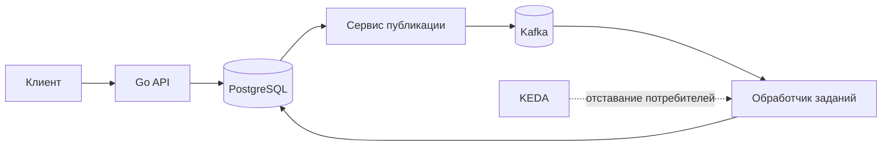

# Kubernetes Application Lab

Kubernetes Application Lab — учебный стенд для исследования работы серверного приложения на Go в Kubernetes. Он позволяет проверять не только конфигурацию компонентов, но и их поведение при обновлениях, нагрузке, сбоях и восстановлении.

В проекте реализованы HTTP API, хранение заданий в PostgreSQL, обработка событий через Kafka, средства наблюдаемости и лабораторная цепочка поставки образов через CI/CD и GitOps.

## Архитектура



PostgreSQL хранит задания, записи Transactional Outbox и результаты обработки. Отдельный сервис публикует события из outbox в Kafka. Обработчик сохраняет результат в PostgreSQL до подтверждения смещения Kafka и учитывает повторную доставку событий. Такая схема позволяет исследовать сбои на границе базы данных и брокера, не предполагая, что сообщение будет доставлено ровно один раз.

Наблюдаемость построена на Prometheus, Grafana, Loki, Grafana Alloy, OpenTelemetry Collector, Tempo и Alertmanager. Метрики, журналы и трассировки помогают сопоставлять события между компонентами. В стенд было заложено, что недоступность системы наблюдаемости не должна останавливать основную обработку заданий. Масштабирование обработчика через KEDA включается отдельным профилем.

Подробности: [системная архитектура](docs/architecture/system-architecture.md), [обработка событий](docs/design/kafka-event-processing.md) и [архитектура наблюдаемости](docs/design/observability-architecture.md).

## Что реализовано и проверено

| Область | Возможности и лабораторные сценарии |
|---|---|
| Жизненный цикл приложения | HTTP API, проверки готовности и работоспособности, управляемое завершение, обновление и откат через Helm. |
| Ресурсы и безопасность Kubernetes | CPU throttling, OOMKilled, HPA, Service и DNS, NetworkPolicy, Gateway/TLS, RBAC и Pod Security. |
| Состояние и обработка событий | PostgreSQL, миграции, резервное копирование и восстановление; Kafka, transactional outbox, повторная доставка, ограниченные попытки обработки и DLQ; CronJob и KEDA. |
| Наблюдаемость | Метрики приложения и зависимостей, панели Grafana, централизованные журналы, сквозные трассировки и шесть проверенных правил оповещения с внутренним получателем. |
| CI/CD и GitOps | Проверки Go и Helm, сборка и анализ образов API, publisher и worker, проверка API в `kind`, публикация проверенного образа в GHCR и развёртывание одного digest в development и stable без повторной сборки. |

Результаты отдельных экспериментов, использованные версии, диагностические данные и границы выводов приведены в [каталоге проверок](docs/verification/README.md). Завершение CI/CD и проверка нового выпуска описаны в [итоговой приёмке этапа 9](docs/verification/milestone9-completion.md) и [отчёте о проверках безопасности и выпуске образа](docs/verification/security-release.md).

## Быстрый запуск

Этот сценарий разворачивает **только HTTP API**. PostgreSQL, Kafka и система наблюдаемости для него не требуются.

### Требования

- Go **1.26.10 или новее**, Git и [Task](https://taskfile.dev/) (минимальная версия указана в `go.mod`).
- Docker Engine или Docker Desktop с поддержкой контейнеров Linux.
- `kind`, Helm и `kubectl`. Конфигурация стенда использует Kubernetes 1.34; версия `kubectl` должна отличаться от версии сервера не более чем на один минорный выпуск.

Перед запуском убедитесь, что Docker доступен и что выделенный кластер `kind-kubernetes-application-lab` не используется для других задач. Команды проекта обращаются к заранее определённым именам кластера и ресурсов.

Клонируйте репозиторий:

```sh
git clone https://github.com/Spudifull/kubernetes-application-lab.git
cd kubernetes-application-lab
```

Проверьте код, соберите образ и разверните приложение:

```sh
go test ./...
task image-build
task cluster-up
task deploy
task smoke
```

`task smoke` запускает временный клиент внутри кластера и обращается к `/version` через DNS-имя Kubernetes Service. При успешной проверке команда завершается без ошибки и выводит сведения о версии приложения; временный Pod удаляется.

Для просмотра состояния используйте `task status`. После работы можно удалить только Helm release приложения:

```sh
task undeploy
```

Команда `task cluster-down` удаляет **весь выделенный кластер `kind`**, включая его ресурсы и локальные данные. Выполняйте её только тогда, когда сохранение данных не требуется. Кластер не удаляется автоматически.

Подробная инструкция: [локальная разработка](docs/engineering/local-development.md).

## Дополнительные сценарии

Компоненты подключаются по отдельности. Перед установкой PostgreSQL, Kafka или системы наблюдаемости необходимо проверить доступные ресурсы и условия хранения данных.

| Что исследовать | С чего начать |
|---|---|
| PostgreSQL и постоянное хранилище | [Проверка PostgreSQL](docs/engineering/database-lab.md), `task db-preflight` |
| Kafka, outbox и обработчик заданий | [Установка и проверка Kafka](docs/engineering/kafka-lab.md), `task kafka-preflight` |
| Метрики, журналы и трассировки | [Система наблюдаемости](docs/engineering/observability-lab.md), `task observability-preflight` |
| CI/CD, GHCR и Argo CD | [Проверка CI/CD и GitOps](docs/engineering/ci-cd-gitops-lab.md) |
| Многонодовый `kind` (процедуры подготовлены) | [Сценарии этапа 10A](docs/engineering/multi-node-kubernetes-lab.md) |
| Отдельные виртуальные машины и `kubeadm` (процедура подготовлена) | [Hyper-V и kubeadm](docs/engineering/kubeadm-hyperv-lab.md) |

Все инструкции доступны в [инженерном разделе](docs/engineering/README.md). Для GitOps используется отдельный кластер `kind` с окружениями development и stable; эти эксперименты не являются частью быстрого запуска.

## Примеры результатов

Ниже приведены изображения из исторических лабораторных проверок, иллюстрирующие некоторые этапы экспериментов из роадмапа:


Методика, условия и ограничения каждого опыта описаны в [каталоге проверок](docs/verification/README.md). При наличии полного репозитория эти же изображения доступны в каталоге `docs/verification/images/`.

## Ограничения и происхождение результатов

- Проверенные эксперименты с PostgreSQL, Kafka и наблюдаемостью выполнялись в одноузловом `kind` с одним брокером Kafka. Для трёхузлового `kind` подготовлены отдельные сценарии.
- Проверки CI/CD охватывают образы API, publisher и worker; сценарий работы и восстановления в `kind` проверяет только API. GitOps-приёмка проведена для API в двух изолированных пространствах имён отдельного кластера.
- Результаты этапов 1–8 получены в другом репозитории до публикации данного репозитория. В публичном дереве сохранены 22 файла с первичными данными (21 JSON и 1 TXT) и 26 исторических изображений. Исходные идентификаторы коммитов взяты с того репозитория и не заменены результатами новых запусков.

Подробные сведения о переносе истории и составе опубликованных материалов: [происхождение публичного снимка](docs/provenance.md).

## Документация

- [Обзор проекта](docs/overview.md) — назначение стенда, состав компонентов и границы проверок.
- [Карта документации](docs/README.md) — переход к нужному разделу.
- [Архитектура](docs/architecture/README.md) и [проектные контракты](docs/design/README.md) — устройство системы и гарантии компонентов.
- [Инженерные инструкции](docs/engineering/README.md) — запуск и воспроизведение сценариев.
- [Результаты проверок](docs/verification/README.md) — фактические наблюдения и ограничения.
- [Архитектурные решения](docs/adr/README.md) и [процесс разработки](docs/process/README.md) — принятые решения и порядок внесения изменений.

## Лицензия и участие в разработке

Исходный код проекта распространяется по [лицензии MIT](LICENSE). У сторонних материалов и зависимостей могут быть собственные условия использования: [используемые инструменты](THIRD_PARTY_SKILLS.md) и [зависимости Go](THIRD_PARTY_DEPENDENCIES.md).

Правила изменений приведены в [CONTRIBUTING.md](CONTRIBUTING.md), порядок сообщения об уязвимостях — в [SECURITY.md](SECURITY.md).
