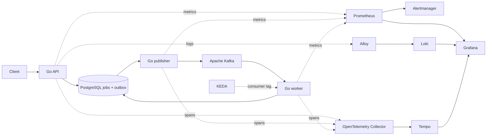
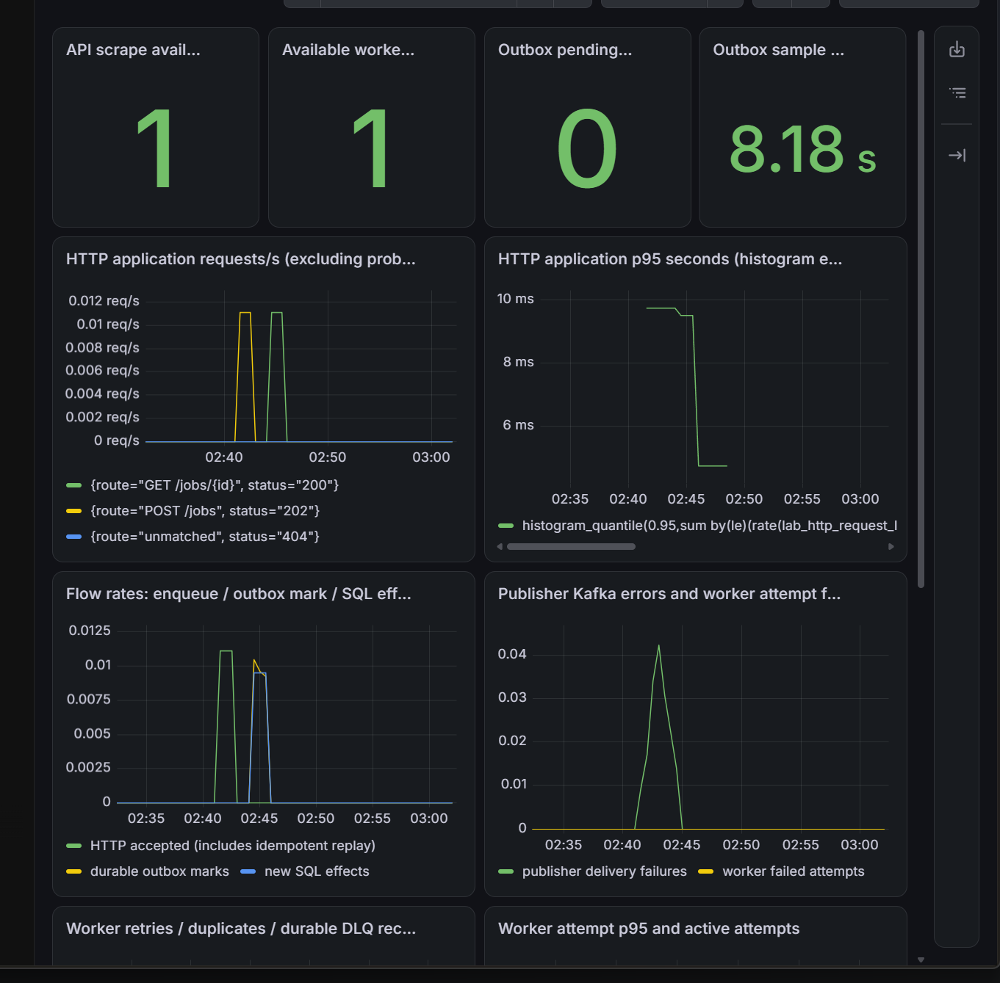
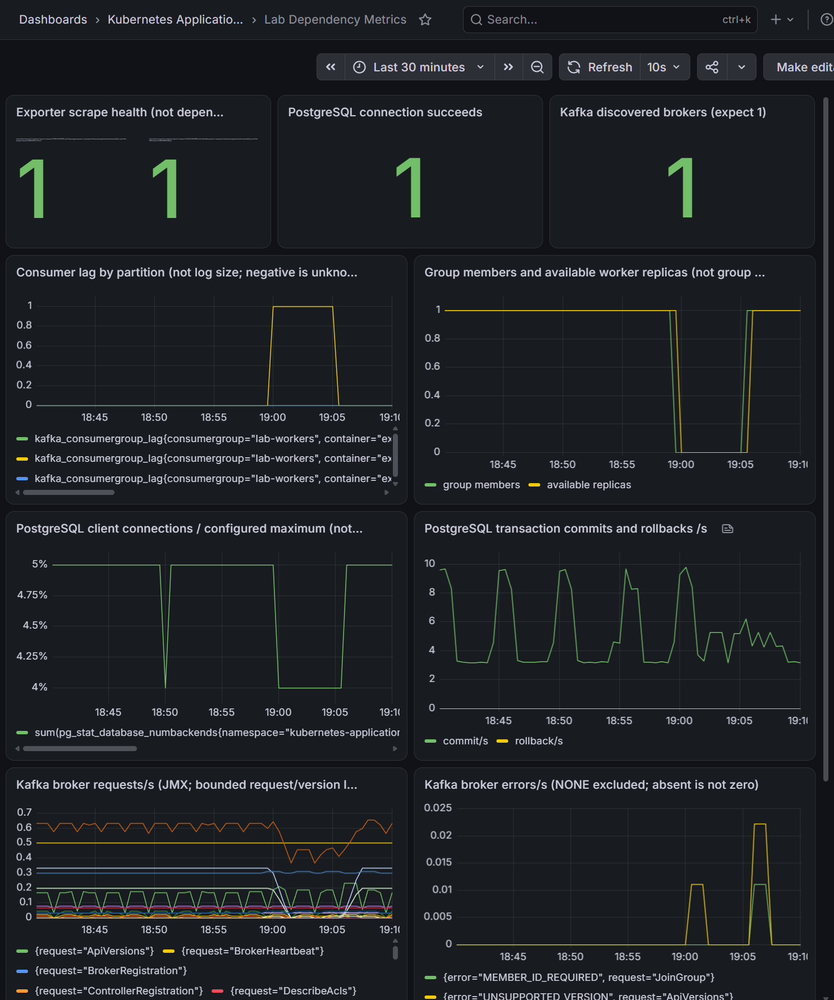
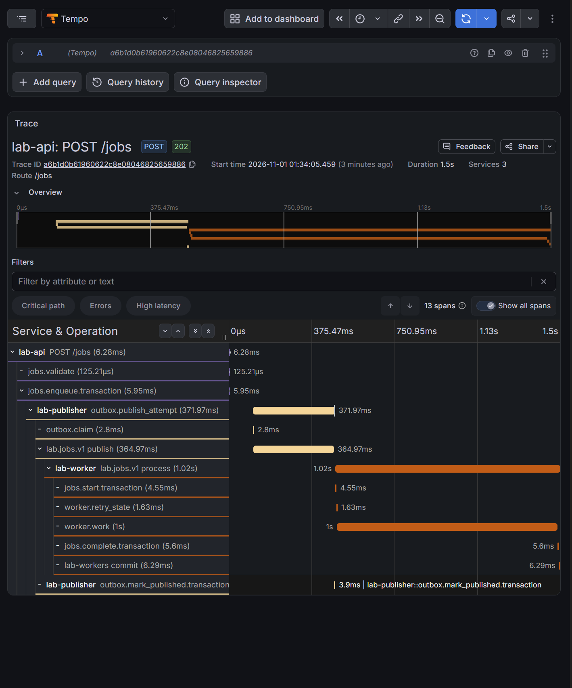
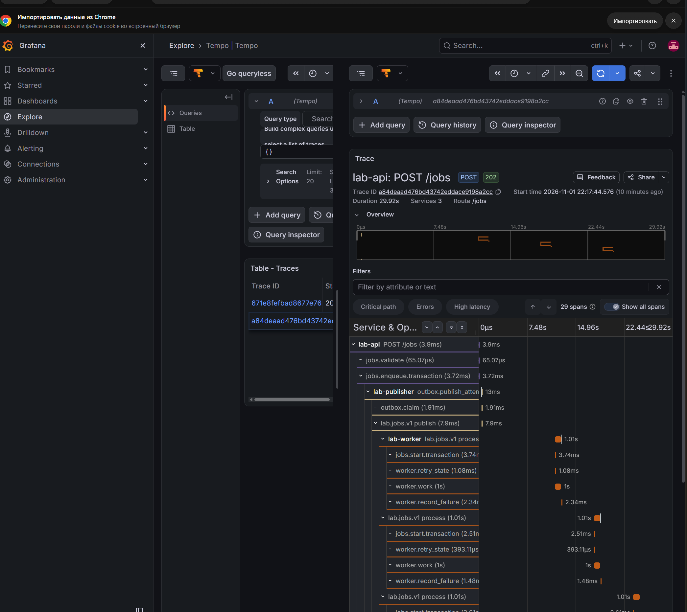
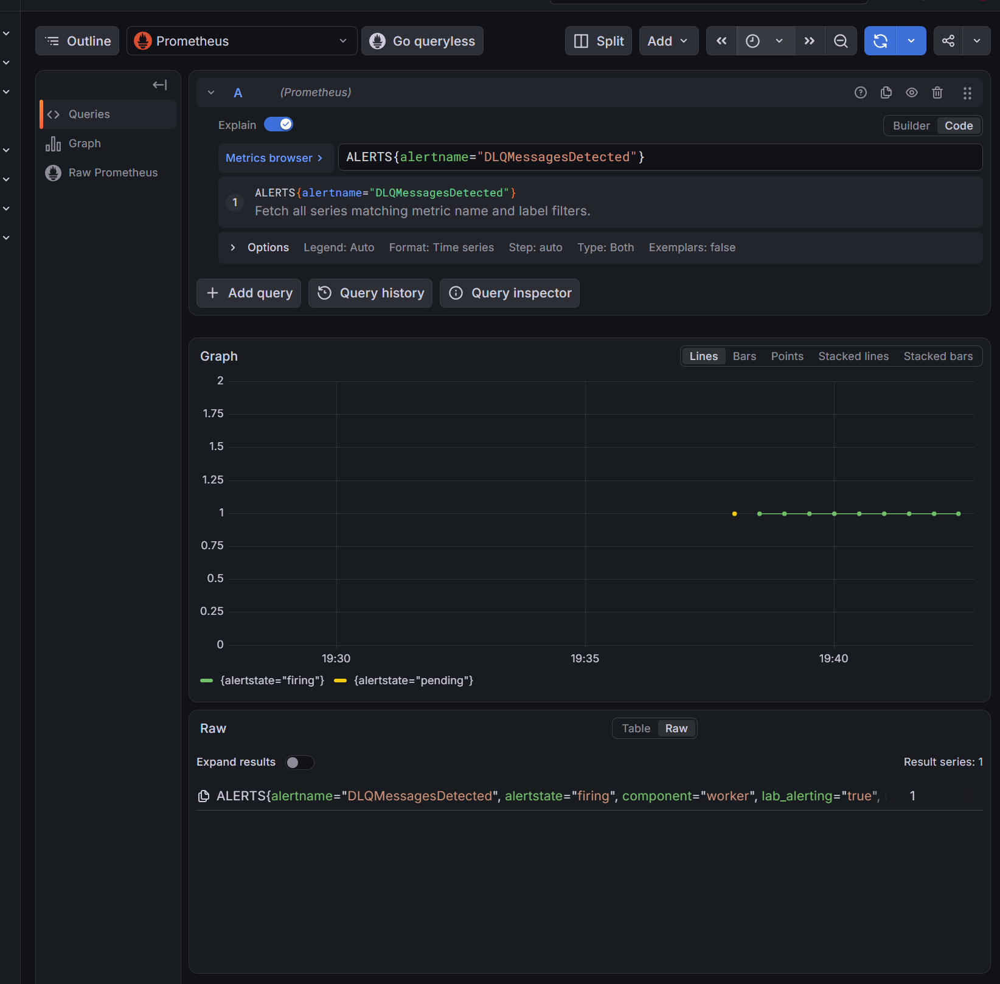

# Kubernetes Application Lab

Milestone 9 начат: восстановлены [22 первичных архива Milestone 8](docs/verification/README.md#первичные-доказательства-milestone-8), быстрый CI для Go/Helm/evidence прошёл в GitHub Actions на `5bd57b0`. Контейнерная поставка и GitOps ещё не проверены. [Фактические проверки и ограничения](docs/verification/evidence-restoration-ci.md).

A reproducible Go workload lab for Kubernetes: lifecycle, resources, networking, persistent state, reliable events, and observability. Учебный одноузловой стенд; гарантии production/HA не заявляются.

## Архитектура



Хранилище состояния — PostgreSQL; Kafka передаёт события. Publisher публикует transactional outbox; worker сохраняет SQL-результат до Kafka offset commit и распознаёт дубликаты. Наблюдаемость обслуживает путь обработки; её доступность не является условием readiness приложения. KEDA — opt-in профиль, заключительные опыты выполнялись с одной фиксированной репликой.

## Реализованные сценарии

Milestones 1–8: Go HTTP API и контейнеры; Helm rollout/rollback и graceful shutdown; CPU/OOM/HPA; Service/DNS, NetworkPolicy, Gateway/TLS, RBAC/Pod Security; PostgreSQL StatefulSet/PVC, миграции и backup/recovery; Kafka/Strimzi, outbox, consumer groups, retries/DLQ, redelivery, CronJob/KEDA; Prometheus/Grafana, Loki/Alloy, OpenTelemetry/Tempo и проверенные циклы Alertmanager.

## Требования

Go 1.26+, Git, Docker Engine/Desktop с Linux containers, Task, kind, Helm и kubectl в пределах одного minor от сервера. Образ kind закреплён на Kubernetes 1.34; подходит kubectl 1.35. На Windows используются те же task-команды. Kafka/PostgreSQL/наблюдаемость требуют дополнительных CPU, памяти и диска; перед их установкой выполнить соответствующий preflight.

## Quick start: только stateless API

Клонируйте репозиторий и перейдите в его каталог:

```sh
git clone https://github.com/Spudifull/kubernetes-application-lab.git
cd kubernetes-application-lab
```

Затем выполните проверки и поднимите stateless API:

```sh
go test ./...
task image-build
task cluster-up
task deploy
task smoke
```

Команды используют локальный кластер с фиксированным именем; перед запуском убедиться, что это ваш учебный стенд. Они не должны выполняться против чужого рабочего кластера. Автоматического cluster-down нет. Происхождение снимка описано в [provenance](docs/provenance.md). Навыки агента для запуска не нужны.

## Профили и эксперименты

Начать с [обзора](docs/overview.md) и [карты документации](docs/README.md). [Каталог проверок](docs/verification/README.md) содержит воспроизводимые процедуры и границы результатов. PostgreSQL, Kafka и наблюдаемость включаются отдельно через Taskfile; основные инструкции находятся в docs/engineering. Helm charts — основной источник конфигурации workloads; Taskfile — исполняемый вход команд.

## Наблюдаемость

Версионированные dashboards: Application Metrics и Dependency Metrics. HTTP rates/mean/p95, SQL outbox freshness, publisher/worker counters, Kafka lag, PostgreSQL connections. По Job/Trace ID можно перейти к Loki/Tempo. Шесть правил оповещения проверены с внутренним receiver; внешняя доставка уведомлений и долговечность receiver не гарантируются. Интерфейсы доступны через loopback port-forward, Grafana использует отдельный Secret.

## Selected Verification Evidence

Исторические иллюстрации исходных экспериментов; это не повторный прогон публичного снимка. Полные процедуры и ограничения — в [каталоге проверок](docs/verification/README.md). Изображения проверены индивидуально; значения, время и статусы сохранены.



Метрики приложения: ошибки publisher и восстановление потока (30 октября 2026).



Kafka: рост lag при остановке worker и последующее восстановление (31 октября 2026).



Сквозная трасса API → publisher → worker: 3 сервиса, 13 spans (1 ноября 2026).



Трасса сценария DLQ с повторными попытками worker (1 ноября 2026).



Оповещение DLQMessagesDetected: Pending → Firing (1 ноября 2026).

## Структура

- cmd, internal — Go entrypoints и общие пакеты;
- docker — многоэтапные Dockerfiles;
- helm, cluster, k8s, scripts/kubernetes — конфигурация стенда и диагностические клиенты;
- docs/design, docs/architecture — контракты и границы;
- docs/engineering, docs/verification — инструкции и исторические результаты.

## Происхождение и ограничения

Результаты Milestones 1–8 получены в приватной истории до публичного экспорта. Исторические SHA сохранены как идентификаторы, а не ссылки на будущие публичные коммиты. Сырые JSON остаются приватными; 26 проверенных исторических скриншотов включены. Публичная копия не является полным первичным архивом. [Политика происхождения](docs/provenance.md).

Один kind node и один Kafka broker не обеспечивают HA. local-path PVC не переживает потерю кластера. Очереди telemetry ограничены; исторические рестарты Strimzi и ограничения замеров сохранены в отчётах. Свежий public clone требует повторной проверки по нужной процедуре.

## Лицензия и вклад

Собственный код: [MIT](LICENSE), Copyright (c) 2026 Daniil Kalitvencev. Сторонние материалы имеют собственные условия: [acknowledgements](THIRD_PARTY_SKILLS.md), [Go dependencies](THIRD_PARTY_DEPENDENCIES.md). [CONTRIBUTING](CONTRIBUTING.md), [SECURITY](SECURITY.md).
