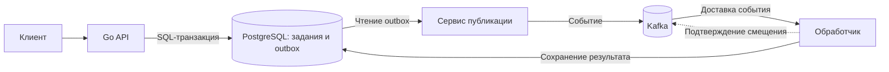

# Системная архитектура

Kubernetes Application Lab — учебный стенд для проверки поведения серверного приложения при развёртывании в Kubernetes, изменении нагрузки и отказах компонентов.

**Состояние:** основные компоненты приложения и лабораторная цепочка CI/CD и GitOps реализованы (`Current`). Для трёхузлового `kind` на одном хосте подготовлены сценарии этапа 10A (`Prepared`). Отдельные виртуальные машины с `kubeadm` и инфраструктурное управление через Terraform остаются запланированными (`Target`). Итоги проверенных экспериментов приведены в [каталоге проверок](../verification/README.md).

## Состав системы

В базовом профиле работает HTTP API на Go без внешних зависимостей. Его достаточно для проверки жизненного цикла `Pod`, маршрутизации через `Service`, обновлений и ограничений ресурсов.

При включении дополнительных компонентов приложение использует PostgreSQL для хранения заданий и событий, Kafka — для их передачи обработчикам. Система наблюдаемости собирает метрики, журналы и трассировки; её отказ не останавливает основную обработку заданий.

Запись задания и запись в outbox сохраняются в одной транзакции PostgreSQL. Сервис публикации отправляет событие в Kafka и отмечает его опубликованным после подтверждения брокера. Обработчик фиксирует результат в базе данных до подтверждения смещения Kafka. Поскольку событие может поступить повторно, обработка предусматривает защиту от повторного применения результата.

Гарантии и поведение при отказах определены в [контракте обработки событий](../design/kafka-event-processing.md).

## Уровни ответственности

Разделение на уровни позволяет установить, какой компонент обеспечивает конкретное свойство и где следует искать причину отказа.

| Уровень | За что отвечает | Чего не гарантирует |
|---|---|---|
| **Приложение** | HTTP-интерфейс, готовность к обработке запросов, корректное завершение, SQL-транзакции, идемпотентность, прикладные метрики. | Не управляет размещением `Pod` и маршрутизацией Kubernetes. |
| **Контейнерный образ** | Исполняемые файлы, зависимости, пользователь процесса, файловая система и точка входа. | Не обеспечивает готовность приложения или восстановление после отказа. |
| **Kubernetes** | Желаемое состояние ресурсов, размещение и замена `Pod`, `Service`, проверки состояния, ограничения ресурсов, масштабирование и политики доступа. | Не обеспечивает корректность бизнес-операций, SQL-транзакций и обработки повторных событий. |
| **Инфраструктура кластера** | Вычислительные узлы, сеть, хранилище и доступность самого Kubernetes. | Не заменяет прикладные механизмы восстановления данных. |

Например, Kubernetes передаёт процессу сигнал завершения, но приложение само должно прекратить приём новой работы и корректно завершить принятую. Подробности приведены в [эксплуатационной архитектуре](operational-architecture.md).

## Развёртывание и управление конфигурацией

В проекте используются два независимых способа развёртывания.

**Локальные лабораторные сценарии.** `Taskfile.yml` предоставляет команды для сборки образа, подготовки выделенного кластера `kind`, установки Helm chart и проверки работы приложения. Helm описывает ресурсы приложения; подготовка пространств имён и зависимостей выполняется отдельно.

**Лабораторная поставка через GitOps.** CI проверяет образы API, publisher и worker; для API дополнительно выполняет испытания в `kind`. Проверенный образ API публикуется в GHCR и используется в окружениях development и stable без повторной сборки. Argo CD приводит фактическое состояние выделенного кластера к конфигурации, зафиксированной в Git. Development отслеживает ветку `dev` с автоматическим восстановлением конфигурации; stable отслеживает `main` и синхронизируется вручную.

Способы лучше не смешивать в одном эксперименте: ручная установка приложения и управление теми же ресурсами через Argo CD создают конкурирующие источники желаемого состояния. Правила поставки описаны в [контракте CI/CD и GitOps](../design/ci-cd-gitops.md).

## Лабораторные окружения

| Окружение | Назначение | Особенности |
|---|---|---|
| Основной кластер `kind` | Приложение, PostgreSQL, Kafka и наблюдаемость. | Один узел; компоненты и профили устанавливаются по мере необходимости. |
| Отдельный сетевой кластер `kind` | Диагностика DNS, `Service`, `NetworkPolicy` и сетевой маршрутизации. | Используется Cilium; результаты не переносятся автоматически на основной кластер с другой сетевой конфигурацией. |
| Отдельный кластер GitOps | Проверка поставки stateless API в development и stable. | Два пространства имён, отдельные Helm releases и приложения Argo CD; это не полное развёртывание PostgreSQL и Kafka. |
| Трёхузловой `kind` (10A, `Prepared`) | Подготовленные опыты с планировщиком, обслуживанием рабочих узлов, сбоями и сетевыми политиками. | Один управляющий и два рабочих узла на общем хосте; для сетевых опытов предусмотрен отдельный кластер с Calico. Выполненные прогоны пока не подтверждены. |
| Виртуальные машины и `kubeadm` (`Target`) | Подготовка собственного кластера из отдельных виртуальных машин. | Процедура описана, но создание, проверка и удаление такого окружения не выполнялись. |

## Наблюдаемость

Система наблюдаемости отделена от прикладного пути обработки:

- **Prometheus** собирает метрики, **Grafana** отображает их, **Alertmanager** обрабатывает срабатывания правил.
- **Alloy** передаёт журналы приложения в **Loki**.
- **OpenTelemetry Collector** принимает трассировки и передаёт их в **Tempo**.

Контракты находятся в разделе [наблюдаемости](../design/observability-architecture.md), результаты — в [каталоге проверок](../verification/README.md).