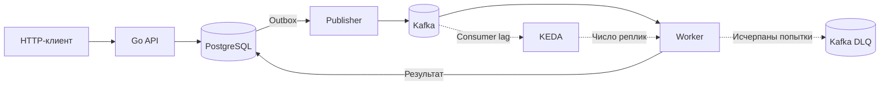

# Kafka и обработка заданий

API принимает задание и сохраняет его в PostgreSQL, publisher доставляет событие в Kafka, worker выполняет задание и сохраняет результат. Эти операции не входят в одну распределённую транзакцию, поэтому система рассчитана на повторную доставку, идемпотентную запись результата и восстановление после отказов.

**Состояние:** `Current`. Проверены основной поток, повторы и DLQ, redelivery, контролируемый отказ единственного брокера, CronJob и KEDA. Условия конкретных опытов находятся в [отчётах](../verification/README.md).

## Путь задания

Приём задания фиксируется в SQL **вместе с outbox**. Успех публикации означает подтверждение брокера, но не завершение задания. Worker записывает бизнес-эффект в PostgreSQL **до** подтверждения Kafka offset. Если он аварийно завершится между этими действиями, запись придёт повторно; уникальность эффекта обеспечивается SQL, а не обещанием exactly-once со стороны Kafka.

## Развёртывание Kafka и хранение сообщений

### Компоненты и ограничения среды

В основном одноузловом `kind` используется Strimzi Kafka Operator `1.3.0`, Apache Kafka `4.2.2` и KRaft. Единственный узел Kafka совмещает роли брокера и контроллера. Конфигурация находится в `cluster/kafka/`; Strimzi управляет ресурсами `Kafka` и `KafkaNodePool` в пространстве имён `kubernetes-application-lab-kafka`. Оператор устанавливается отдельно от приложения.

Версии компонентов и CR сверяются с [матрицей Strimzi](https://strimzi.io/downloads/) и [документацией Strimzi 1.3.0](https://strimzi.io/docs/operators/1.3.0/deploying). Образы брокера, оператора и вспомогательных контейнеров закреплены по digest. Конкретные идентификаторы и наблюдения приведены в [отчёте о запуске Kafka](../verification/kafka-bootstrap.md).

Для пространства имён установлен уровень Pod Security `restricted`. Наличие соответствующей конфигурации само по себе не заменяет проверку допуска ресурсов Kubernetes.

| Компонент | Запрос CPU / памяти | Ограничение CPU / памяти |
|---|---|---|
| Брокер и контроллер Kafka | `1 CPU` / `2Gi` | `1 CPU` / `2Gi` |
| Strimzi Operator | `200m` / `384Mi` | `1 CPU` / `768Mi` |
| Каждый из двух вспомогательных компонентов | `100m` / `256Mi` | `500m` / `512Mi` |

Общий бюджет запросов составляет `900m` CPU и `1920Mi` памяти; ограничения — `3 CPU` и `3840Mi`. Эти значения выбраны для конкретной лабораторной среды и не представляют измеренную потребность JVM. Для брокера задан heap `512m`, для вспомогательных компонентов — по `256m`.

Перед установкой `task kafka-preflight` собирает сведения о доступных ресурсах Docker и Kubernetes, текущих запросах и ограничениях контейнеров, диске, `StorageClass`, а также состоянии API и PostgreSQL. Команда не решает автоматически, достаточно ли ресурсов. Показатели фактического потребления, `requests` планировщика и доступная память Docker — разные величины. Изменять ограничения уже работающих зависимостей только ради установки Kafka нельзя.

### Постоянное хранение и темы

`KafkaNodePool` задаёт один том JBOD (`id: 0`, `kraftMetadata: shared`): PVC ёмкостью `5Gi`, `StorageClass: standard`, `deleteClaim: false`. Эта настройка сохраняет требование к тому при обычном управлении Kafka, но не отменяет `reclaimPolicy: Delete` локального хранилища. Удаление PVC может уничтожить сообщения. Замена брокера с прежним томом не равнозначна восстановлению после потери тома.

| Тема Kafka | Разделы | Срок хранения | Ограничение данных |
|---|---:|---|---|
| `lab.jobs.v1` | 3 | 24 часа | 128 MiB на раздел |
| `lab.jobs.dlq.v1` | 3 | 48 часов | 128 MiB на раздел |
| `lab.smoke.v1` | 1 | 1 час | 16 MiB на раздел |

Для двух основных тем размер сегмента — 16 MiB, для диагностической — 1 MiB. Коэффициент репликации равен `1`, `min.insync.replicas=1`. Темы создаются через `KafkaTopic`; автоматическое создание отключено.

Очистка по сроку хранения выполняется асинхронно, на уровне сегментов. Указанные лимиты не означают строгой верхней границы использования диска. Диагностическая тема отделена от рабочего потока, чтобы сообщения проверки брокера не попадали к worker.

### Сетевой доступ и удостоверения

Внешний bootstrap не публикуется: соединения устанавливаются внутри кластера. Используется mTLS с проверкой центра сертификации и имени сервера. Для publisher, worker и диагностических клиентов предусмотрены отдельные удостоверения и права Kafka ACL.

Publisher может записывать сообщения в рабочую тему. Worker читает `lab.jobs.v1` от имени группы `lab-workers` и публикует сообщения в DLQ. Право создавать темы этим процессам не требуется. Отдельный инспектор DLQ имеет только `Read` и `Describe` для `lab.jobs.dlq.v1` и не получает права публикации.

`Secret` нельзя непосредственно смонтировать в `Pod` другого пространства имён. Поэтому необходимые сертификаты и ключи переносятся специальными командами в отдельные `Secret` приложения без вывода содержимого или записи закрытых ключей в Git. Повторный перенос разрешён только при совпадении содержимого; автоматическая ротация копий не реализована. API не получает ключи Kafka.

Как и в случае PostgreSQL, наличие `NetworkPolicy` в основном кластере с `kindnet` не доказывает её исполнения CNI.

## Формат события и клиент Kafka

Клиентская библиотека — [franz-go](https://github.com/twmb/franz-go), версия `v1.22.2`. Общая конфигурация в `internal/kafka` проверяет CA и пару сертификат/ключ; проверка имени сервера не отключается. Для соединения задан срок 5 секунд, для доставки — 20 секунд. Producer использует подтверждение от всех синхронных реплик (`acks=all`) и штатную идемпотентность библиотеки.

Group consumer создаётся с `ConsumerGroup` и `DisableAutoCommit`. Подтверждение смещения выполняется явно после устойчивого результата обработки. Групповые настройки не применяются к производителю сообщений или диагностическому потребителю с прямым назначением раздела.

Событие версии `1` содержит:

| Поле | Значение |
|---|---|
| `event_id` | Уникальный идентификатор события. |
| `job_id` | Идентификатор задания; используется также как ключ записи Kafka. |
| `job_type` | Тип допустимой операции. |
| `created_at` | Время создания в UTC. |
| `payload` | Ограниченные параметры обработки задания. |

Стабильный ключ `job_id` сохраняет выбор раздела при неизменном количестве разделов. Это **не** исключает повторов и не заменяет проверку уникальности эффекта в PostgreSQL. Полное содержимое сообщений и секреты не записываются в журналы.

Проверка записи и чтения диагностического события выполняется отдельным `kafka-probe` и описана в [инженерной инструкции](../engineering/kafka-lab.md). Её успешный результат не доказывает работу consumer group или обработку задания.

## Приём задания и транзакционный outbox

### Схема и идемпотентность HTTP-запроса

Миграция `002_jobs_outbox.sql` добавляет таблицы `lab_jobs`, `lab_outbox` и `lab_job_effects`, не изменяя уже применённую `001_lab_records.sql`.

`lab_jobs` хранит уникальный ключ идемпотентности и SHA-256 нормализованного типизированного содержимого запроса. В outbox сохраняются идентификаторы задания и события, признаки публикации и поля кратковременного захвата записи. Таблица эффектов обеспечивает уникальность результата worker.

API создаёт задание и запись outbox **в одной транзакции PostgreSQL**. Только после commit клиент получает успешный ответ. Это означает, что запрос принят и сохранён, но **не означает**, что событие опубликовано в Kafka или уже обработано. Для приёма задания Kafka не должна быть доступна.

Повтор запроса с тем же ключом и равнозначным нормализованным содержимым возвращает прежний идентификатор задания. Тот же ключ с другим содержимым приводит к конфликту. Влияние конкурентных запросов необходимо проверять на настоящей PostgreSQL, а не только модульными тестами.

### HTTP-интерфейс заданий

Профиль `values-jobs.yaml` включает `LAB_JOBS_ENABLED=true` совместно с `LAB_DB_ENABLED=true`. Без включённого профиля маршруты заданий отсутствуют.

| Маршрут | Назначение | Результат |
|---|---|---|
| `POST /jobs` | Сохранить задание и outbox | `202 Accepted` и `Location: /jobs/{id}` после SQL commit |
| `GET /jobs/{id}` | Получить состояние задания и результат, если он есть | JSON; `404` для неизвестного корректного UUID |

Приём ограничен `Content-Type: application/json`, размером тела 2048 байт, `idempotency_key` длиной 1–64 символа из `[A-Za-z0-9_-]`, типом `lab_effect` и временем работы `payload.duration_ms` от 1 до 8000. Неизвестные поля и дополнительное JSON-значение запрещены.

Нормализация использует типизированное декодирование JSON: пробелы и порядок полей не влияют на хеш. Если одно имя встречается несколько раз, учитывается последнее декодированное значение; это особенность текущего контракта, а не рекомендация клиентам отправлять дублирующиеся поля.

Одинаковое содержимое с тем же ключом возвращает `202`, прежний ID и актуальное состояние; конфликт содержимого — `409`. Неверное тело — `400`, превышение размера — `413`, неподдерживаемый тип — `415`, отказ БД — `503` без сведений из SQL. Для `GET` неверный UUID даёт `400`.

До запуска worker состояние ограничивается приёмом и публикацией, а результат обработки отсутствует. Готовность API зависит от PostgreSQL и схемы, но не от Kafka; проверка работоспособности `/livez` не обращается к зависимостям.

## Публикация outbox

`cmd/publisher` выбирает ожидающие записи с использованием `FOR UPDATE SKIP LOCKED`, временного захвата на 60 секунд и уникального токена. Захват записывается атомарно в PostgreSQL. Блокировка строки завершается **до** сетевого обращения к Kafka.

Порядок публикации:

1. Атомарно получить право на одну запись outbox.
2. Опубликовать сообщение и дождаться подтверждения брокера через `ProduceSync`.
3. В отдельной SQL-транзакции отметить публикацию при совпадении токена и действующем сроке захвата.
4. Перевести задание из `accepted` в `published`, не возвращая уже более позднее состояние к предыдущему.

Истёкший токен не позволяет подтвердить или снять чужой новый захват. После аварии процесса запись снова становится доступной по истечении срока захвата.

**Возможен повтор:** если Kafka подтвердила сообщение, но publisher завершился до фиксации `published` в PostgreSQL, событие может быть опубликовано ещё раз. Идемпотентность производителя Kafka не устраняет такие повторы между отдельными процессами. `ProduceSync` не создаёт общей транзакции PostgreSQL–Kafka.

Publisher получает не более одного события в секунду на процесс. Общий срок попытки — 25 секунд, срок доставки Kafka — 20 секунд; освобождение захвата при ошибке имеет собственный предел 2 секунды. Между попытками применяется задержка 1, 2, 4, 8, 16 секунд и далее не более 30 секунд. Общее число попыток публикации не ограничено: принятая заявка не должна исчезать из-за продолжительного отказа брокера.

`SIGTERM` прекращает получение новых записей, но допускает завершение уже начатой операции в установленном сроке. Бюджет `Pod` — 35 секунд, без HTTP `preStop`; завершение служебного HTTP — до 3 секунд. `/readyz` проверяет схему PostgreSQL и Kafka в собственных коротких сроках, а `/livez` не зависит от них. Потеря готовности не прекращает цикл восстановления публикации.

Пул PostgreSQL у publisher ограничен четырьмя соединениями. При одной реплике API и publisher суммарный верхний предел их пулов — восемь соединений, не считая других процессов. На время `RollingUpdate` нужно учитывать возможную дополнительную реплику.

Для Kafka publisher использует собственную копию удостоверения в `Secret/lab-publisher-kafka`; её создаёт `labctl publisher-secret-create`. Без автоматической ротации изменение сертификатов требует отдельной процедуры. Доступ к PostgreSQL разрешён соответствующим правилом, но его фактическое исполнение зависит от CNI.

### Отказ адреса подключения и восстановление

Лабораторный сценарий с неверным bootstrap-адресом изменяет только конфигурацию publisher, не останавливает реальный брокер. Адрес восстанавливается из параметров Helm release: сначала устраняется изменение тем же способом, которым оно было создано, затем выполняется обычное обновление Helm. Принудительное присвоение конфликтующих полей и удаление `Deployment` не используются.

Исправленный сценарий и восстановление исходного события проверены в [отчёте об outbox](../verification/kafka-outbox.md). Реальное прекращение работы брокера исследуется отдельно.

## Worker: обработка и подтверждение смещений

### Исполнение SQL-эффекта

`cmd/worker` — самостоятельный процесс и Helm release `lab-worker`. Он не запускается внутри API, не имеет пользовательского HTTP `Service` и не использует HTTP `preStop` основного приложения. Потребители группы `lab-workers` читают `lab.jobs.v1` по mTLS.

Одна реплика worker обрабатывает не более одной записи одновременно. До обработки проверяются максимальный размер события (4096 байт), версия, UUID, соответствие Kafka key и `job_id`, тип операции и допустимая длительность 1–8000 мс.

Для корректного нового события:

1. Короткая SQL-транзакция блокирует строку задания, сверяет событие с сохранённым outbox и определяет, не был ли эффект уже создан.
2. При необходимости задание переводится в `processing`.
3. Ограниченная работа выполняется вне длительной SQL-транзакции.
4. Вторая короткая транзакция сохраняет уникальный эффект по `job_id`, результат и состояние `succeeded` с временем завершения.
5. Только после надёжного результата вызывается `CommitRecords` для исходного сообщения Kafka.

Блокировка строки и ограничение уникальности эффекта защищают от конкурентного повторного выполнения. Publisher не должен возвращать уже обработанное задание в менее продвинутое состояние.

Смещение, подтверждаемое Kafka, указывает **на следующую запись**: после успешной обработки сообщения со смещением `N` сохраняется `N + 1`.

### Ошибки, повторная доставка и rebalance

`DisableAutoCommit` установлен явно. При ошибке обработки либо подтверждения смещения текущая consumer-сессия прекращается. Нельзя продолжать считывание с уже изменённой локальной позиции и затем подтвердить более позднюю запись, пропустив неудачную.

Новая группа начинает чтение с earliest, действующая использует сохранённые смещения. Записи, удалённые Kafka по сроку хранения, автоматически из PostgreSQL не восстанавливаются.

Для обработки перемещения разделов между репликами используется classic cooperative-sticky protocol. `BlockRebalanceOnPoll` откладывает callbacks до завершения ограниченной операции; запрос на rebalance отменяет активную работу, после чего процесс освобождает соответствующее назначение. В журналах фиксируются assigned, revoked и lost. Callback не выполняет SQL и не подтверждает смещения.

Отмена работы при rebalance не является распределённым fencing по эпохе Kafka: SQL-транзакция могла завершиться до утраты назначения. Независимая уникальность результата в PostgreSQL остаётся обязательной.

Каждая попытка обработки ограничена 18 секундами, включая две SQL-операции до 2 секунд, работу до 8 секунд и подтверждение смещения до 3 секунд. Выход из группы ограничен 2 секундами, завершение служебного HTTP — 3 секундами. `terminationGracePeriodSeconds: 30` оставляет запас.

`SIGTERM` останавливает новые чтения. Если текущая операция отменена или не успела завершиться, её смещение не подтверждается, а сообщение допускает повторную доставку. `/readyz` зависит от назначения разделов, Kafka и схемы PostgreSQL; `/livez` — нет. Успешная readiness-проверка не означает, что каждое задание уже обработано.

Количество параллельных потребителей ограничено числом разделов (три). Увеличение реплик свыше этого значения не добавляет параллельную обработку из рабочей темы. При одном процессе обрабатывается одна запись за раз.

### Авария после SQL commit до Kafka commit

Профиль `LAB_WORKER_CRASH_BEFORE_OFFSET_JOB_ID` (`lab.crashBeforeOffsetJobID` в Helm) отключён по умолчанию. Он завершает процесс с кодом `86` для выбранного корректного задания **после сохранения или распознавания SQL-эффекта, но до `CommitRecords`**. Авария происходит без штатного выхода из группы; при перезапуске отказ сохраняется до явного снятия диагностического параметра.

Ожидаемое поведение: после снятия диагностического отказа сообщение обрабатывается повторно, SQL-эффект остаётся единственным, а исходный offset подтверждается. [Отчёт](../verification/kafka-redelivery.md) фиксирует фактический результат отдельного прогона.

В диагностике consumer group состояние `PreparingRebalance` или `CompletingRebalance` с отсутствующим назначением отражается как `assignment_pending=true` вместе с состоянием группы. Неполные данные не считаются повреждёнными автоматически; отсутствие назначения в `Stable` и некорректное непустое назначение остаются ошибками. Данный признак не доказывает актуальность прежнего назначения разделов. Исправление подтверждено в [опыте retry/DLQ](../verification/kafka-retry-dlq.md).

## Повторы и очередь ошибочных сообщений (DLQ)

### Учёт управляемых ошибок

Миграция `003_worker_reliability.sql` добавляет `lab_worker_retries` и `lab_dead_letters`, сохраняя прежние миграции `001` и `002`. Обычные задания не получают искусственных ошибок; лабораторный механизм может для нового задания задать `failures_before_success=2` или `3` при остановленных worker.

Максимум управляемых ошибок — три. После двух ошибок третья рабочая попытка может завершиться успешно; третья ошибка приводит к DLQ **без четвёртой рабочей попытки**.

Счётчик и `next_retry_at` сохраняются в PostgreSQL. Условное обновление с проверкой предыдущего счётчика предотвращает двойное увеличение счётчика при конкурентной обработке одного шага. Срок следующей попытки проверяется по часам БД. Минимальные задержки — 1 и 2 секунды; пауза между сессиями и rebalance могут сделать их длиннее. Обычная тема Kafka не осуществляет отложенную доставку автоматически.

Отмена по контексту, SQL-ошибки и транспортные отказы не учитываются как управляемые ошибки и не расходуют этот конечный бюджет. Они подлежат восстановлению и повтору по отдельным правилам. Такой механизм предназначен для ограниченных экспериментов, а не для классификации всех ошибок производственного приложения.

### Порядок отправки в DLQ

При исчерпании числа попыток worker:

1. Сохраняет ожидающий DLQ-конверт, идентифицированный исходными темой, разделом и смещением.
2. Публикует его отдельным производителем и ожидает подтверждения брокера.
3. В одной SQL-транзакции записывает квитанцию, состояние задания `failed`, код `retry_exhausted` и время завершения.
4. Только после SQL commit подтверждает смещение исходного сообщения.

Результат успешной обработки не создаётся. Если процесс завершится между подтверждением DLQ и сохранением SQL-квитанции, DLQ-запись может появиться повторно. Её стабильный ключ включает исходные координаты Kafka. Если квитанция уже сохранена, повторная обработка не должна без необходимости публиковать DLQ заново; исходные координаты и время терминального состояния не перезаписываются.

Это модель **at-least-once для DLQ**. Сохранение квитанции не означает, что DLQ имеет гарантию exactly-once.

### Некорректные события и ограничение данных

Ветка DLQ предусмотрена также для повреждённого JSON, неизвестной версии или типа, отсутствующего идентификатора задания, несогласованного события и тела более 4096 байт. Для таких сообщений допустима обработка без существующей строки `lab_jobs`.

Недостоверный идентификатор не переносится в квитанцию как подтверждённый `job_id` и не приводит к изменению чужого задания. Конверт версии `1` содержит координаты исходного сообщения, причину, размеры и SHA-256 его ключа и тела. Полные исходные байты не копируются в DLQ или журналы: сообщение может содержать конфиденциальные данные.

Допустимые причины: `invalid_event`, `inconsistent_event`, `retry_exhausted`. Ошибка публикации в DLQ или SQL-фиксации квитанции запрещает подтверждение исходного смещения.

Отдельный DLQ producer использует mTLS и `acks=all`, срок доставки и контекста до 3 секунд, сроки соединения и запроса до 1 секунды и буфер не более четырёх сообщений. Он работает в рамках общего 18-секундного срока попытки. Если времени недостаточно, исходное сообщение остаётся неподтверждённым.

Worker ожидает доступности схемы миграции `003` до получения сообщений. `/readyz` проверяет основного клиента Kafka и БД, **но не проверяет отдельный DLQ producer**: состояние Ready не доказывает доступность DLQ. Ожидание повтора или отказ DLQ приостанавливает последовательную consumer-сессию целиком, а не только затронутый раздел.

Инспектор DLQ использует собственное удостоверение, ограниченное чтением; оно не передаётся рабочему worker. Для отрицательных опытов отдельному диагностическому Pod может временно выдаваться право публикации от имени publisher. Параметр `lab.dlqBootstrap` позволяет сделать недоступным только DLQ producer, не меняя bootstrap основного consumer. Обычные команды остановки и развёртывания сбрасывают этот отказ через Helm. Таблицы retry и DLQ-квитанций не очищаются автоматически по сроку хранения сообщений Kafka.

Поведение повторов, восстановления DLQ и некорректных событий подтверждается в [отчёте retry/DLQ](../verification/kafka-retry-dlq.md). Авария между Kafka ack DLQ и SQL commit остаётся отдельной границей проверки.

## Отказ брокера и восстановление

В лаборатории один брокер Kafka, совмещённый с контроллером. Во время его остановки API продолжает принимать задания в PostgreSQL: заявки и outbox остаются сохранёнными, но публикация ждёт возвращения брокера. Это не очередь Kafka и не подтверждение завершения задания.

Диагностический сценарий временно приостанавливает Strimzi Operator, чтобы тот не восстанавливал брокер во время опыта, а затем останавливает выбранный Pod. Возврат оператора и брокера выполняется с сохранением исходных PVC, Kafka metadata и идентификаторов ресурсов. Результат должен подтверждаться не только Ready, но и чтением ранее опубликованного сообщения, возобновлением публикации outbox, одним SQL-эффектом и согласованными смещениями группы.

Этот управляемый отказ не равнозначен потере физического узла или диска. Процедура и её результаты — в [инструкции](../engineering/kafka-broker-outage-lab.md) и [отчёте](../verification/kafka-broker-outage.md).

## Запуск заданий по расписанию

Отдельный Helm chart `helm/lab-cron` развёртывает `CronJob`, использующий тот же образ API в одноразовом режиме `enqueue-scheduled`. Процесс **только принимает задание в PostgreSQL** через существующий транзакционный интерфейс. Он не публикует событие напрямую в Kafka и не выполняет работу worker.

По умолчанию chart не включён. После явной установки `CronJob` находится в состоянии `suspend: true`; разрешение запуска выполняется отдельным действием.

| Параметр | Значение |
|---|---|
| Расписание | Каждую минуту в `Etc/UTC` |
| `concurrencyPolicy` | `Forbid` |
| `startingDeadlineSeconds` | `30` |
| `backoffLimit` для Job | `2` |
| `activeDeadlineSeconds` для Job | `90` |
| `ttlSecondsAfterFinished` | `3600` |
| `restartPolicy` | `Never` |

Возобновление или приостановка расписания не останавливает уже созданный `Job`. Повторная установка обычного профиля возвращает `suspend: true`.

### Идентичность запуска и дедупликация

Логический запуск задаётся сочетанием пространства имён, имени `CronJob` и исходного назначенного времени UTC. Ключ идемпотентности состоит из префикса `cron_` и 56 шестнадцатеричных символов SHA-256 этой идентичности. UID создаваемых `Job` и `Pod` не входят в ключ.

Для события используется `lab_effect` с длительностью 1000 мс. Повтор той же назначенной минуты возвращает исходное задание; создание второго outbox и эффекта не допускается. Пересоздание `CronJob` с тем же именем сохраняет логическую идентичность, пока нужные SQL-данные доступны.

С версии Kubernetes 1.32 плановое время доступно в аннотации родительского `Job` `batch.kubernetes.io/cronjob-scheduled-timestamp`. Одноразовый процесс получает имя `Job` через Downward API, читает его метаданные по защищённому соединению и проверяет принадлежность нужному `CronJob`. При ошибке чтения процесс завершается без создания задания; подстановка текущего времени запрещена. Отдельный ServiceAccount имеет только `get` для `jobs` в своём namespace, без чтения Secret и изменения ресурсов.

Параметр `LAB_CRON_SCHEDULED_AT` применяется для ручного повторения конкретного времени и не заполняется автоматически. Процесс ограничен 30 секундами, учитывает `SIGTERM` и использует не более одного SQL-соединения. Успешное выполнение `Job` подтверждает приём задания, **не завершение его обработки в Kafka worker**.

Практическая проверка разделяет приём задания по расписанию, повторное выполнение той же минуты и последующую обработку worker. Результаты и обнаруженные ограничения — в [отчёте](../verification/cronjob.md), процедура — в [инструкции](../engineering/cronjob-lab.md).

## Масштабирование worker через KEDA

KEDA `2.21.0` устанавливается отдельно и работает в пространстве имён основного приложения, но её CRD, RBAC и APIService имеют кластерную область. Для чтения показателей Kafka используется отдельное удостоверение `lab-keda` с правом `Describe` темы и группы, mTLS и собственным `Secret`.

Профиль отключён по умолчанию. При включении `ScaledObject` и `TriggerAuthentication` принадлежат Helm chart worker. `Deployment` не задаёт `replicas`; число экземпляров управляется HPA в диапазоне **от 1 до 3** — по числу разделов рабочей темы. Порог задержки обработки — `lagThreshold=3`, стабилизация уменьшения числа реплик — 60 секунд. Масштабирование до нуля не реализуется и не считается проверенным.

При действующем `ScaledObject` команды фиксированного масштабирования и намеренных отказов worker блокируются: одновременное управление одним полем через разные механизмы привело бы к гонке согласования. Для возврата к обычному профилю KEDA ставится на паузу с одной репликой, затем удаляются относящиеся к worker `ScaledObject` и HPA; после этого Helm снова задаёт фиксированное число реплик. Удаление чужих ресурсов и принудительное присвоение чужих полей не допускаются.

Количество реплик зависит от подтверждённого lag группы `lab-workers`, а не от длины outbox в PostgreSQL. Увеличение числа worker повышает возможное число SQL-соединений: каждый использует пул не более четырёх, поэтому три реплики могут открыть до двенадцати соединений. Поведение масштабирования и возврата управления Helm зафиксировано в [отчёте KEDA](../verification/keda.md); оно не доказывает масштабирование до нуля или устойчивость к недоступности внешних метрик.

## Как проверять результат

HTTP `202` подтверждает сохранение заявки в PostgreSQL. `published_at` подтверждает отметку после Kafka ack. `succeeded` и единственная запись эффекта подтверждают результат SQL. Состояние Kafka consumer group и её committed offset проверяются отдельно. Ни одна из этих проверок не заменяет остальные.

Пошаговое выполнение — в [инструкции Kafka](../engineering/kafka-lab.md) и профильных инструкциях повторов, восстановления и KEDA. Их результаты сохранены в [каталоге проверок](../verification/README.md). Единственный брокер и один PVC не обеспечивают высокую доступность или сохранность при потере хранилища.
