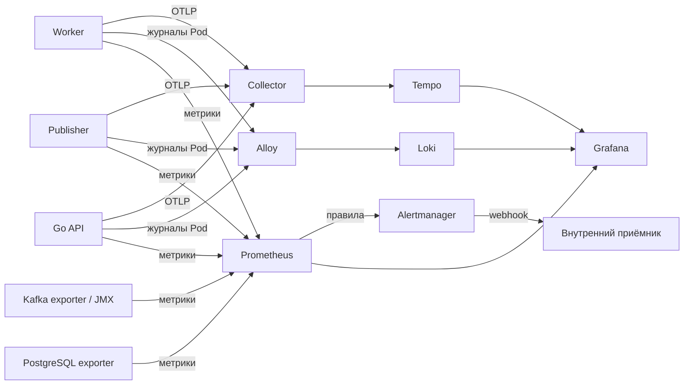

# Наблюдаемость приложения

Наблюдаемость помогает ответить на три разных вопроса: **что происходит с системой**, **какие события привели к результату** и **как проходила отдельная операция**. Для этого используются метрики Prometheus, журналы Loki и трассировки Tempo. Grafana объединяет поиск и панели, Alertmanager обрабатывает условия оповещений.

**Состояние:** `Current` для лабораторного стенда. Метрики, журналы, трассировки и оповещения имеют отдельные [проверки](../verification/README.md); ни один из этих сигналов сам по себе не заменяет проверку SQL и Kafka offsets.

## Архитектура и разграничение ответственности

Основное приложение развёртывается в `kubernetes-application-lab`, а платформа наблюдаемости — в `kubernetes-application-lab-observability` основного `kind` с Kubernetes 1.34. Для пространства имён платформы задан Pod Security Admission уровня `restricted`.

Ресурсы разделены между Helm-релизами:

| Релиз | Назначение |
|---|---|
| `lab-monitoring` | Prometheus, Alertmanager, Grafana, Prometheus Operator и сопутствующие компоненты официального `kube-prometheus-stack` |
| `lab-observability` | Прикладные `ServiceMonitor`, `PodMonitor`, `PrometheusRule` и конфигурация прикладных сигналов |
| `lab-dependency-metrics` | Exporters PostgreSQL/Kafka, конфигурация JMX, средства обнаружения и сетевые правила |
| `lab-otel-collector`, `lab-tempo`, `lab-tracing-controls` | Приём, пересылка, хранение трассировок и ограничения сетевого доступа |
| `lab-logging` | Loki, Alloy и связанные средства сбора журналов |
| `lab-alerting` | Шесть правил оповещения и внутренний HTTP-приёмник уведомлений |

Каждый релиз изменяет только предусмотренные для него ресурсы. Новая установка не должна неявно присваивать чужие CRD, Helm-релизы или объекты приложения. Файлы Helm и `cluster/observability/` определяют исполняемую конфигурацию; этот документ объясняет её смысл.

## Метрики: Prometheus и Grafana

### Версии компонентов

Для базового стека выбраны `kube-prometheus-stack` `92.7.0`, Prometheus `v3.15.0-distroless`, Prometheus Operator `v0.94.1`, Alertmanager `v0.34.1`, Grafana chart `13.6.0` и приложение Grafana `13.2.4-distroless`, kube-state-metrics chart `8.6.0` и приложение `2.20.0`, webhook certgen `1.11.0`. Версии закреплены в конфигурации; наличие тега само по себе не фиксирует digest фактически запущенного контейнера. Исходные сведения о версиях: [kube-prometheus-stack](https://github.com/prometheus-community/helm-charts/blob/kube-prometheus-stack-92.7.0/charts/kube-prometheus-stack/Chart.yaml), [Grafana chart](https://github.com/grafana-community/helm-charts/blob/grafana-13.6.0/charts/grafana/Chart.yaml).

### Начальный бюджет

| Компонент | CPU: requests / limits | Память: requests / limits |
|---|---|---|
| Prometheus | `100m / 700m` | `256Mi / 512Mi` |
| Operator | `50m / 300m` | `64Mi / 128Mi` |
| Alertmanager | `25m / 200m` | `32Mi / 64Mi` |
| Grafana | `50m / 300m` | `768Mi / 1Gi` |
| kube-state-metrics | `25m / 200m` | `48Mi / 64Mi` |
| Два config reloader, суммарно | `20m / 200m` | `32Mi / 96Mi` |
| Временный webhook Job | `10m / 100m` | `16Mi / 32Mi` |

Без временного Job и отдельного релиза exporters конфигурационный бюджет работающих компонентов составляет `270m / 1900m` CPU и `1200Mi / 1888Mi` памяти. Это сумма настроек, а не измеренное потребление.

После `OOMKilled` Grafana при лимите `256Mi` лимит последовательно увеличивали. При `768Mi` наблюдалось `628–712Mi`, с запасом всего `56Mi` относительно максимума; поэтому принят профиль `768Mi` request / `1Gi` limit. На обновлённом профиле последующий 15-минутный опыт показал `225–762Mi` без перезапусков. Ни одно из этих измерений не доказывает отсутствие пиков за пределами выборки или достаточность ресурсов для более тяжёлой нагрузки. Подробности находятся в [проверке метрик зависимостей](../verification/dependency-metrics.md).

Перед установкой проверяются фактическая доступная память хоста (`MemAvailable`), `allocatable` узла, занятые requests/limits, дополнительные резервы, состояние Docker и наличие давления на узел. Для базового стека начальное условие по памяти Linux-среды составляет не менее `2560Mi` (`2048Mi + 512Mi`); это не объём свободной памяти конкретного Pod. Проверка ресурсов не разрешает автоматически уменьшать лимиты PostgreSQL, Kafka или других работающих компонентов. На повторной установке необходимо учитывать уже существующие Pod и возможное перекрытие обновления.

### Сбор, хранение и доступ

Prometheus выбирает `ServiceMonitor`, `PodMonitor` и `PrometheusRule` по `release: lab-monitoring`. Метрики API собираются через `Service` в пространстве имён приложения, `http` и `/metrics`; для publisher/worker предусмотрены отдельные `PodMonitor`. Обнаружение объекта не равнозначно успешному сбору: для вывода требуются `UP` и актуальные значения метрик.

Prometheus использует одну реплику, PVC `2Gi` со StorageClass `standard`, retention `6h` и ориентир размера блоков `512MB`. Журнал WAL, головной блок и асинхронное удаление не позволяют интерпретировать настройки retention как строгую дисковую квоту. PVC сохраняется при обычной очистке релиза; удаление PVC при `reclaimPolicy: Delete` может удалить данные. Потеря узла или всего `kind` не покрывается гарантией сохранности истории.

Для Grafana применяется конфигурация источников данных и панелей из файлов Git. Доступ извне ограничен временным `kubectl port-forward` на `127.0.0.1`; учётные данные администратора создаются отдельным Kubernetes Secret без публикации в репозитории. Внешний доступ и анонимная регистрация не предполагаются. Ручные настройки Grafana и состояния Alertmanager, хранящиеся без постоянного тома, могут исчезнуть при замене Pod.

### Интерпретация сигналов API

Приложение сохраняет прежнее семейство `lab_http_request_duration_seconds_sum/count` и предоставляет гистограмму `lab_http_request_latency_seconds_bucket/sum/count`. Для гистограммы определены границы `0.005`, `0.01`, `0.025`, `0.05`, `0.1`, `0.25`, `0.5`, `1`, `2.5`, `5`, `10`, `30` секунд и `+Inf`.

Средняя задержка вычисляется по `sum/count`; оценка p95 — по `histogram_quantile()` на скорости изменения накопительных bucket. Из summary без квантилей нельзя вычислять p95. При отсутствии запросов значение задержки может быть неопределённым, и его нельзя заменять нулём ради благополучной панели.

Допустимые метки HTTP-метрик — нормализованный метод, шаблон маршрута и код ответа. Полные URL, SQL-параметры, содержимое заданий, ключи идемпотентности и `job_id`/`event_id`/`trace_id` в метки не включаются.

### Прикладные метрики

Publisher и worker предоставляют `/metrics` на существующих внутренних HTTP-портах здоровья `8081` и `8082`; отдельные внешние Service для этого не создаются. `PodMonitor` выбирает конкретные Pod приложения, интервал сбора `15s`, timeout `5s`, `sampleLimit: 2000`, `targetLimit: 8`. Новые мониторы не следует включать до обновления соответствующих образов, иначе прежний `/metrics` может отвечать `404`.

| Сигнал | Как его понимать |
|---|---|
| `lab_publisher_attempts_total`, `lab_publisher_retries_total` | Захваченные записи outbox и повторные попытки; это не число уникальных заявок |
| `lab_publisher_publish_success_total`, `lab_publisher_publish_errors_total` | Подтверждение брокером и ошибки публикации; подтверждение брокером ещё не означает отметку `published_at` в SQL |
| `lab_publisher_outbox_published_total`, `lab_publisher_outbox_mark_errors_total` | Результат отдельной фиксации публикации в PostgreSQL |
| `lab_publisher_claim_errors_total` | Ошибки получения записи outbox, кроме отсутствия ожидающей работы |
| `lab_publisher_last_broker_ack_timestamp_seconds` | Время последнего подтверждения брокером, `0` до первого успеха |
| `lab_worker_jobs_processed_total` | Новый SQL-эффект, сохранённый до подтверждения Kafka offset |
| `lab_worker_jobs_duplicates_total` | Обнаруженный ранее сохранённый эффект или конкурентный повтор |
| `lab_worker_jobs_failed_total` | Неудачные попытки обработки; это не число окончательно неуспешных заявок |
| `lab_worker_jobs_retried_total` | Зафиксированные управляемые ошибки, породившие новую попытку |
| `lab_worker_jobs_dlq_total` | Подтверждённая брокером и сохранённая в SQL отправка в DLQ |
| `lab_worker_kafka_offset_commits_total`, `lab_worker_kafka_offset_commit_failures_total` | Результаты явного подтверждения Kafka offset, независимо от успешности SQL-операции |
| `lab_{publisher,worker}_active`, `attempt_duration_seconds` | Число активных попыток и распределение времени их выполнения |

Счётчики процесса обнуляются при его перезапуске. Отказ между долговечной записью и очередным сбором метрик способен скрыть увеличение счётчика. Поэтому ни один счётчик сам по себе не заменяет проверку SQL-состояния и подтверждённых Kafka offsets.

Состояние outbox измеряется запросом к PostgreSQL каждые `10s`, со сроком выполнения не более `2s` через существующий пул publisher. Используются `lab_outbox_pending_events`, `lab_outbox_oldest_pending_age_seconds`, `lab_outbox_stats_up`, `lab_outbox_stats_last_success_timestamp_seconds`; ошибки снимков учитываются отдельно. До первого успешного снимка значения неизвестны. При отказе запроса прежние числа не становятся актуальными: `stats_up=0`, время последнего успеха не обновляется. В панелях и правилах учитываются только успешные снимки моложе `30s`. Несколько publisher наблюдают одну очередь, поэтому их значения не суммируются.

Версионированная панель `Lab Application Metrics` имеет UID `lab-application-metrics`, исходный JSON — `cluster/observability/dashboards/application.json`. Проверенная повторная загрузка панели после пересоздания Grafana описана в [отчёте](../verification/application-metrics.md).

## Метрики зависимостей

Релиз `lab-dependency-metrics` содержит два exporters, конфигурацию JMX и соответствующие `PodMonitor`/сетевые правила. Он не управляет PostgreSQL или Kafka и не создаёт дублирующий стек Prometheus.

PostgreSQL использует `quay.io/prometheuscommunity/postgres-exporter:v0.18.1`. Учётная запись `lab_metrics` получает `CONNECT` и `pg_monitor`, но не права чтения и изменения прикладных таблиц. Пароль передаётся через Secret, не попадает в Helm values или журналы. Для сеанса ограничены число соединений (`2`), `statement_timeout=3s`, `lock_timeout=1s`, `default_transaction_read_only=on`. Режим только чтения не заменяет ограничение SQL-прав. Внутреннее соединение с PostgreSQL не объявляется зашифрованным.

Kafka использует `docker.io/danielqsj/kafka-exporter:v1.10.0` с mTLS и проверкой сертификата. Отдельная учётная запись `lab-metrics` получает разрешения `Describe` для нужных topic, consumer group и метаданных кластера, но не право записи, чтения сообщений или изменения offsets. Фильтры ограничивают экспорт данных `lab.jobs.v1` и `lab-workers`. Отрицательный или отсутствующий lag нельзя выдавать за ноль; число участников группы не определяет её состояние.

Метрики запросов и ошибок брокера поступают через JMX. Изменение `metricsConfig` Kafka применяется отдельно и может потребовать перезапуска единственного broker/controller, поэтому до установки сохраняются данные о его состоянии и томах. Эта операция не меняет Kafka storage, topics и offsets непосредственно.

Начальные ресурсы каждого exporter — CPU `25m/200m` и память `64Mi/128Mi` (requests/limits). Помимо их суммарных `50m/128Mi` requests и `400m/256Mi` limits установка закладывает дополнительный резерв для JMX и проверяет его доступность. Это расчётный бюджет, а не измеренная потребность брокера.

Версионированная панель `Lab Dependency Metrics` имеет UID `lab-dependency-metrics`, исходный JSON — `cluster/observability/dashboards/dependencies.json`. Метрика `pg_up=1` означает успешную проверку экспортера, но не подтверждает прикладную транзакцию; обнаружение брокера не доказывает прохождение записи через Kafka. Отдельное подтверждение прав, фактических samples, роста и уменьшения lag и сохранности PVC находится в [отчёте](../verification/dependency-metrics.md).

## Журналы, трассировки и оповещения

API, publisher и worker пишут структурированные журналы в stdout. **Alloy → Loki** собирает их без изменения бизнес-операций; Grafana умеет переходить по trace ID к сохранённым спанам. Формат, индексные метки и случаи потери строк определены в [контракте журналирования](application-logging.md).

**OpenTelemetry SDK → Collector → Tempo** связывает запрос API, outbox и обработку Kafka-события. W3C-контекст сохраняется в PostgreSQL и передаётся через Kafka headers. Подробнее — [транспорт трассировок](tracing-infrastructure.md) и [прикладная трассировка](application-tracing.md).

Шесть правил Prometheus направляют уведомления в Alertmanager и внутренний диагностический приёмник. Пороги, окна, маршруты и последствия потери уведомлений определены в [контракте оповещений](alerting.md). Здесь эти настройки не дублируются.

## Границы результата

Доступность Grafana не означает, что все сигналы собраны. `up=1` подтверждает успешный scrape, а не выполнение задания. Логи и спаны могут теряться при отказе транспортной инфраструктуры; основной бизнес-процесс должен продолжать работу. Привязка к конкретным образам, времени и количеству проверенных targets хранится в [отчётах](../verification/README.md), а команды установки — в [инструкции](../engineering/observability-lab.md).
