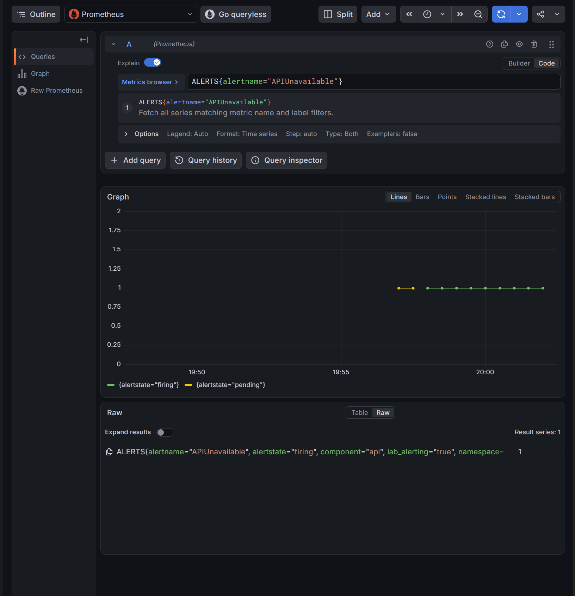

> Historical result from the private development history. Original identifiers are preserved; this is not a rerun of the public snapshot. Reviewed screenshots and selected archived evidence are included; attachment dumps remain private. See [provenance](../provenance.md) and the [evidence index](README.md#первичные-доказательства-milestone-8). Local paths, where present, were redacted.

Первичные данные: [api-unavailable-partial-2026-11-01.json](evidence/api-unavailable-partial-2026-11-01.json), [api-unavailable-recovery-2026-11-01.json](evidence/api-unavailable-recovery-2026-11-01.json). Классификация и SHA-256 — в [индексе](README.md#первичные-доказательства-milestone-8).

# Отсутствие API и доставка оповещения

- Статус: `Passed` для полного цикла и восстановления HTTP/scrape; доказательство дополнено отдельным status после тайм-аута первоначального наблюдателя.
- Подготовка: commit `3af4bca`; HEAD/чистота дерева и вывод тестов нового CLI в данном вложении не показаны.
- Среда: основной kind, Kubernetes 1.34.
- Контракт: [alerting](../design/alerting.md).
- Процедура: [APIUnavailable](../engineering/alerting-lab.md#apiunavailable-ноль-реплик-и-восстановление-http).

## Цель и исходные условия

Сопоставить временное отсутствие API backend с Pending/Firing, приёмом уведомления и Resolved после возвращения HTTP. Исходно одна фиксированная доступная реплика API, /version отвечает через Service proxy, правило inactive, KSM scrape исправен, pending/lag=0.

## Отказ, механизм и ожидаемые признаки

У существующего Helm-owned Deployment временно меняется scale 1→0. HPA/KEDA должны отсутствовать для этой цели; остальные процессы не останавливаются. Kubernetes завершает Pod и убирает готовые endpoints; приложение выполняет обычное завершение. Service proxy должен отклонить /version из-за отсутствия backend. Это отличается от потери доступа kubectl к control plane или завершения локального port-forward.

Правило проходит for=1m, активируется в Alertmanager и доставляется внутреннему receiver. Наблюдатель требует известного дефицита реплик при исправном kube-state-metrics и свежем ряде available replicas. Отсутствующая telemetry не считается успешным восстановлением.

## Восстановление и диагностика

Вернуть scale 0→1, дождаться rollout, проверить /version, прежнюю revision, in-cluster smoke, targets/метрики/lag/pending. Нужны matching resolved fingerprint/startsAt, Prometheus inactive и известный дефицит=0. Время старта receiver и evicted не должны меняться. Сохранить локальный proof, снимки Deployment и результаты Service proxy.

## Наблюдавшиеся признаки

Первый прогон 2026-11-01 сохранён в архиве (private original artifact omitted; see provenance). Наблюдатель `.local-observability/20261101T165601.940145300Z-alerts-watch` содержит 96 снимков, но завершился по восьмиминутному пределу до восстановления. Новый alert-cycle-proof.json отсутствует; старые proof других сценариев не относятся к этому опыту.

Все времена UTC. Исходное inactive/дефицит=0 наблюдалось в 16:56:02.1960238; дефицит=1 — в 16:56:17.4469197, Pending — в 16:56:57.4532184, Firing — в 16:57:57.4595779. Receiver принял firing в 16:57:53.769717337, startsAt=16:57:39.146, fingerprint `3ea719546a9fd2f7`. В последнем снимке 17:03:57.4519314 правило всё ещё firing, дефицит=1, matching resolved отсутствует. Время старта receiver 15:07:33.792549256Z, evicted=0 во всём сохранённом окне.

Восстановление началось через api-alert-start в 17:04:36, уже после завершения наблюдателя. В 17:04:40.054951 api-alert-check подтвердил /version через Service proxy, revision `0b77cd84de5e`; in-cluster smoke прошёл и удалил свой Pod. Worker group в 17:05:22 Stable/один участник, lag=0 по трём partition.

Три финальные проверки targets/application-metrics/dependency-metrics в 17:04:44–45 завершились ошибкой. В первом сохранённом ответе новый API Pod `lab-api-88c698dfc-t8qsw`, instance `10.244.0.65:8080`, имеет health=unknown, lastError пустой, lastScrape нулевой. Это согласуется с ожиданием первого scrape после появления Pod; новая успешная проверка нужна, чтобы подтвердить эту причину и восстановление сбора.

Продолжение опыта получено: архив восстановления (private original artifact omitted; see provenance). Receiver принял resolved в 17:05:23.761498379Z, endsAt=17:05:09.146Z, startsAt=16:57:39.146Z и fingerprint=3ea719546a9fd2f7 совпадают с firing. В status 17:08:33.1417878Z правило inactive, известный дефицит=0, активных fingerprint нет. ReceiverStarted не изменился, evicted=0. Это завершение того же цикла без повторного отказа, подтверждённое отдельным status; исходному наблюдателю не приписывается alert_cycle_completed, отсутствующий alert-cycle-proof.json не создавался задним числом.

api-alert-check в 17:08:32.0642601Z подтвердил здоровый /version с прежней revision 0b77cd84de5e. Повторные targets/application-metrics/dependency-metrics прошли: 69 записей targets в трёх проверках, все UP; pending=0, SQL sampler здоров, Kafka lag=0 по трём partition, members=1. Таким образом, прежний unknown API target был переходным состоянием до первого scrape, а не устойчивым отказом метрик.

## Граница доказательства и риск

Это контролируемая пауза одной реплики, не crash, зависание handler, сетевой отказ ingress или production availability/SLO. Service proxy не доказывает доступность через все сетевые пути. Scale меняется временно, образ и Helm-шаблон сохраняются. После прерывания требуется явное восстановление. Наличие правила и подготовленного кода не заменяет runtime.
