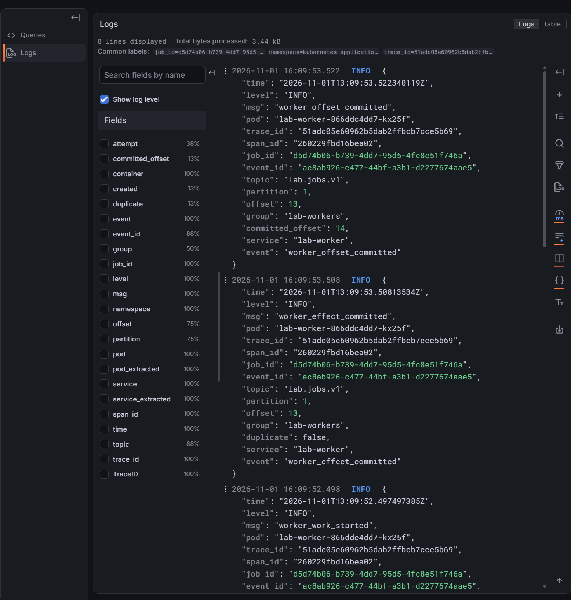
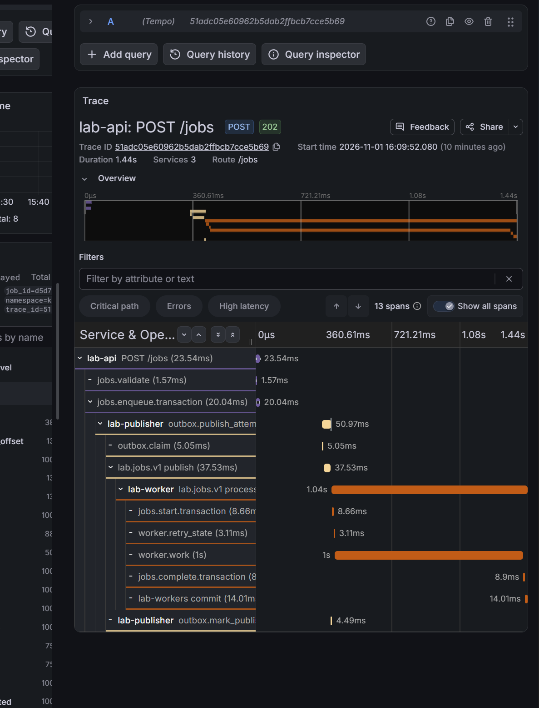
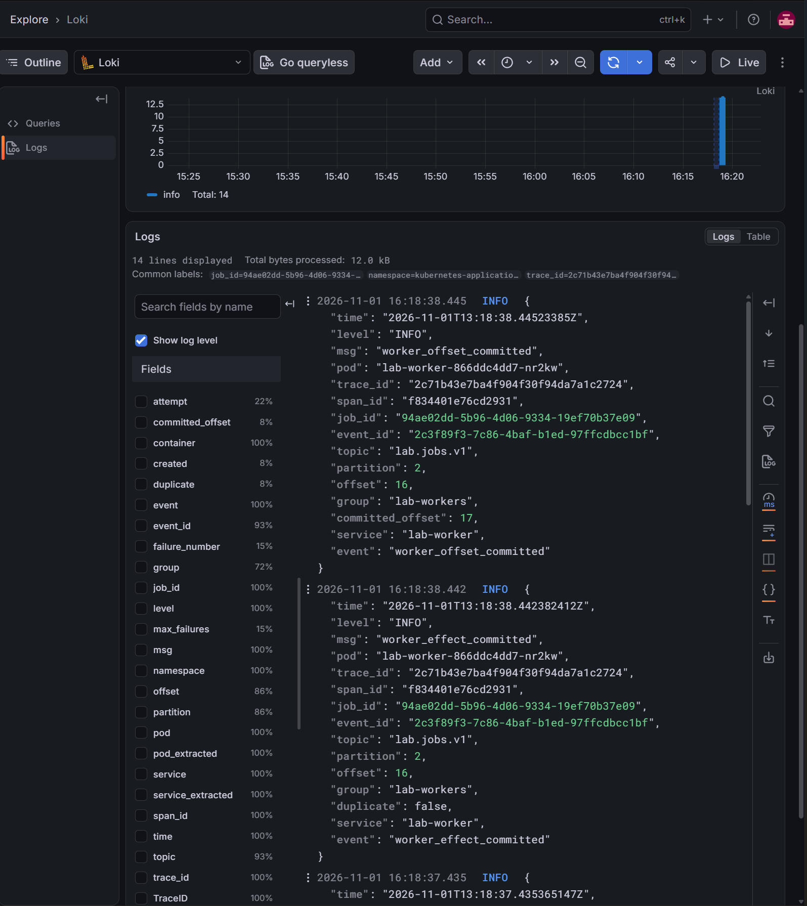

> Historical result from the private development history. Original identifiers are preserved; this is not a rerun of the public snapshot. Reviewed screenshots are included; raw captures remain private. See [provenance](../provenance.md). Local paths, where present, were redacted.

# Централизованные журналы API, publisher и worker

- **Статус: Passed в ограниченном объёме.** Выполнено владельцем 2026-11-01.
- Код CLI/chart: `d92960e`, перед прогоном `git status --short` пуст. Приложение использует прежние чистые образы с tracing; smoke подтверждает API revision `0b77cd84de5e`. Эти SHA относятся к разным артефактам, пересборка приложения для сбора журналов не требовалась.
- Среда: основной `kind-kubernetes-application-lab`, Kubernetes 1.34; namespace приложения `kubernetes-application-lab`, наблюдаемости `kubernetes-application-lab-observability`.
- Контракт: [application-logging](../design/application-logging.md). Порядок: [процедура](../engineering/application-logging-lab.md).

## Цель и исходные условия

Проверить сбор структурированных журналов через Alloy → Loki, поиск событий трёх процессов по job ID и переход Grafana → Tempo. Различить управляемые повторы worker и успешную фиксацию SQL/offset. Проверить ресурсы за ограниченный интервал и доступность прежних метрик после установки.

Использованы прежние PostgreSQL, Kafka, monitoring и tracing. Установлен release `lab-logging`, chart 0.1.0, revision 1. Monitoring обновлён до revision 9, `lab-observability` до 11 для datasource. Новых миграций или изменений Kafka storage/offsets сценарий установки не вводит. Прямое чтение `kubectl logs` остаётся способом диагностики вне Loki.

## Проверки конфигурации и установка

Успешно выполнены владельцем `go test -count=1 -race ./cmd/labctl` (1.288s), `go vet ./cmd/labctl`, `task logging-helm-lint` (0 failed), `logging-render`, `observability-render`, `logging-install`, `logging-status`, `observability-install`. Установка включает штатные проверки ресурсов/владения/StorageClass и server dry-run; успех Helm отдельно не используется как доказательство доставки строк.

Финальный inventory: Alloy Deployment и Loki StatefulSet имеют по одной Ready/Available реплике, `observedGeneration=metadata.generation=1`. Loki `/ready` успешен, Service внутренний `ClusterIP:3100`. PVC `data-lab-loki-0`: Bound, 2Gi, standard, UID `7a6ecc32-d206-4025-9826-53d4f9bc46a3`, PV `pvc-7a6ecc32-d206-4025-9826-53d4f9bc46a3`. Удаление/восстановление PVC не проверяется. Отдельная сверка всех прежних PV UID не представлена; доступность зависимостей подтверждена заданиями и метриками.

## Обычное задание и переход в Tempo

Задание `d5d74b06-b739-4dd7-95d5-4fc8e51f746a` принято в `13:09:52.1036585Z` с HTTP 202. Общий trace ID `51adc05e60962b5dab2ffbcb7cce5b69`, event ID publisher/worker `ac8ab926-c477-44bf-a3b1-d2277674aae5`.

`logging-verify` в `13:10:04Z` вернул восемь строк: API `job_accepted`; publisher `outbox_claimed`, `outbox_broker_ack`, `outbox_published`; worker `worker_received`, `worker_work_started`, `worker_effect_committed`, `worker_offset_committed`. Effect записан в `13:09:53.50813534Z`, offset commit — в `13:09:53.522340119Z`; partition 1, source offset 13, committed offset 14. SQL: succeeded, одна outbox row, один effect. Kafka group: Stable, один member, lag=0 по всем partition.

Grafana Explore Loki вернула те же восемь строк. Derived field TraceID открыл Tempo с тем же ID: три сервиса, 13 spans, 1.44s общего диапазона. HTTP POST /jobs занял 23.54ms и вернул 202: это приём, а не завершение асинхронной обработки.

## Два управляемых повтора

Worker штатно остановлен (Helm revision 26). Принято задание `94ae02dd-5b96-4d06-9334-19ef70b37e09`, задано `failures_before_success=2`, восстановлен диагностический профиль worker (revision 27). Новый Pod `lab-worker-866ddc4dd7-nr2kw` получил работу после запуска. Отсутствие consumer при остановке не является отказом broker.

Trace ID `2c71b43e7ba4f904f30f94da7a1c2724`, event ID `2c3f89f3-7c86-4baf-b1ed-97ffcdbcc1bf`. `logging-retry-verify` в `13:19:28Z` вернул 14 строк с обязательными событиями и двумя различимыми повторами:

| Событие | UTC |
|---|---|
| API job accepted | 13:18:09.280023016 |
| Publisher broker ack | 13:18:09.328775577 |
| Первый retry scheduled | 13:18:26.316337633 |
| Второй retry scheduled | 13:18:32.380036457 |
| SQL effect committed | 13:18:38.442382412 |
| Offset committed | 13:18:38.44523385 |

SQL независимо подтвердил succeeded, failure_count=2, один effect; outbox pending=0, одна строка задания. Partition 2: source offset 16, committed offset 17. В `13:20:39Z` группа Stable, один member, lag=0 по всем partition. Попытки имеют общий trace и отдельные span ID. Управляемые повторы записаны на INFO; это не два разных задания или два SQL-эффекта. Grafana подтверждает поиск 14 строк, duplicate=false и последующий commit.

## Ресурсы и поведение Kubernetes

Напрямую сверены samples.txt из `.local-observability/logging-resources-20261101T132637Z` и 31 Pod JSON. Интервал **13:26:37.3877520Z–13:41:51.1168492Z**, **913.729 секунды** (15 минут 13.729 секунды). Снимки 0–30 без пропусков; get_pods_exit, top_pods_exit, pod_snapshot_exit равны 0 во всех 31 случаях. Три Pod всегда Ready/Running, restartCount=0; UID и imageID не менялись.

| Процесс | CPU min–max | Память min–max | Requests памяти | Limit памяти |
|---|---|---|---|---|
| Alloy | 4–7m | 38–39Mi | 128Mi | 256Mi |
| Loki | 10–14m | 59–69Mi | 512Mi | 1Gi |
| Grafana | 15–27m | 227–519Mi | 768Mi | 1Gi |

| Pod | UID |
|---|---|
| lab-alloy-8549c9c8c6-w2rc9 | 3ab9e25f-155c-453e-a0b4-c32dee6e61d7 |
| lab-loki-0 | d7758b4b-cea5-436d-a308-fdb6c002ccb0 |
| lab-monitoring-grafana-76494dd7bc-sb6v2 | 0b81e833-6bd7-411f-a54a-e80f77c4582d |

Фактические imageID:

- Alloy: `docker.io/grafana/alloy@sha256:8ab871206bd2d8f89277f53abffee5f452a293980788d52f85fa183a87a505a4`.
- Loki: `docker.io/grafana/loki@sha256:0db216b630ae1f348a1584c67f3cead8b4c1fc839169a39501db664744158e28`.
- Grafana: `docker.io/grafana/grafana@sha256:ae3d3add290adbe6a88412229f5d76fd7bb82743050881698642d3d62f277e35`.

В этом интервале лёгкой нагрузки память не приблизилась к лимитам. Разность min/max Grafana не объясняет механизм освобождения памяти и не доказывает отсутствие утечки или длительную устойчивость. Предельная нагрузка, рост диска Loki за 24 часа и стоимость API-сбора при большом количестве Pod не измерялись.

## Первоначальный отказ и восстановление

Сохранён первоначальный неуспех трёх проверок (`prometheus-targets`, `application-metrics-verify`, `dependency-metrics-verify`) в `13:06:24–13:06:27Z`: down был **Grafana target**, URL `http://10.244.0.33:3000/metrics`, connection refused. Общая ошибка CLI «API target missing or at least one selected target is not UP» не означала отказ API. После обновления Grafana использовался новый IP. Владелец связал ситуацию с ожиданием развёртывания; вывод подтверждает кратковременную недоступность и успешный повтор, но не точную внутреннюю причину готовности процесса. Первоначальные ошибки остаются в архиве.

Повторы в `13:08Z` прошли. После наблюдения в `14:31:25Z` успешен logging-status; prometheus-targets в `14:31:27Z` и targets внутри application-metrics-verify в `14:31:29Z` показали **23/23 UP**, пустые last_error, включая Loki/Alloy. Outbox pending=0, stats_up=1, возраст удачного SQL-снимка **19.1069457531s** (<30s). Worker group в `14:31:35Z`: Stable, один member, offsets/end 14/14, 14/14, 17/17, lag=0. Smoke: Succeeded, API revision `0b77cd84de5e`, EndpointSlice `10.244.0.25:8080`; smoke Pod удалён.

Финальные проверки выполнены после интервала ресурсов; непрерывного наблюдения между `13:41:51Z` и `14:31Z` нет. Диагностические worker Pod сохранены для доказательств; их штатная очистка в присланных командах отдельно не подтверждена. Рабочие Loki/Alloy и PVC остаются развёрнутыми.

## Архив и граница результата

- Выбранные события владельческих прогонов (private original artifact omitted; see provenance): job/logging/group/targets, включая первоначальные down и SHA-256 исходных вложений. Это выборка, не полный архив всех журналов.
- Исходные строки измерений в UTF-8 (private original artifact omitted; see provenance).
- Проекция 31 Pod JSON (private original artifact omitted; see provenance): время, UID, phase/Ready, imageID, restartCount, resources; SHA-256 исходного samples.txt. Secrets и env не копируются.
- Полные ответы CLI/render остаются в `.local-observability`, включая `20261101T131004.471810600Z-logging-verify`, `20261101T131928.375902500Z-logging-retry-verify`, `20261101T143125.436515100Z-logging-status`, `20261101T143127.842084400Z-targets`, `20261101T143129.431393100Z-application-metrics-verify`.

Подтверждены сбор/поиск двух новых заданий, связь трёх процессов по job/event/trace ID, переход Loki → Tempo, наблюдение управляемых повторов без второго SQL-эффекта, ограниченный интервал ресурсов и восстановленное здоровье метрик. logging-verify использует raw line filter и проверяет returned stream labels; появление job/trace ID после `| json` в Grafana — извлечение при запросе, а не доказательство индексирования этих полей.

Не подтверждены exactly-once доставка журналов, отсутствие потерь при отказе Loki/Alloy, длительная устойчивость, фактическая очистка retention, сохранность после удаления kind, enforcement NetworkPolicy или отказоустойчивый Loki. Полный аудит отсутствия секретов во всей исторической telemetry не выполнялся; архив ограничен диагностическими полями без payload. Оповещения, оставшиеся совместные сценарии отказов и итоговый эксперимент Milestone 8 этим отчётом не закрываются.
