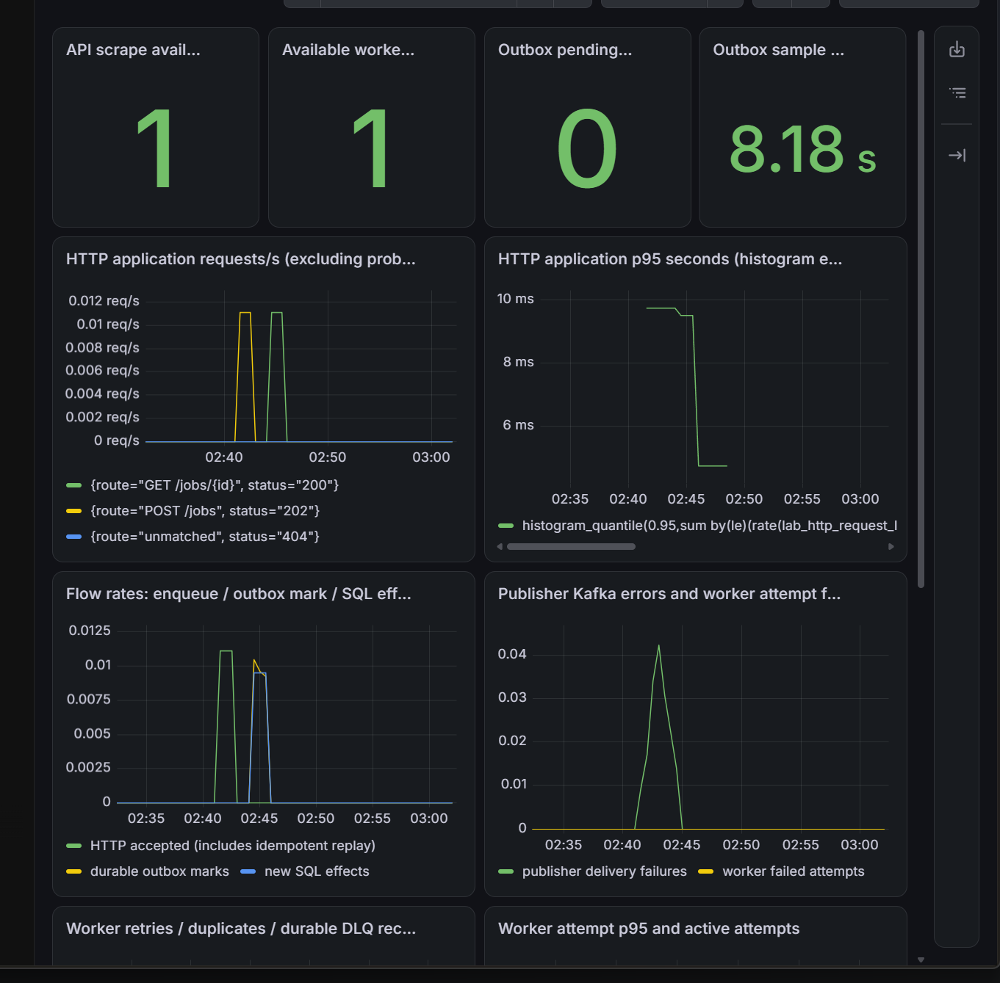
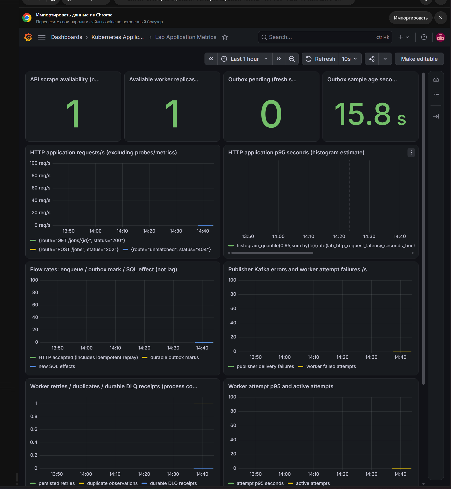

> Historical result from the private development history. Original identifiers are preserved; this is not a rerun of the public snapshot. Reviewed screenshots are included; raw captures remain private. See [provenance](../provenance.md). Local paths, where present, were redacted.

# Прикладные метрики и первая панель Grafana

- Статус: `Passed`, первая часть итерации 2 Milestone 8 (B/C и начальная панель G), в границах ниже.
- Ревизия прогона: `401ca963a55c17a9eb89b6466aad1e79d4638b7e`, чистое дерево; API/publisher/worker сообщают `401ca963a55c`.
- Контракт: [наблюдаемость](../design/observability-architecture.md#прикладные-метрики).
- Порядок выполнения: [инструкция](../engineering/observability-lab.md#прикладные-метрики-и-первая-панель).
- Среда: основной kind/Kubernetes 1.34, существующие PostgreSQL/Kafka, фиксированный worker 1, CronJob suspended. Namespace приложения не меняется.

## Цель и исходные условия

Связать реальную обработку задания с HTTP histogram, publisher broker ack/SQL mark, новым SQL-эффектом worker, offset commit и измеренным в PostgreSQL outbox. Подтвердить загрузку dashboard JSON из Git и сохранение панели после замены Grafana Pod. Не считать нулевые counters доказательством обработки.

Для воспроизведения нужны чистые новые образы всех трёх процессов и сохранённые imageIDs/build revisions. Существующие PVC, Secret, topics, offsets и квитанции DLQ не удаляются. Перед обновлением сохранить preflight/status. Владелец выполнил проверки Go/Helm, сборку, сценарии нагрузки, повторной доставки и отказа publisher, замену Grafana Pod с восстановлением панели, 15-минутное наблюдение памяти и opt-in SQL integration-тест на отдельной БД.

## Наблюдавшиеся признаки, 29–30 октября 2026 года

Времена ниже — UTC; график на скриншоте использует время браузера UTC+03:00. Проверки выполнял владелец; агент сверил присланные результаты.

- `go test -count=1 ./...`, `go test -count=1 -race ./...`, `go vet ./...`, Helm lint и observability-render завершились успешно. Обычный `go test` не заменяет opt-in SQL integration-тест.
- Первая проверка в 23:02:35 остановилась на Grafana target: `connection refused` при запуске нового Pod. В 23:15:58 все 16 targets UP, Grafana `database: ok`, outbox SQL-снимок успешен и младше 30 секунд. Начальный отказ не исключён из результатов.
- Нагрузка `worker-1793315866883048900`: 12 заданий приняты в 23:17:46, последнее завершено в 23:17:59. На прежних Pod publisher `lab-publisher-67d847678d-zq75n` и worker `lab-worker-998b55745-rz4v5` счётчики durable marks / processed выросли с 0 до 12. SQL: succeeded 19 → 31, у каждого нового задания effects=1; pending=0. Group Stable, один участник, lag всех трёх partition=0.
- Первое вычисление HTTP p95 после короткой нагрузки вернуло NaN. После 45 чтений существующего задания с интервалом около секунды в 23:22:41 получено `0.004857954545454545` секунды. Это оценка HTTP latency по histogram, не время ожидания фонового результата; причина первоначального NaN отдельно не установлена.
- Повторная доставка задания `ff2820bc-eea4-490c-ad1c-cbb431148a2f` в 23:23:53: event `83baaca2-23bc-437c-9102-3e2f3887664c`, partition=1, новый offset=8. На том же worker processed остался 12, duplicates вырос 0 → 1; SQL effects=1. Последующая диагностика показала committed offset=9 и lag=0 для partition 1.
- Отказ создан профилем publisher-unreachable без остановки Kafka: publisher заменён на `lab-publisher-78d79697cc-qln22` с закрытым bootstrap-адресом loopback. Задание `a193b0f1-b5e5-483b-82a4-e4dabb30ef9e` принято HTTP 202 в 23:40:55. Во время отказа publish_errors=2, pending=1, измеренный oldest age=37.749202 секунды, stats_up=1, свежесть снимка около 22 секунд. SQL независимо подтвердил accepted, effects=0, `kafka_publish_failed`, отсутствие published_at и Kafka offset.
- После восстановления то же событие `1a3723e3-7ded-4974-9745-cb859fb88ef6` опубликовано с попытки 7 в 23:43:57, partition=1/offset=9; задание завершено в 23:43:58 с effects=1. Первые samples после восстановления ещё показывали pending=1 / processed=12: периодический сбор не является синхронным SQL-чтением.
- В 23:57:19–23:57:23 подтверждены все 16 targets UP, worker processed=13, pending=0, oldest age=0, stats_up=1, свежесть около 3.7 секунды. Новый publisher `lab-publisher-67d847678d-7mtkx` показывает durable marks=1: process counter начался заново. Group lag после восстановления=0.

Каталоги доказательств включают `.local-observability/20261029T231847.262068000Z-application-metrics-verify`, `.local-observability/20261029T232241.839775300Z-query`, `.local-observability/20261029T232432.492932200Z-query`, `.local-observability/20261029T234152.525731300Z-query` и `.local-observability/20261029T235718.961837100Z-application-metrics-verify`. Полные SQL/group-выводы предоставлены владельцем; изображение дополняет, но не заменяет их.

### Иллюстрация панели после восстановления publisher

На скриншоте видны API scrape=1, одна доступная worker-реплика, pending=0 и возраст SQL-снимка 8.18 секунды. В историческом интервале видны ошибки доставки publisher и последующие durable outbox marks / новые SQL effects. Причинная связь установлена сценарием и SQL-выводами, а не только формой линий. Интервал около 02:35–03:00 по времени браузера не включает начальную нагрузку из 12 заданий в 02:17. Нижние панели показаны не полностью; их содержимое и повторная загрузка после замены Pod этим изображением не подтверждаются. Устойчивость памяти из скриншота не следует.

### Восстановление панели и наблюдение памяти, 30 октября

Владелец явно удалил только Grafana Pod `lab-monitoring-grafana-546d7f85c-sl77g`, UID `737ed992-2da5-49be-922a-1503ca5c7858`. Deployment создал `lab-monitoring-grafana-546d7f85c-zvz69`, IP `10.244.0.202`, Ready 1/1. Проверка в 11:37:47 UTC вернула `database: ok`; после нового port-forward и входа панель с прежним UID `lab-application-metrics` появилась без ручного импорта.

Скриншот показывает панель после замены Pod, API scrape=1, одну доступную worker-реплику, pending=0 и свежесть снимка 15.8 секунды. Последний час не включает ночные эксперименты: нулевые rates и пустой p95 при отсутствии новых запросов не означают потери исторических данных.

Наблюдение с открытой панелью и обновлением 10 секунд: 31 снимок с 11:42:47.9142196 до 11:57:52.9764145 UTC (15 минут 5 секунд), один и тот же Pod Ready 1/1, Running, RESTARTS=0 во всех снимках. Память по `kubectl top` 232–497Mi, CPU 8–22m; последнее значение 497Mi. Память снижалась с 491 до 361Mi, затем снова росла. Это не измерение абсолютного пика или доказательство отсутствия утечки. При лимите 512Mi наблюдаемый максимум около 97% лимита: запас мал, длительная устойчивость и достаточность для следующих панелей не подтверждены. Лимит не менялся.

После наблюдения `grafana-status` в 11:57:57 UTC вернул `database: ok`; `application-metrics-verify` подтвердил все 16 targets UP, новый Grafana endpoint `10.244.0.202:3000`, worker=13, pending=0, stats_up=1, возраст SQL-снимка около 15.86 секунды. Smoke завершился успешно на API ревизии `401ca963a55c`, диагностический smoke Pod удалён. Каталоги: `.local-observability/20261030T113747.573662100Z-grafana-status`, `.local-observability/20261030T115757.077560100Z-grafana-status`, `.local-observability/20261030T115757.768188800Z-application-metrics-verify`.

### SQL integration и очистка

Владелец выполнил `task jobs-sql-integration-test`: `go test -tags integration -count=1 -race ./internal/jobs -run '^TestPostgresOutbox$' -v`. Получен настоящий `PASS`, не SKIP: TestPostgresOutbox 0.23s, пакет 1.801s. Использована отдельная новая БД `lab_jobs_test_bc42f2f8971042f3a91de713da8cceb1`; тест включает SQL-проверки OutboxStats. После теста прежние переменные окружения восстановлены, пароль не выводился. Владелец удалил только эту временную БД через dropdb; контрольный SELECT по точному имени не вернул строк. Основная БД, PVC, topics и offsets не удалялись.

### Увеличение запаса памяти после прогона

После наблюдавшихся 497Mi при лимите 512Mi владелец согласовал request=512Mi и limit=768Mi. Применение этого профиля и последующее наблюдение с двумя панелями (628–712Mi за 10 минут без перезапусков) подтверждены в [отчёте метрик зависимостей](dependency-metrics.md). Текущий подготовленный профиль, его обоснование и граница применения принадлежат [архитектуре наблюдаемости](../design/observability-architecture.md#начальный-бюджет). Успех прикладного опыта выше остаётся доказательством для прежнего лимита 512Mi. Увеличение запаса не доказывает устранение утечки.

## Нагрузка и ожидаемые признаки

1. После обновления API/publisher/worker и monitoring сохранить Helm revisions, фактические PodMonitor/ServiceMonitor и target discovery. При одной реплике каждого процесса ожидаются два дополнительных UP targets publisher/worker; число не жёстко задано, каждый Pod проверяется отдельно.
2. `application-metrics-verify` требует API target и все targets UP, publisher/worker UP, успешный SQL-снимок outbox младше 30 секунд и непустые counters. Снимок до первой удачи — NaN, не ноль. Это проверка экспозиции и свежести, не прогресса бизнеса.
3. До нагрузки сохранить counters, затем выполнить существующий worker-batch (12 новых заданий). После обработки сохранить новые counters и SQL/group status. Ожидается прирост 12 durable outbox marks и 12 новых SQL effects при отсутствии другой работы. Новые HTTP-запросы должны появиться в histogram. Результаты заданий, один эффект и offsets остаются независимыми доказательствами — metrics не заменяют их.
4. Выполнить существующий worker-replay для явно выбранного успешного job. Ожидается прирост duplicates, а не processed; SQL-эффект остаётся один. При crash in-memory counters могут потеряться до scrape: отсутствие increment не доказывает отсутствие SQL commit.
5. Для backlog использовать существующий профиль publisher-unreachable, не останавливая broker. Enqueue нового задания должен пройти; после SQL sampling и scrape ожидаются pending>0, растущий измеренный age, publish_errors и новые попытки. Publisher Pod может быть NotReady, но его PodMonitor должен продолжать сбор /metrics. Нулевой outbox при stats_up=0 либо устаревшем timestamp не засчитывается.
6. После publisher-unreachable-restore дождаться завершения той же заявки: pending возвращается к исходному значению, age=0 при пустом outbox, появляется свежий broker ack и durable mark. Счётчики нового Pod обнуляются; не вычитать counters разных Pod как одну непрерывную величину.
7. Открыть dashboard `Lab Application Metrics` в папке `Kubernetes Application Lab`: сохранить JSON-запросы и фактические samples. p95 — оценка histogram при наличии запросов, NaN при пустом потоке не подменять нулём. Сохранить UID панели `lab-application-metrics`, затем отдельной явно согласованной заменой Pod Grafana подтвердить её повторную загрузку из файлов. Ручные панели временной БД не являются источником истины.

## Диагностика и восстановление

Отсутствующий PodMonitor — проверить Helm release и release label; target отсутствует — namespace/Pod labels/порт health; target UP, но нет counters — образ/маршрут /metrics; stats_up=0 — доступность SQL, права publisher и ограничение запроса, не «очередь пуста». Sampling выполняется раз в 10 секунд с тайм-аутом 2 секунды через тот же pool с максимумом 4 соединения на publisher. SQL не выполняется в обработчике scrape.

Восстановить штатный publisher, fixed worker 1, проверить прежнюю заявку, group lag, доступность API и свежесть outbox. Не сбрасывать offsets или удалять бизнес-данные ради красивых графиков. Диагностические Pod очищаются только существующей явной командой после сохранения доказательств; панели/метрики исторических опытов могут остаться в Prometheus в пределах retention.

## Граница доказательства и Target

Подтверждены сбор прикладных метрик, прирост counters на реальной нагрузке, наблюдаемая повторная доставка без второго SQL-эффекта, накопление outbox при отказе publisher и восстановление той же заявки. Подтверждены повторная загрузка первой панели после замены Grafana Pod, 15 минут работы без перезапуска при наблюдаемой памяти до 497Mi и SQL integration-тест с очисткой временной БД. Проверка не доказывает достаточный запас памяти или длительную устойчивость Grafana. Счётчики retries/DLQ и ошибок offset commit не получили отдельного нового сценарного подтверждения этим прогоном. Kafka consumer lag как постоянно собираемая метрика, Kafka exporter/JMX, PostgreSQL server exporter с отдельным read-only пользователем, connections/max connections, остальные панели, tracing, Loki и доставка alerts не реализованы этим изменением. Outbox gauges — SQL-снимок приложения, не PostgreSQL exporter. Publisher ack — доставка брокеру, не завершение job. Worker processed — новый SQL-эффект, не гарантия Kafka offset commit. Масштабирование KEDA не перепроверено. Весь Milestone 8 не закрыт.
