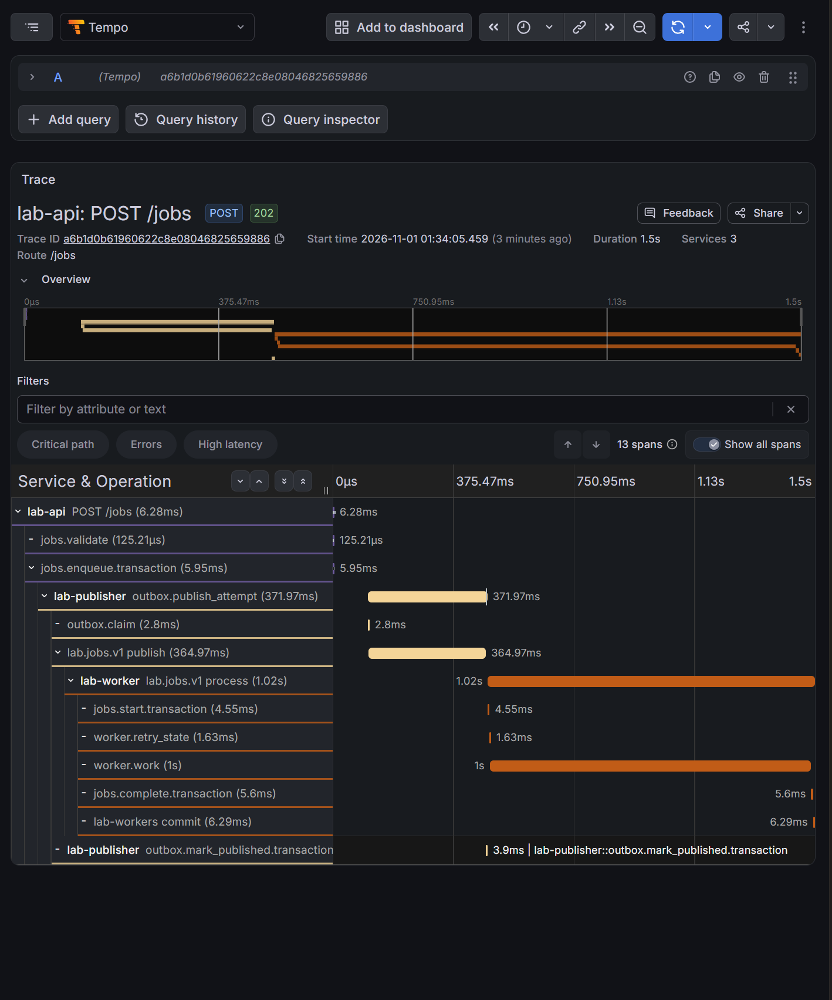
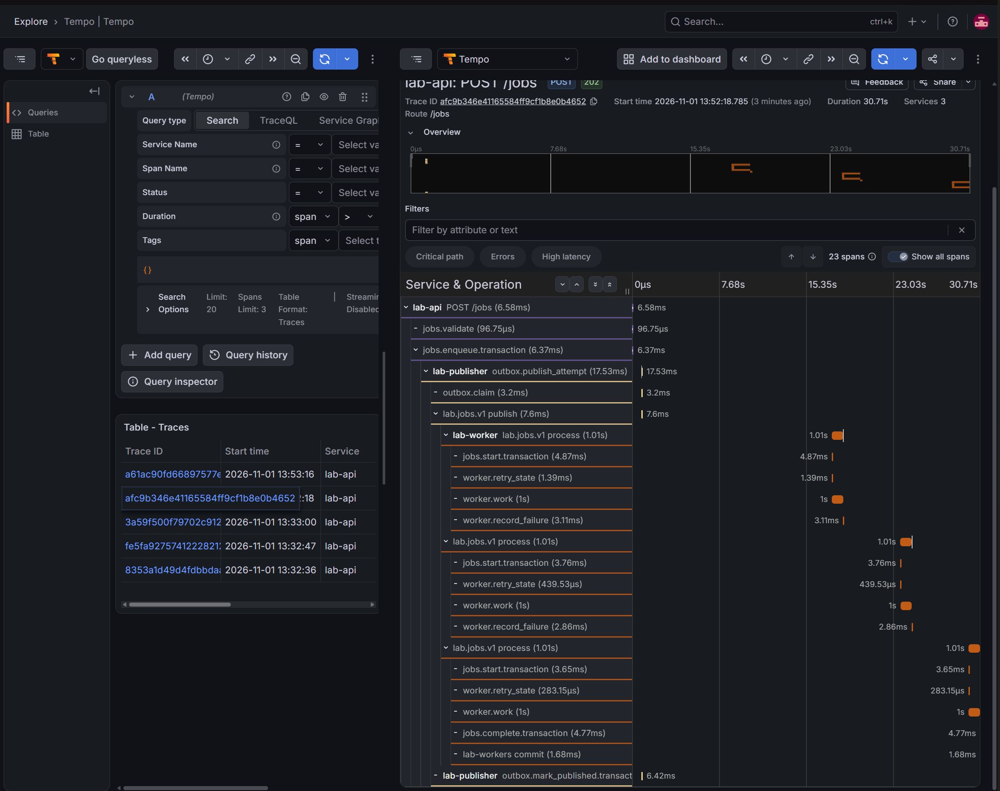
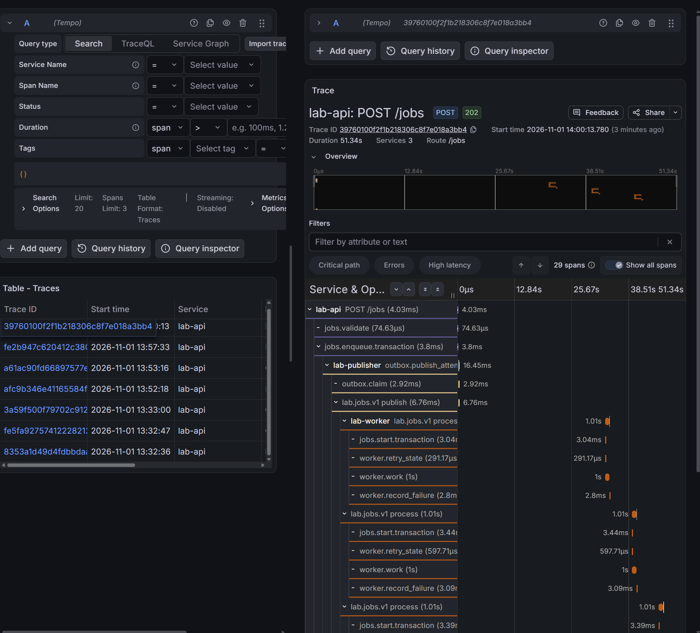
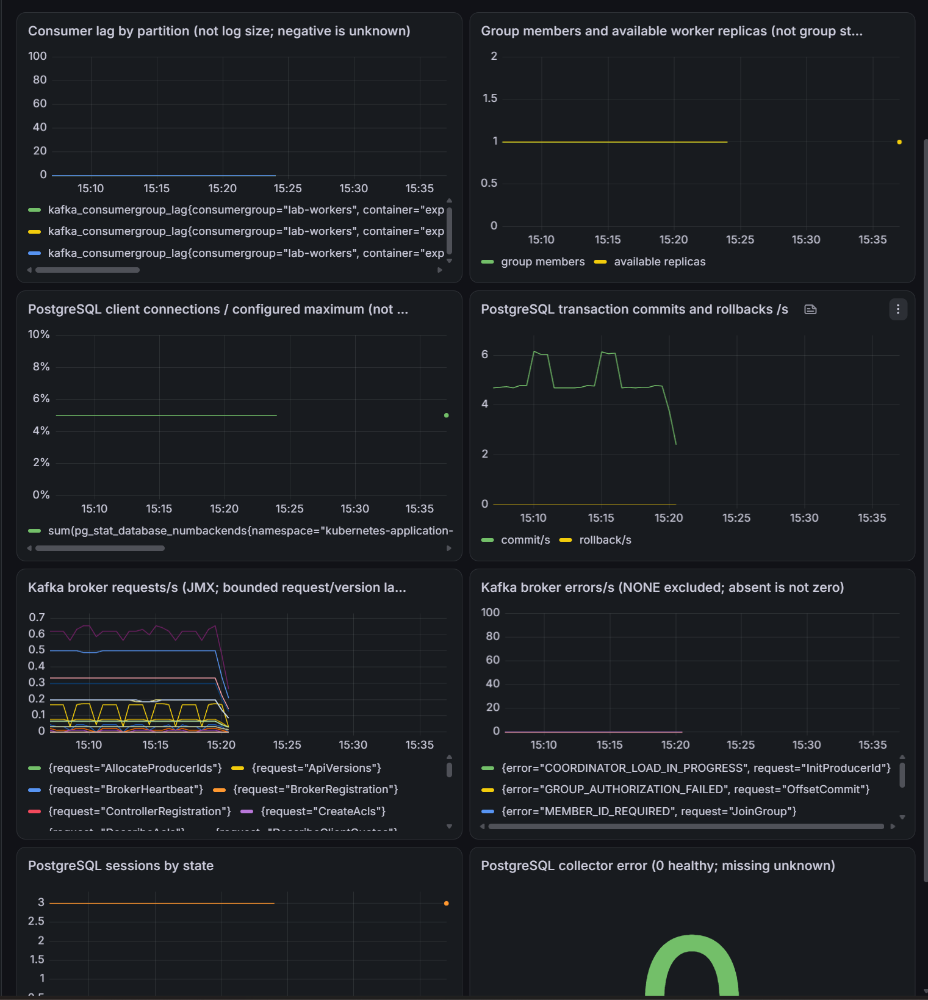
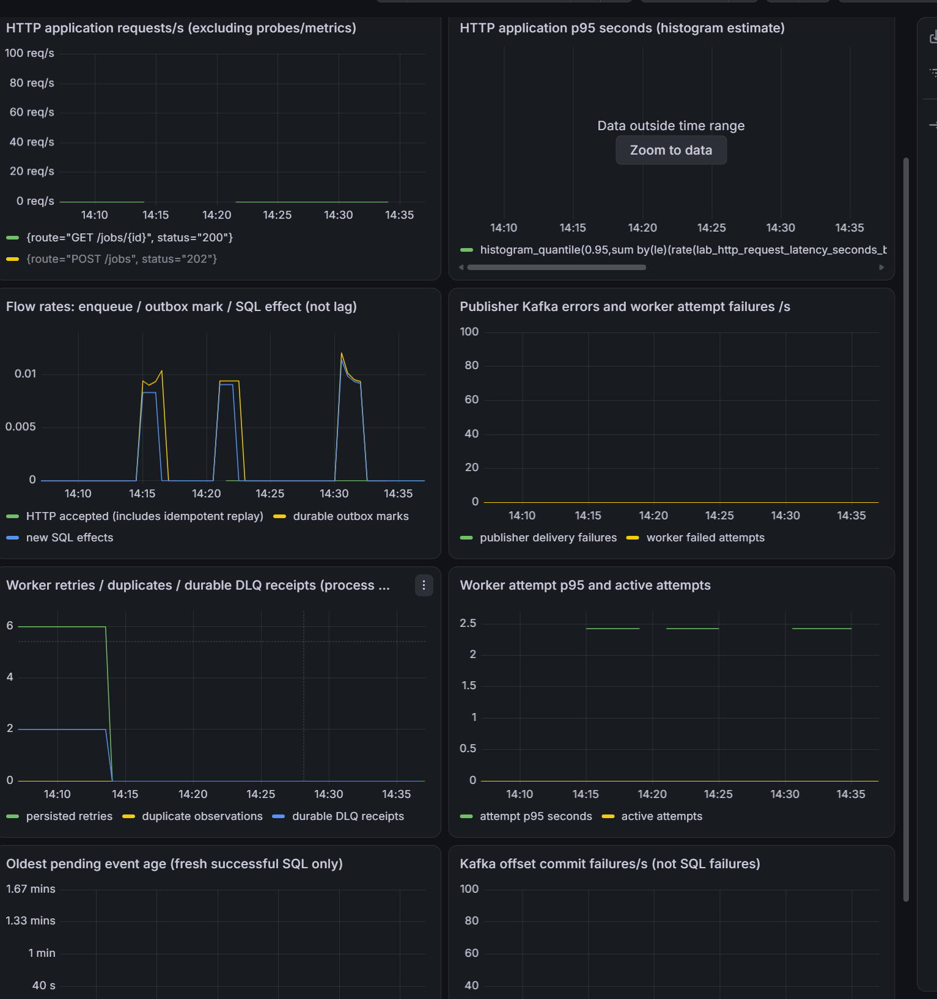

> Historical result from the private development history. Original identifiers are preserved; this is not a rerun of the public snapshot. Reviewed screenshots and selected archived evidence are included; attachment dumps remain private. See [provenance](../provenance.md) and the [evidence index](README.md#первичные-доказательства-milestone-8). Local paths, where present, were redacted.

Первичные данные: [application-tracing-dlq-2026-11-01.json](evidence/application-tracing-dlq-2026-11-01.json), [application-tracing-resources-2026-11-01.json](evidence/application-tracing-resources-2026-11-01.json). Классификация и SHA-256 — в [индексе](README.md#первичные-доказательства-milestone-8).

# SDK и сквозная трассировка задания

- Статус: `Passed` для обычного задания, сохранения контекста после замены publisher Pod, двух отказов worker с последующим успехом, исчерпания трёх попыток/DLQ, просмотра трассировок и обработки одного задания при недоступном telemetry endpoint. После восстановления профилей доставка новой связанной трассировки также подтверждена. Обработка при выключенном SDK и 31 снимок шести workloads за 15 минут без перезапусков также подтверждены в указанных границах. Исторические разрывы на панелях требуют отдельного объяснения.
- Ревизия: `0b77cd84de5eabf739ceb9ff9df713fd06bfafa3`. Перед сборкой агент наблюдал чистое рабочее дерево; build args, smoke и startup logs трёх процессов содержат `0b77cd84de5e` без `-dirty`.
- Контракт: [application-tracing](../design/application-tracing.md).
- Воспроизведение и восстановление: [application-tracing-lab](../engineering/application-tracing-lab.md).
- Исходное доказательство транспорта: [Collector/Tempo](tracing-infrastructure.md), отдельное `Passed` не распространяется на приложение.

## Цель и ожидаемые признаки

Проверить сохранение контекста после завершения HTTP и перезапуска publisher: POST → enqueue/outbox → publish/ack → worker → SQL effect → offset. В Tempo должны существовать реальные span ID/parent ID трёх сервисов с допустимыми временными интервалами. Job succeeded, effects=1, pending/lag=0. Header или запись trace_id в журнале недостаточны.

Отдельные сценарии: retry, DLQ, выключенный SDK, недоступный telemetry endpoint и восстановление. Бизнес-обработка при отказе telemetry должна завершаться с прежними SQL/offset гарантиями; spans могут теряться. Наблюдение ресурсов и штатного завершения ограничивает вывод конкретным интервалом и нагрузкой.

## Что зафиксировать после выполнения

Чистый SHA и состояние Git перед сборкой; API/publisher/worker refs, imageIDs, startup revisions, UID; migration 004; Helm values/revisions; исходные pending/lag, Cron и fixed worker. Для каждого опыта — UTC интервал, job/event/trace ID, фактический ответ Tempo и граф parent ID, журналы, SQL effect count/status, offsets/end, снимки ресурсов и итог восстановления. Скриншот служит иллюстрацией к этим данным.

## Выполненные проверки и исходные условия

Владелец выполнил полный `go test -count=1 -race ./...`, `go vet ./...`, `git diff --check`, lint/render трёх диагностических Helm-профилей. После восстановления поддержки trace ID пакет labctl прошёл race-проверку за 1.156s. SQL integration TestPostgresOutbox имеет два настоящих PASS (0.25s и 0.20s) в отдельных БД; обе БД затем удалены командами dropdb без ошибки. Агент тесты и Kubernetes-команды не запускал.

Все три образа собраны и развёрнуты владельцем:

| Процесс | Записанная ссылка образа | Helm revision |
|---|---|---|
| API | kubernetes-application-lab-api:868bde3dee34a73f07230ac15ed558645ff4d0fcea72ddd542940f97bd98abb1 | 8 |
| Publisher | kubernetes-application-lab-publisher:dfd8460d06f1a79b2a5217c855f03794969faa86e01ac105a341383d70b0ab32 | 9 |
| Worker | kubernetes-application-lab-worker:7f076b217de6d8f1d0327c0e4940039d3fd70c8986507abc9366db2c3371f96c | 15 |

Migration Job lab-db-migration-20261031222837 завершён Complete; outbox-status перечисляет 001–004, включая 004_outbox_trace_context. tracing-status, application-metrics-verify, dependency-metrics-verify и smoke завершились успешно. Перед новым заданием pending=0, published=33; метрики показывали lag=0 и одного участника группы. Эти сведения не заменяют отдельное наблюдение ресурсов и реальных runtime imageIDs/UID.

## Наблюдения обычного сценария

Опыт выполнен 2026-10-31 в 22:34 UTC (2026-11-01 01:34 по Москве): одна новая заявка длительностью 1000ms через API port-forward. Job `4c6372a7-9a91-4d51-a50c-8313a37d8096`, event `e394254a-1fd5-4375-bde5-e76d595b99b1`, trace `a6b1d0b61960622c8e08046825659886`.

HTTP вернул 202; job-status затем вернул succeeded. SQL показывает одну строку outbox и один effect, attempts=1, published_at заполнено; pending=0, published=34. Durable traceparent: `00-a6b1d0b61960622c8e08046825659886-76b6c83076fd8090-01`. Пустой контекст прежних строк сохранён: миграция не приписывает им новую трассировку.

Publisher подтвердил partition=0/offset=12. Worker зафиксировал SQL effect перед commit offset=13. Группа Stable, один member, assignment [0,1,2]; committed/end равны 13/13, 11/11 и 12/12, lag=0. В журналах API/publisher/worker один trace ID и разные span ID.

Команда application-trace-read сохранила `.local-observability/20261031T223417.330877800Z-application-trace-read`: application-trace.json с фактическим ответом Tempo и verified-span-chain.json. Агент прочитал оба файла, подтвердил 13 spans трёх сервисов, включая validation, claim, broker_ack и mark_published. Семь ключевых spans образуют следующую связь (стрелка означает parent):

```text
POST /jobs dadf0d01534d98f4
  → jobs.enqueue.transaction 76b6c83076fd8090
    → outbox.publish_attempt 056f6c035bab2b13
      → lab.jobs.v1 publish b0a30ae0c9768a4e
        → lab.jobs.v1 process 9388a719b21313b0
          → jobs.complete.transaction d6f41f902c2932f6
          → lab-workers commit cb31f85f8840ecb2
```

HTTP span занял 6.28ms; publisher attempt — 371.97ms, publish — 364.97ms, consumer — около 1.02s, work — 1s. SQL completion закончился в 22:34:06.955185004 UTC, commit offset начался в 22:34:06.955268639 UTC. Полная трассировка занимает около 1.5s: это длительность асинхронной цепочки, а не HTTP-запроса.

Владелец открыл тот же trace ID через datasource Tempo в Grafana. Скриншот показывает HTTP 202, Services=3, 13 spans и дерево асинхронной обработки:



## Остановка publisher и восстановление — Passed

2026-11-01 в 10:32–10:33 UTC (13:32–13:33 по Москве) владелец выполнил publisher-stop, дождался удаления старого Pod, затем поставил новое задание. Это управляемая остановка через replicas=0, а не SIGKILL или отказ Kafka. Использован уже развёрнутый образ ревизии `0b77cd84de5e`; между опытами изменялась только документация.

| Признак | Наблюдение |
|---|---|
| Старый publisher | lab-publisher-5cd4699d79-vl74p, UID 718e8ba0-1b41-49c8-b5e3-2de41a45355a |
| Новый publisher после publisher-start | lab-publisher-5cd4699d79-4xqm9, UID 2274fd39-a1e1-4d44-80a8-88e827bef077 |
| Job | a32a9a5e-3cf0-4da9-9cab-bc5a731e0b0a |
| Event | 8cbd4d91-aa47-4ac1-9a95-a3d7d7437e18 |
| Trace | 8353a1d49d4fdbbdaa495887c17266e1 |
| Durable traceparent до и после восстановления | 00-8353a1d49d4fdbbdaa495887c17266e1-71fc90dc69b9ec1e-01 |

В 10:32:36.7676896 UTC POST вернул 202. Во время отсутствия publisher job-status в 10:32:47.4475968 UTC показывал accepted. SQL: pending=1, published=34, возраст ожидающего события 13s, outbox_rows=1, effects=0, attempts=0, published_at не заполнено. Контекст уже находился в outbox, хотя процесса publisher не было.

Publisher-start вернул одну готовую реплику. Startup нового Pod в 10:32:53.378216542 UTC подтвердил прежнюю ревизию образа; claim, broker ack и outbox_published содержат тот же trace ID. Событие опубликовано в partition=1/offset=11, attempts=1, published_at=10:32:53.449857 UTC. Задание завершилось succeeded в 10:32:54.460347 UTC с одним effect и одной строкой outbox. Pending вернулся к 0, published=35. Группа Stable с одним member; committed/end равны 13/13, 12/12, 12/12, lag=0.

Evidence `.local-observability/20261101T103307.133431000Z-application-trace-read` содержит фактический ответ Tempo и проверенную цепочку. Агент прочитал оба файла: 13 spans, три сервиса, семь ключевых spans связаны через parent ID. HTTP span `e6ad5f1c5e87c925` завершился в 10:32:36.766719441 UTC; enqueue span `71fc90dc69b9ec1e` стал родителем нового publisher attempt `1bf3709397eb6f88`, начавшегося в 10:32:53.378242664 UTC — примерно через 16.61s после HTTP-ответа. Producer `f3acce55b1e08b43` связан с consumer `e070c76cb25f2b5f`. SQL completion `043b8bb07579eea9` закончился в 10:32:54.464546224 UTC; offset commit `71d0003f1f26f6c3` начался в 10:32:54.464614947 UTC.

Таким образом, связь пережила окончание HTTP и отсутствие/замену процесса publisher: новый процесс восстановил контекст из PostgreSQL и передал его через Kafka. Это не повторная попытка публикации после ошибки: единственная реальная публикация имела attempt=1. Дополнительный просмотр именно этой трассировки в Grafana не прислан; найденная связанная трассировка подтверждена ответом Tempo API. Прежний снимок Grafana относится к обычному сценарию выше.

Восстановление: publisher=1, новый Pod готов, задание succeeded, pending/lag=0. Рабочие таблицы, PVC и offsets не удалялись и не сбрасывались. Диагностический Pod lab-worker-diagnostic-1793529184000451600 оставлен командой для доказательств; его очистка ещё не показана.

## Два отказа worker и успешная повторная обработка — Passed

2026-11-01 в 10:52–10:53 UTC владелец остановил worker (Helm revision 16), создал job `d9c878e1-3205-4cda-92e1-fd7a1c03826f` и до запуска consumer настроил failures_before_success=2. Затем tracing-worker-deploy вернул одну реплику с диагностическим профилем (Helm revision 17). Startup Pod lab-worker-866ddc4dd7-p55nh подтвердил прежний образ ревизии `0b77cd84de5e`.

Event `e38491f5-fa4e-42a9-9fb0-6cca0bc00f7e` опубликован один раз в partition=2/offset=12; publisher attempts=1. Trace ID `afc9b346e41165584ff9cf1b8e0b4652` сохранён в outbox и во всех трёх приёмах сообщения. Worker выполнил контролируемые отказы в 10:52:37.409150969 и 10:52:43.448421638 UTC (failure_number 1 и 2); после каждого пересоздал consumer session с отзывом/назначением partition, не завершая процесс Pod. Между session действует задержка 2s и повторное присоединение к группе; фактические промежутки не равны только SQL backoff.

SQL reliability показывает failures_before_success=2, failure_count=2, succeeded и effects=1. Job завершился в 10:52:49.48678 UTC. Ровно одна строка outbox и один effect; записей DLQ для задания нет. Pending=0, published=36. Группа Stable с одним member; committed/end равны 13/13, 12/12, 13/13 и lag=0. Сообщение с offset=12 повторно получено три раза; commit offset=13 журналируется после успешного SQL effect третьей обработки.

Evidence `.local-observability/20261101T105324.310559000Z-application-trace-read`: фактический ответ Tempo содержит 23 spans, а verified-span-chain.json подтверждает семь ключевых spans успешного пути. Агент прочитал ответ и сверил три соседних consumer spans под одним producer `c0c908c43b9966b7`:

| Consumer span ID | Начало UTC | Наблюдение |
|---|---|---|
| 1d4b32bb62f45334 | 10:52:36.399301249 | retry_scheduled, lab.failure_number=1, lab.outcome=retry_pending |
| 86882089bca06f6b | 10:52:42.440122865 | retry_scheduled, lab.failure_number=2, lab.outcome=retry_pending |
| 006554ed94becc8d | 10:52:48.479730992 | SQL completion и offset commit |

SQL completion `9ba5efa7f4590c3c` закончился в 10:52:49.489430539 UTC; commit `7ef32cd12b085e38` начался в 10:52:49.489502785 UTC. Оба — потомки третьего consumer. Таким образом, retries не потеряли исходный контекст, не создали дополнительных SQL-эффектов и не потребовали повторной публикации publisher. Владелец также открыл эту трассировку в Grafana: снимок ниже показывает тот же trace ID, Services=3, 23 spans, три соседних consumer spans, две операции worker.record_failure и SQL completion/offset commit третьей обработки. Общая длительность 30.71s включает ожидание остановленного worker и повторное присоединение к группе; HTTP span длится только 6.58ms. Это не 30 секунд выполнения HTTP-запроса.



Восстановление: worker=1 в tracing-профиле, succeeded, pending/lag=0. Историческая настройка отказов и диагностические Pods сохраняются для доказательств. Результат относится к контролируемому отказу полезной работы; ошибки SQL/Kafka, исчерпание попыток и DLQ этим опытом не проверены.

## Исчерпание попыток и DLQ — Passed для указанного поведения

Опыт 2026-11-01 10:57–11:03 UTC выполнялся на прежнем worker-образе `0b77cd84de5e`. Начальная worker-dlq-secret-create завершилась ошибкой Kafka CA or client identity missing. Проверка показала наличие CA и отсутствие KafkaUser lab-dlq-inspector вместе с его Secret. Владелец применил cluster/kafka/users.yaml: создан только lab-dlq-inspector, остальные пользователи unchanged; KafkaUser достиг Ready, Strimzi создал исходный Secret, затем labctl создал lab-dlq-inspector-kafka в namespace приложения без печати ключей. История исходного отказа сохранена: это отсутствие диагностической identity, а не отказ рабочего consumer.

До исправления подготовки владелец уже остановил worker, создал job `828977e8-1540-440d-873d-5fbe0584a0c2` (trace `fe2b947c620412c3804bc416ebcdcbdd`) и настроил три отказа. После создания identity он повторил постановку с новым ключом: job `e1ecca49-f1d0-426b-bd35-e9a46a1fa0e9`, event `b0fbf1ec-5f6b-40be-b983-046e32d9ace3`, trace `39760100f2f1b218306c8f7e018a3bb4`. Поэтому итог содержит два failed задания и две отдельные записи DLQ, а не дубликат одного эффекта.

Worker-stop создал revisions 18 и 19; tracing-worker-deploy — revision 20. Pod lab-worker-866ddc4dd7-x97xn сначала обработал первое оставленное задание, затем второе. Оба имеют failure_count=3, failures_before_success=3, error_code=retry_exhausted, effects=0 и по одной строке outbox. Одна публикация каждого исходного события (publisher attempts=1) привела к нескольким consumer sessions. Первое событие lab.jobs.v1/1/12 записано в DLQ partition=0/offset=0, квитанция SQL — 11:00:46.99133 UTC.

Для основного второго задания подтверждено:

- POST вернул 202 в 11:00:13.7854344 UTC; durable traceparent `00-39760100f2f1b218306c8f7e018a3bb4-fb5e408d5c7e0fae-01`.
- Исходное сообщение: lab.jobs.v1, partition=2, offset=13. Три worker_retry_scheduled: failure_number 1, 2, 3 в 11:00:48.002069928, 11:00:54.041539346 и 11:01:00.077389132 UTC.
- При следующем получении consumer span `5b1b2755496e36e2` зафиксировал DLQ broker ack в 11:01:05.120151939 UTC, SQL-квитанцию в журнале worker_dlq_recorded — 11:01:05.123617323 UTC, затем commit исходного offset=14 — 11:01:05.124954049 UTC. Во всех записях сохранён исходный trace ID.
- SQL: failed/retry_exhausted, completed_at=11:01:05.12106 UTC, effects=0; квитанция published_at=11:01:05.121304 UTC с DLQ partition=2/offset=0.
- Независимый worker-dlq-read прочитал фактическую запись lab.jobs.dlq.v1/2/0: совпадают source topic/partition/offset, job/event ID, reason=retry_exhausted и failures=3. Наличие только broker ack не использовалось как доказательство чтения DLQ.
- Pending=0, published=38; группа Stable с одним member и lag=0. Committed/end по partition 0/1/2 равны 13/13, 13/13 и 14/14.

Скриншот владельца подтверждает чтение trace `39760100f2f1b218306c8f7e018a3bb4` из Tempo через Grafana: Services=3, 29 spans, длительность 51.34s при HTTP span 4.03ms. Длительность включает отсутствие worker, обработку ранее оставленного задания и промежутки между sessions; она не равна времени HTTP или сумме полезной работы. На предоставленном фрагменте видны верхняя часть дерева и повторные consumer spans; завершающие DLQ/SQL/commit spans находятся ниже края изображения. Владелец затем сохранил полный ответ Tempo в .local-kafka/dlq-trace.json. Агент прочитал его, сверил все 29 spans одного trace ID и трёх сервисов и сохранил неизменённый JSON (private original artifact omitted; see provenance) в отчёте. Цепочка parent ID: POST `1d248dee90421b44` → enqueue `fb5e408d5c7e0fae` → publisher attempt `5ee7104152c3dd8b` → producer `af6e412f66cc193f` → четыре соседних consumer spans. Финальный consumer `5b1b2755496e36e2` содержит dead_letter с reason=retry_exhausted и четыре дочерних операции ниже. Это подтверждает связь завершающего DLQ-пути фактическими spans, дополнительно к журналам и SQL.

| Span | Span ID | Начало UTC | Конец UTC |
|---|---|---|---|
| worker.dlq_prepare | 38ad908a5392e836 | 11:01:05.116060329 | 11:01:05.118859268 |
| lab.jobs.dlq.v1 publish | 2d2065d839b8254d | 11:01:05.118866219 | 11:01:05.120143169 |
| worker.dlq_mark.transaction | d9650a9c33beea3c | 11:01:05.120185151 | 11:01:05.123592922 |
| lab-workers commit | afe91572da32f466 | 11:01:05.123673277 | 11:01:05.124938428 |

У всех четырёх parentSpanId=5b1b2755496e36e2; интервалы не пересекаются: prepare → publish/ack → SQL-квитанция → commit исходного offset. Ни одного jobs.complete.transaction в DLQ-трассировке нет, что согласуется с effects=0.



Восстановление: один worker в tracing-профиле, publisher работает, ожидающих outbox-событий и lag нет. Failed задания и квитанции сохраняются как история опыта. Диагностические Pods пока оставлены; topics, offsets и PVC не сбрасывались. Этот результат не доказывает отказ самой DLQ, exactly-once доставку или поведение при недоступной telemetry.

## Недоступный telemetry endpoint — Passed для одного задания

2026-11-01 в 11:13–11:15 UTC владелец применил tracing-api-unavailable, tracing-publisher-unavailable и tracing-worker-unavailable к прежним записанным образам. Helm revisions API/publisher/worker — 9/10/21. Профиль задаёт SDK endpoint http://127.0.0.1:14319 внутри каждого Pod, то есть недоступный адрес доставки telemetry. Сам Collector и Tempo не останавливались; этот опыт не является отказом всех компонентов наблюдаемости.

Первый запуск нового API port-forward завершился ошибкой занятого порта 18081. Повторный запуск показал Forwarding; последующие реальные HTTP-запросы прошли. Ошибка локального listener не относится к SDK или обработке задания.

Job `0fed4786-37bb-49dc-b55a-8135dbf95bec`, event `c755ea7d-59d6-46e4-8cbf-803e992afcbf`, trace ID в ответе/журналах `9eb6d01635b1b0558ecfd2281f6b3783`. POST вернул 202 в 11:14:38.6150264 UTC; SQL завершение задания succeeded — 11:14:40.105839 UTC. Одна строка outbox, один effect, publisher attempts=1; partition=2/offset=14. Durable traceparent сохранён: `00-9eb6d01635b1b0558ecfd2281f6b3783-4dbea67ec20df81c-01`.

Все три процесса зафиксировали tracing_export_failed/error_code=telemetry_unavailable:

| Процесс | Время UTC | Pod |
|---|---|---|
| API | 11:14:39.03223911 | lab-api-d56d9d598-fbthn |
| Publisher | 11:14:40.023641119 | lab-publisher-7b48b4c56d-vkqbm |
| Worker | 11:14:40.088103483 | lab-worker-c5ff85c9d-rzstc |

Несмотря на ошибку экспорта worker зафиксировал эффект в журнале в 11:14:40.108651793 UTC и commit offset=15 — в 11:14:40.110156347 UTC. Группа Stable, один member, committed/end равны 13/13, 13/13, 15/15, lag=0. Pending=0, published=39; прежние два failed задания остаются историей DLQ-опыта. Smoke прошёл на ревизии `0b77cd84de5e`. После обработки все три Pod имели Ready=1/1, Running, RESTARTS=0; возраст снимка 91–103s. Это ограниченный снимок, не длительное наблюдение ресурсов.

Таким образом, отказ доставки telemetry не помешал HTTP, outbox, Kafka, полезной работе, SQL effect или offset commit одного задания. Продолжение trace ID в журналах не доказывает доставку spans: в этом опыте отсутствие или полнота трассировки в Tempo отдельно не проверялись. Переполнение очереди, длительный отказ, SDK shutdown и точность ограничения повторных предупреждений за 30s не измерялись.

Восстановление выполнено тремя tracing-*-deploy в 11:15 UTC: releases API/publisher/worker имеют revisions 10/11/22 и deployed. В 11:20 UTC после восстановления поставлено новое задание `086f489e-78ea-404e-9a18-8294e1f687a7`, event `b6d623e7-ce26-4eb2-8914-eb4ff24153ab`, trace `a6e04081fc0a29ef54467b4e7bb583d3`. HTTP 202 — 11:20:33.3366672 UTC, succeeded — 11:20:34.897317 UTC. SQL показывает outbox_rows=1, effects=1, attempts=1 и исходное сообщение partition=2/offset=15. Pending=0, published=40, группа Stable с одним member; committed/end равны 13/13, 13/13, 16/16, lag=0.

Evidence `.local-observability/20261101T112046.697167000Z-application-trace-read` содержит ответ Tempo с 13 spans трёх сервисов и семь ключевых spans проверенной цепочки. Агент прочитал фактический ответ и verified-span-chain.json: POST `96833ab46afc9dc2` → enqueue `b51488640b635c00` → publisher attempt `a864cad5bac1c0ea` → producer `bcd18498d110d210` → consumer `7c1bd85035be8aa7`. SQL completion `6ec86dcf7805c4c0` закончился в 11:20:34.900095174 UTC; commit `7b79e981f0217d0b` начался в 11:20:34.900173869 UTC. Цикл доступный endpoint → недоступная доставка telemetry при успешном задании → восстановленная доставка новой трассировки подтверждён. Потерянные spans задания периода отказа не объявляются восстановленными. Диагностический Pod lab-worker-diagnostic-1793531687375577500 оставлен для доказательств.

## SDK выключен — Passed для одного задания

2026-11-01 в 11:29–11:30 UTC владелец выполнил jobs-api-deploy, publisher-deploy и worker-deploy с теми же записанными образами. Helm revisions API/publisher/worker — 11/12/23. Чтение фактических Deployment подтвердило LAB_TRACING_ENABLED=false у всех трёх процессов.

POST задания `edd93e0b-f31b-4718-abcc-428f6fa2c770` вернул 202 в 11:30:08.4817947 UTC и пустой trace_id. Job succeeded, completed_at=11:30:09.540764 UTC, effects=1, outbox_rows=1, publisher attempts=1. Event `6b5a886f-57fe-4279-b2ee-d64ee9864ac8` опубликован в partition=0/offset=13; поле trace_parent пустое. Локальный locator также пуст: saved_trace_id=[]. Это соответствует выключенному SDK и отсутствию входного traceparent в данном запросе.

Pending=0, published=41; два прежних failed задания остаются историей DLQ. Группа Stable с одним member, committed/end равны 14/14, 13/13, 16/16, lag=0. Smoke прошёл на `0b77cd84de5e`; временный smoke Pod удалён. Worker оставлен в одной реплике без SDK, реальные зависимости не менялись.

Результат подтверждает обычную обработку при выключенном SDK. Поиск отсутствующей трассировки в Tempo не использовался как доказательство: проверены фактический флаг, пустые идентификаторы и сохранённое бизнес-поведение. Прежние трассировки не удалялись. Накладные расходы включённого SDK, сравнение профилей по CPU/памяти и работа с переданным извне контекстом этим опытом не измерены.

## Наблюдение ресурсов — Passed в лёгком режиме

Владелец прислал 31 последовательный снимок sample=0…30 за интервал 2026-11-01 11:34:10.8517422–11:49:20.7767704 UTC: 15 минут 9.93s. В каждом снимке для всех шести выбранных Pod есть состояние и CPU/память из Metrics API. Агент разобрал исходный вывод и сохранил нормализованные данные (private original artifact omitted; see provenance) с SHA-256 исходного файла.

| Контейнер | CPU, m | Память, Mi | Снимков |
|---|---|---|---|
| API | 1–2 | 3–5 | 31 |
| Publisher | 2 | 4–5 | 31 |
| Worker | 1–2 | 5–6 | 31 |
| Collector | 1 | 19–20 | 31 |
| Tempo | 3–4 | 40–52 | 31 |
| Grafana | 8–28 | 227–567 | 31 |

Имена Pod не менялись: lab-api-88c698dfc-lmhq9, lab-publisher-5cd4699d79-d98s6, lab-worker-866ddc4dd7-kx25f, lab-otel-collector-659f97ff44-mcvpk, lab-tempo-0, lab-monitoring-grafana-54c74987bf-bpn6h. Во всех 31 снимке каждый Pod имел Ready=1/1, Running, RESTARTS=0. Имена ReplicaSet приложения соответствуют ранее проверенному диагностическому профилю; непосредственно команды его повторного включения, runtime env, UID и imageIDs в этом присланном блоке не напечатаны. Для Grafana максимум выборки 567Mi ниже настроенного лимита 1Gi. Максимумы выборки не являются абсолютными пиками.

Это наблюдение лёгкого режима при просмотре UI, без зафиксированной устойчивой нагрузки заданиями. Оно подтверждает доступность шести Pod и отсутствие перезапусков в указанном интервале. Оно не измеряет разницу SDK on/off, предел производительности, потери при переполнении очереди или длительную устойчивость за пределами 15 минут.

Два предоставленных скриншота сохранены как иллюстрации состояния панелей, а не как доказательство непрерывного сбора метрик. На панели зависимостей видны разрывы рядов и отдельные поздние точки; на панели HTTP p95 — Data outside time range. Дата и абсолютный интервал dashboard-запроса на изображениях не показаны, поэтому их нельзя автоматически сопоставить с UTC-интервалом выборки kubectl. Разрыв не равен нулю или отказу приложения; по скриншоту нельзя установить, был ли это пропуск scrape, недоступность Prometheus, изменение выбранного интервала или иная причина. Чтение Metrics API через kubectl top отдельно не доказывает непрерывность Prometheus.





Финальная короткая проверка выполнена владельцем 2026-11-01 в 12:41 UTC. prometheus-targets (`20261101T124113.100108800Z-targets`) и application-metrics-verify (`20261101T124114.639871400Z-application-metrics-verify`) оба показали 21 из 21 targets UP без last_error. Подтверждены samples приложения, outbox_pending=0, outbox_stats_up=1 и возраст успешного SQL-снимка около 8.76s. Счётчики публикаций publisher и новых эффектов worker в этих новых Pod равны 0: новые процессы ещё не обрабатывали заданий, это не исчезновение исторических SQL-эффектов. Smoke завершился успешно на образе 0b77cd84de5e через EndpointSlice 10.244.0.25; временный клиент удалён.

Владелец уточнил, что отошёл после завершения опыта. Это согласуется с отсутствием новой нагрузки и p95 вне скользящего окна. Точная причина разрывов других рядов не устанавливалась; непрерывность исторического scrape не заявляется. Текущее состояние исправно, повтор 15-минутной выборки не требуется. Прикладная итерация трассировки закрыта в перечисленных границах; следующий блок — Loki/Alloy.

## Поведение и границы доказательства

Kubernetes выполнил migration Job и обновил три Deployment; прежние зависимости и smoke доступны. Приложение завершило HTTP после SQL-постановки и продолжило обработку через durable outbox и Kafka с тем же trace ID. Broker ack не был принят за итоговый успех: отдельно подтверждены SQL effect, succeeded и committed offsets.

Подтверждены обычное задание, задание во время управляемой остановки publisher и задание с двумя контролируемыми отказами worker на указанной ревизии и конфигурации. Временный API port-forward и диагностические Pods группы сохранялись для продолжения опытов. Исторические ошибки транспорта и исправление теста Helm-команды не удалены из соответствующих материалов.

Остаются непроверенными потери при переполнении очереди, накладные расходы в сравнении SDK on/off и длительная устойчивость. Текущее состояние Prometheus после разрывов dashboard проверено: 21 UP target и smoke успешны; причина исторических разрывов не установлена. До выполнения этих опытов весь прикладной блок трассировки не считается закрытым.
