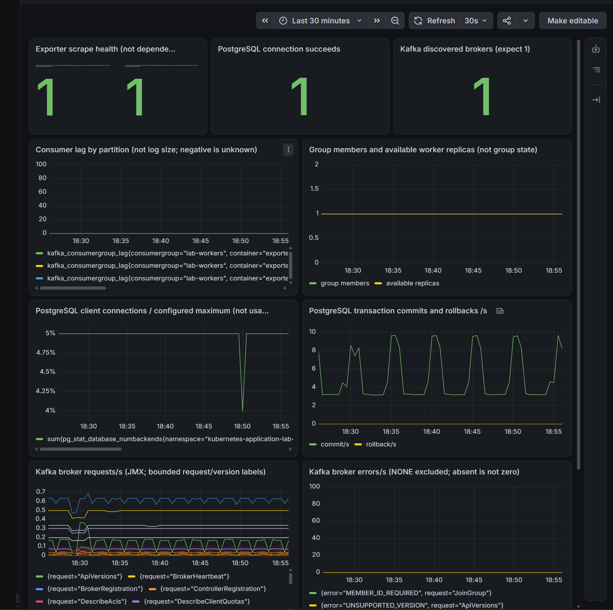
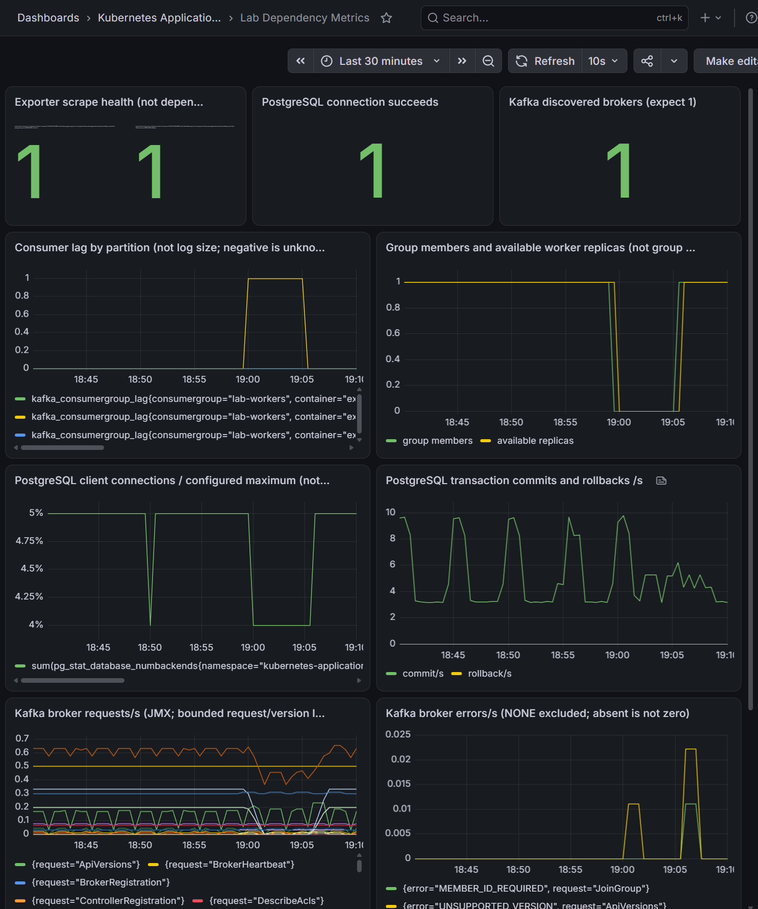
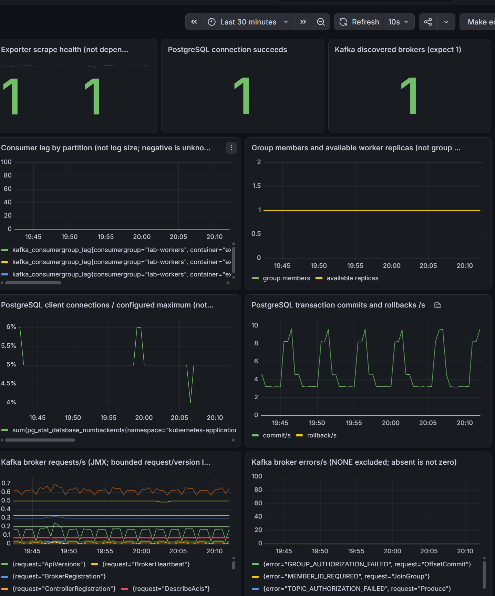

> Historical result from the private development history. Original identifiers are preserved; this is not a rerun of the public snapshot. Reviewed screenshots are included; raw captures remain private. See [provenance](../provenance.md). Local paths, where present, were redacted.

# Метрики Kafka и PostgreSQL

- Статус: `Passed` в описанном объёме части D Milestone 8 и панели зависимостей G. Не означает завершение всего Milestone 8.
- Ревизия установки и опыта lag: `641639000c99a5b13309bda13cd163325449361e`. Ревизия отрицательной Kafka-проверки: `405c58554a8c4c0a937b901e954ed251888b445c`. Перед обоими опытами 2026-10-31 владелец предоставил SHA и пустой `git status --short`. Прикладной образ остался на `401ca963a55c`.
- Контракт: [наблюдаемость зависимостей](../design/observability-architecture.md#метрики-зависимостей).
- Порядок: [инструкция](../engineering/dependency-metrics-lab.md).
- Среда: main kind/Kubernetes 1.34, PostgreSQL 16.14, Kafka 4.2.2/Strimzi 1.3.0, одна совмещённая broker/controller-нода; fixed worker 1, CronJob suspended.

## Цель

Отличить доступность exporter от доступности зависимости; получить lag каждой partition независимо от размера журнала, сравнить его с worker-group-status; связать соединения/транзакции PostgreSQL с обработкой заданий. Наблюдать broker requests/errors через отдельный источник JMX, не дублирующий lag exporter.

## Исходные условия и нагрузка

Сохранить clean SHA, версии/imageIDs, готовность Operator/broker/API/SQL/publisher/worker, прежние Helm revisions и PVC UID/PV. Проверить реальные requests/limits и доступную память, а не только объём RAM машины. Подготовить выделенные удостоверения и вручную проверить render до установки. Включение JMX может вызвать rolling restart единственного broker/controller: кратковременная недоступность ожидаема, HA не заявляется.

Ожидаются три новых targets: PostgreSQL exporter, Kafka lag exporter, broker JMX. Проверить pg_up=1 отдельно от up=1 и pg_exporter_last_scrape_error=0; наличие трёх неотрицательных lag-серий для lab-workers/lab.jobs.v1, kafka_brokers=1, запросов JMX. Отсутствующий lag, значение -1 и неизвестная группа не превращаются в ноль. Количество участников не считается состоянием группы.

Создать управляемое отставание штатными worker-stop → job-enqueue → worker-deploy в отдельных окнах; во время остановки сохранить lag и worker-group-status. Сохранить ID каждого задания, затем восстановить worker и проверить каждое задание. Этот путь не зависит от дедлайна worker-batch, который ожидает результат до 90 секунд. Не сбрасывать offsets. Проверить рост lag, его уменьшение после восстановления, один SQL-эффект, прежние PVC, свежие broker samples. Сравнивать близкие времена, не требовать побитового совпадения несинхронных снимков.

## Права и диагностика

SQL подготовка создаёт только выделенную роль lab_metrics, помеченную комментарием владения, и Secret lab-metrics-postgres. Нужны pg_monitor/CONNECT, connection limit 2, ограничения времени запроса. Эффективные права на public-таблицы и CREATE проверяются до COMMIT; при неожиданных правах транзакция откатывается. Для приёмки сохранить результат has_table_privilege и отказ UPDATE под этой ролью, а не только наличие SQL-скрипта. Не выдавать SELECT на jobs/outbox и не менять grants приложения ради удобства exporter.

KafkaUser lab-metrics имеет Describe только для основного topic/группы и Describe cluster. Для приёмки сохранить KafkaUser ACL, успешные metadata/lag-запросы и отдельное подтверждение отказа записи/изменения offsets этим удостоверением. Нельзя подменять monitoring identity удостоверением publisher/worker или расширять ACL до wildcard/Write/Read ради устранения ошибки. Брокер и exporter используют mTLS; проверка CA/имени не отключается. Отрицательная проверка dependency-metrics-acl-test выполнена, результаты приведены ниже. Запись фиктивного job event в основной topic не используется.

Секреты не включать в вывод. При SQL prepare failure вывод намеренно подавлен: осмотреть только атрибуты роли и grants через административное подключение, не выгружать пароль/pg_authid. При cert mismatch остановиться для разбора ротации, существующий Secret не перезаписывается автоматически. Ошибка одного collector не должна скрываться за pg_up=1.

## Восстановление

Вернуть fixed worker 1 штатным worker-deploy, дождаться исходных заданий и lag=0, проверить API/outbox/group status и сохранность PVC. После JMX patch ждать актуальный observedGeneration Kafka CR и фактический target/порт, старое Ready недостаточно. При сбое не удалять Kafka/KafkaNodePool, topics, PVC, offsets или Secret.

Набор устанавливается отдельным Helm release lab-dependency-metrics. Не удалять его ConfigMap, пока Kafka ссылается на JMX config. Для согласованного возврата сначала явно убрать только spec.kafka.metricsConfig после сохранения исходного значения, дождаться согласования Operator и восстановления брокера, затем отдельно вернуть/удалить только exporter release. Не использовать Helm uninstall или полное восстановление старого Kafka CR как автоматическую очистку. Удаление роли/Secret не входит в штатный сценарий.

## Наблюдавшиеся признаки и граница доказательства

### Установка и сбор метрик — Passed

Владелец выполнил `go test -count=1 -race ./cmd/labctl`, `go vet ./cmd/labctl`, lint и оба render. После выбора kubectl 1.35.9 проверки завершились успешно; первоначальный отказ из-за client/server skew 1.36/1.34 произошёл до установки. Подготовка удостоверений завершилась без вывода credentials. Release `lab-dependency-metrics` установлен с revision 1 в 15:05 UTC. Включение JMX пересоздало единственный broker; после согласования Kafka CR имеет generation=2, observedGeneration=2 и Ready=True. Само прежнее Ready при observedGeneration=1 не засчитывалось.

Проверка в 15:09 UTC показала 19 доступных целей, включая PostgreSQL exporter, Kafka exporter и broker JMX. PostgreSQL: pg_up=1, общий признак ошибки=0, все 11 показанных новых collectors успешны, соединений 5 при max_connections=100. Kafka exporter возвращает три неотрицательных lag и одного участника группы; JMX возвращает реальные счётчики запросов. Это подтверждает работу выбранного набора collectors с PostgreSQL 16.14 и lag exporter с Kafka 4.2.2 в данном стенде. Не доказывает все возможности этих продуктов или минимальность прав.

После `observability-install` release `lab-monitoring` имеет revision 5, `lab-observability` — 7. Grafana отвечает database=ok; панель зависимостей загружена штатным provisioning. Повторные проверки метрик и smoke успешны. Исходный снимок показывает доступные exporters, один broker, нулевой lag и одного участника группы. Транзакции PostgreSQL включают фоновую работу, а broker requests — служебные обращения; их нельзя считать количеством заданий.

### Остановка и восстановление worker — Passed

Выполнено владельцем 2026-10-31. Времена ниже — UTC; на скриншотах Grafana использует время браузера UTC+3.

| Состояние | Независимая диагностика и приложение | Prometheus / Grafana |
|---|---|---|
| До остановки, 15:59:00 | Группа Stable, один участник, offsets/end 12/12, 10/10, 12/12; 32 succeeded, pending=0 | lag всех partition 0 |
| Worker остановлен; задание принято в 15:59:55 | `408be0f4-69da-488c-9bbd-25c69e243a95`, event `bf957dba-ce93-430b-9159-1bcb99949198`, опубликовано в partition 1, offset 10; статус published, effects=0 | участники и доступные реплики 1→0; lag partition 1 вырос до 1 |
| Во время остановки, 16:01–16:04 | Группа Empty, участников 0; partition 1 committed=10, end=11, lag=1; outbox события опубликован | lag 1 сохраняется; broker остаётся 1 |
| После worker-deploy, завершение 16:05:27 | Задание succeeded, outbox_rows=1, effects=1; в 16:07 группа Stable, один участник; partition 1 committed=end=11 | участники и реплики 0→1, lag 1→0; остальные partition остаются на 0 |

Причина отставания — отсутствие обработчика. Kafka продолжала хранить опубликованное сообщение; publisher не нуждался в доступном worker для завершения публикации. Приложение после восстановления создало один SQL-эффект и подтвердило offset. Kubernetes выполнил явное изменение числа реплик через Helm; автоматическое масштабирование в этом опыте не проверялось. Outbox pending=0 при lag=1 показывает разные этапы доставки. Размер Kafka-журнала не уменьшался при возврате lag к нулю.

Скриншоты предоставлены владельцем и сохранены без изменения. Они иллюстрируют выводы команд, а не заменяют offsets, состояние задания и SQL-эффект. Исходные результаты сохранены в локальных каталогах `.local-observability` и присланных выводах. Проверки выполнял владелец; агент сверил результаты и обновил документацию, но Go/Helm/kubectl/Docker проверки не запускал.

### Диагностика Operator и оставшиеся проверки

Отрицательная Kafka-проверка — Passed на чистой ревизии `405c58554a8c4c0a937b901e954ed251888b445c`. Владелец выполнил `go test -count=1 -race ./cmd/labctl` (успех, 1.832s), `go vet ./cmd/labctl` и `git diff --check`. `task dependency-metrics-acl-test` сохранил `.local-observability/20261031T164654.273732600Z-dependencies-acl-check`: в 16:46:54.384 UTC Produce вернул TOPIC_AUTHORIZATION_FAILED (29), в 16:46:54.394 UTC OffsetCommit — GROUP_AUTHORIZATION_FAILED (30), оба expected=true, principal=CN=lab-metrics. Локальный labctl использовал выделенный mTLS Secret через loopback, без записи credentials на диск; запросы адресовали только несуществующую partition -1, Produce не содержал записей. Это подтверждает отказы двух операций, а не полный аудит Kafka API.

До проверки в 16:46:08 и после неё в 16:47:18 группа Stable, один участник; committed/end для partition 0/1/2 одинаковы: 12/12, 11/11, 12/12, lag=0. Outbox pending=0, published=33, succeeded=33, контрольное задание по-прежнему имеет один эффект. Повторные dependency-metrics-verify и smoke успешны. Это подтверждает сохранение рабочих offsets, конца журнала и прикладного состояния во время проверки отказов. Образы приложения не пересобирались.

Фактические образы и UID Pod зафиксированы владельцем после проверки. Все четыре Pod Ready=True, Restarts=0. UID Pod не является Unix UID процесса; фактический Unix UID этой командой не измерялся.

| Pod | Pod UID | ImageID |
|---|---|---|
| lab-kafka-exporter-5f9b4dff46-d8j2g | 92c814bf-4742-492e-b30d-8a2b6eee0997 | docker.io/danielqsj/kafka-exporter@sha256:346a53c2489a3530790d01f7b96632496d0d58926662f4c35bb65f569db2ab42 |
| lab-postgres-exporter-6945ddf78c-z7xtm | 7fcc93e5-f40f-490d-bc1d-7edcd3ecfdd2 | quay.io/prometheuscommunity/postgres-exporter@sha256:fb96c4413985d4b23ab02b19022b3d70a86c8e0a62f41ab15ebb6f4673781a5d |
| lab-kafka-dual-role-0 | 92b42e4a-05ee-4a54-916f-6ca63c3b8660 | quay.io/strimzi/kafka@sha256:b9b9e37491ce17c1b2722b3668661de91430d9437acf18c5f5bafaef38138652 |
| lab-monitoring-grafana-5b5c4d57c7-6q85l | 10e5d81e-9672-45f9-8da1-846b293e5ac3 | docker.io/grafana/grafana@sha256:ae3d3add290adbe6a88412229f5d76fd7bb82743050881698642d3d62f277e35 |

Сравнение хранилища — Passed: повторный запрос владельца сравнил текущий Kafka PVC `data-0-lab-kafka-dual-role-0` со снимком `20261031T150529.647609700Z-dependencies-install/dependency-pvc-before.json`. UIDUnchanged=True, PVUnchanged=True, Status=Bound. Это подтверждает сохранение объекта PVC и привязки к PV после обновления broker, но не является отдельной проверкой всех данных на диске.

KafkaUser `lab-metrics` имеет актуальный Ready=True, generation=observedGeneration=1, username `CN=lab-metrics`, authentication=tls. Предоставленный spec содержит Describe для literal topic `lab.jobs.v1`, literal group `lab-workers` и cluster. Write/Read/Alter в показанном spec отсутствуют. Декларация сверена с фактическими отказами Produce/OffsetCommit, описанными выше.

Измерения ресурсов выполнены владельцем 2026-10-31 с 16:23:43.294 до 16:33:49.637 UTC: 21 снимок за 10 минут 6 секунд, Grafana с открытой панелью. Во всех снимках одни и те же четыре Pod имеют Ready=1/1, Running, RESTARTS=0.

| Pod | CPU, mCPU | Память по kubectl top, MiB |
|---|---|---|
| lab-kafka-exporter-5f9b4dff46-d8j2g | 1–2 | 9 |
| lab-postgres-exporter-6945ddf78c-z7xtm | 1–2 | 7–9 |
| lab-kafka-dual-role-0 | 12–31 | 745–749 |
| lab-monitoring-grafana-5b5c4d57c7-6q85l | 12–26 | 628–712 |

В этом режиме exporters значительно ниже настроенных memory requests/limits 64/128Mi; broker с JMX ниже существующего лимита 2Gi. Отдельная стоимость JMX не выделяется: нет сопоставимого измерения до его включения. Grafana при лимите 768Mi достигла 712Mi (около 93%, запас 56Mi); отсутствие перезапусков за этот интервал не доказывает достаточный запас на длительную работу или расширение панели. Данные kubectl top являются снимками, не точным максимумом потребления между ними. Измерения приняты, бюджет Grafana требует отдельного внимания перед дальнейшим расширением.

SQL-права — Passed по выводу владельца: у lab_metrics отключены superuser, createdb, createrole, replication и bypassrls, connection limit=2. Для всех семи public-таблиц has_table_privilege показал SELECT=false и INSERT/UPDATE/DELETE/TRUNCATE=false; CREATE для БД lab и схемы public также false. В транзакции после SET LOCAL ROLE lab_metrics подтверждён current_user; UPDATE lab_jobs с WHERE false получил insufficient_privilege, обработанный как ожидаемый отказ. Выполнен ROLLBACK. Это проверка эффективных прав роли, а не отдельного нового подключения по паролю.

Первая попытка сравнения PVC не дала результата: в новом окне PowerShell переменная $ctx не была задана, kubectl завершился до чтения ресурсов. Следующее сообщение «Не найден прежний PVC» возникло при сравнении с отсутствующим результатом запроса и не доказывает потерю PVC. Повтор с явно заданным context успешен. Первоначальный вывод цикла ресурсов не содержал samples; последующий полный вывод из 21 снимка засчитан отдельно выше.

До установки JMX у Strimzi Operator уже было 16 перезапусков. Последний процесс завершился в 14:58:52 UTC: журнал сообщает `Stopped being a leader => exiting`, Last State — Error, exit code 1. Это не OOMKilled для данного завершения. Причина потери лидерства и причины остальных перезапусков не установлены; нельзя приписывать их JMX или автоматически увеличивать память.

Статус Passed ограничен установкой, сбором выбранных метрик, панелью, циклом lag, проверенными SQL/Kafka правами, сохранностью PVC/PV и измеренным интервалом ресурсов. Запросы и лимиты exporters сопоставлены с измерениями в указанном режиме. JMX использует существующий broker image/лимит; отдельный запас 128Mi не увеличивает heap или cgroup-limit брокера и не гарантирует отсутствие OOM. Длительная устойчивость новой панели и достаточный запас памяти Grafana не доказаны. Владелец сообщил об очистке диагностических Pod; отдельный вывод этой очистки не предоставлен.

### Новый бюджет Grafana — Passed в измеренном интервале

Владелец применил request=768Mi и limit=1Gi на чистой ревизии `dd444e40f65fc82b385a22dcca02af4c38cd42ce`. Go race-тесты labctl прошли (1.797s), vet, оба Helm lint и diff-check успешны. Render сохранён в `20261031T165450.571650000Z-render`, preflight — в `20261031T165453.923892800Z-preflight`, установка — в `20261031T165522.441554000Z-install`. Preflight показал MemAvailable=24555304kB. Консервативный бюджет CLI увеличен на 256Mi по requests и limits, порог MemAvailable — до 2560Mi. Это запас по измерениям, а не изменение CPU или ресурсов зависимостей.

Release lab-monitoring обновлён с revision 6 до 7, lab-observability — с 8 до 9. Сохранённый monitoring-workloads.json подтверждает реальные ресурсы Grafana: requests 50m/768Mi, limits 300m/1Gi; chart задал GOMEMLIMIT=921MiB. Новый Pod `lab-monitoring-grafana-5bb847cc66-wdgnp` получил IP 10.244.0.231. Краткая readiness connection refused во время запуска сменилась Ready; grafana-status, dependency-metrics-verify, application-metrics-verify и smoke успешны. Прикладной образ по-прежнему 401ca963a55c.

С 16:56:47.271 до 17:11:52.268 UTC 2026-10-31 получен 31 снимок за 15 минут 5 секунд: один и тот же Pod Ready=1/1, Running, RESTARTS=0; CPU 8–31m, память 225–762Mi. Максимум выборки оставляет 262Mi до лимита 1Gi. Память выросла с 238Mi до 762Mi, затем снизилась до 399Mi в 17:04:49 и до 227Mi в 17:06:50 без перезапуска; последний снимок — 556Mi. Такие снижения не доказывают конкретный механизм GC или освобождения кеша, а выборка не исключает утечку или пиков между измерениями.

Подтверждены применение профиля, загрузка панели и ограниченное наблюдение без перезапусков. Скриншот иллюстрирует доступность метрик, а не потребление памяти; память подтверждается выводом kubectl top. Длительная устойчивость остаётся вне доказанного объёма. Рост к новому пределу требует диагностики, а не автоматического очередного повышения лимита.

Этот отчёт не заменяет прежние Passed прикладных метрик, KEDA и отказа брокера. KEDA с новым мониторингом и реальный отказ зависимости в этой итерации не проверялись. OpenTelemetry, Loki и доставка оповещений не входят в этот набор.
