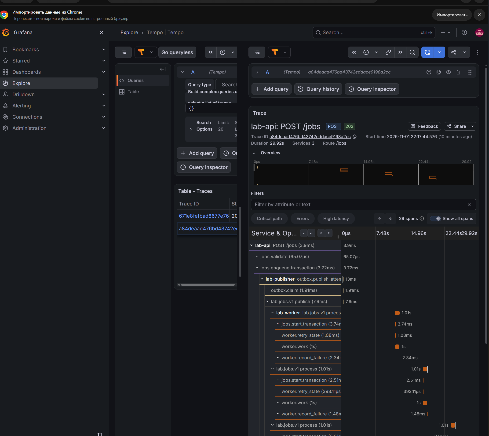
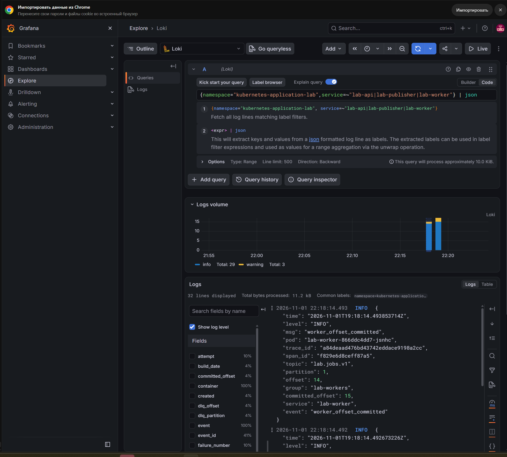
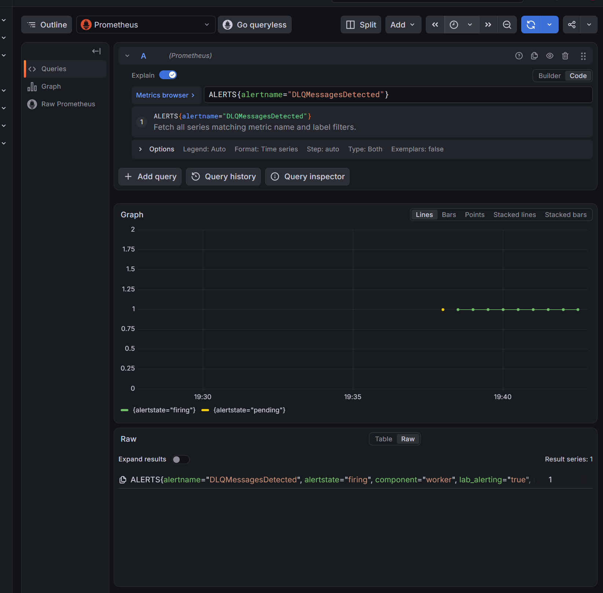
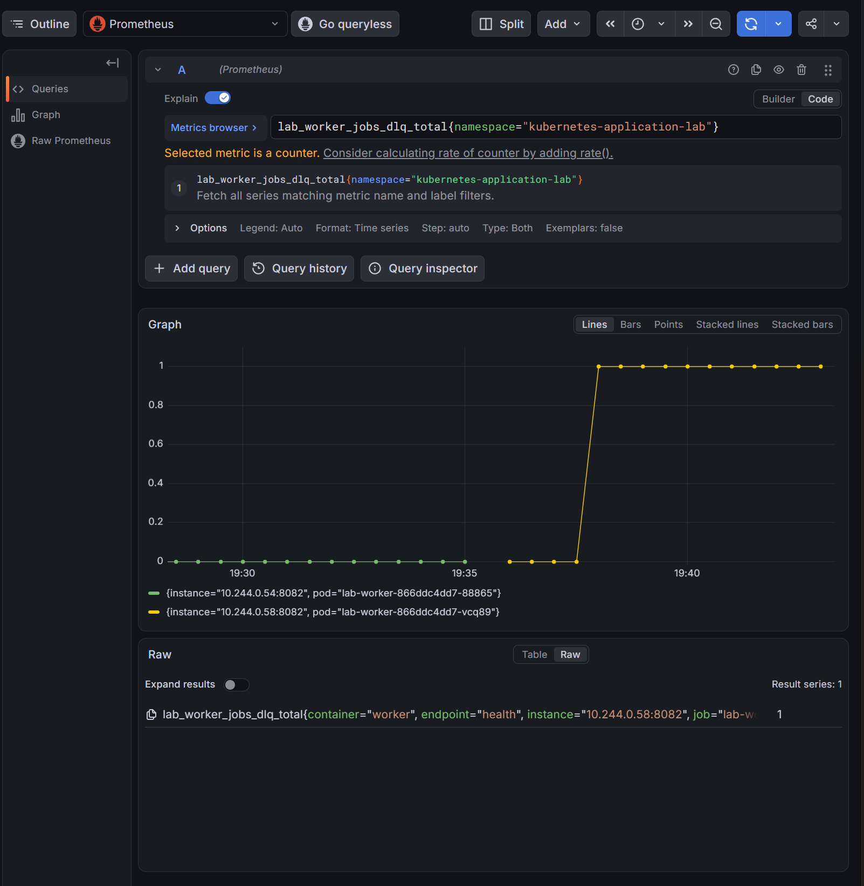
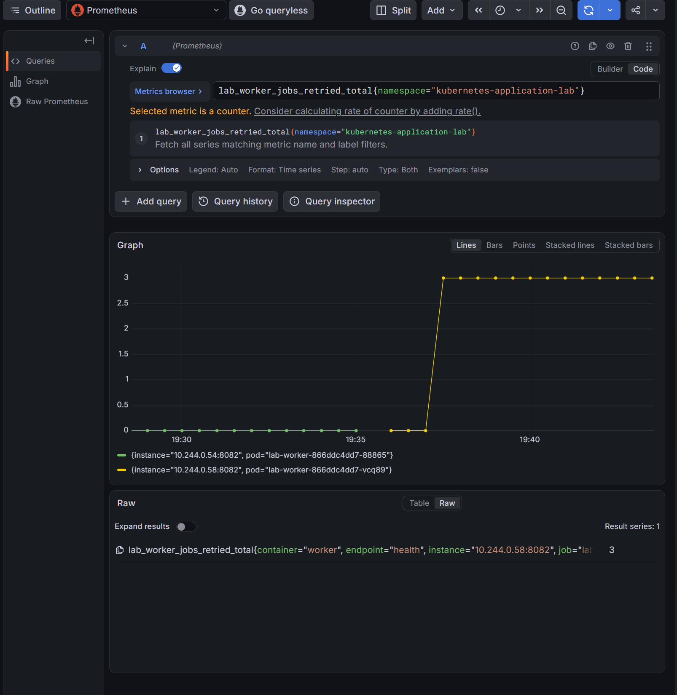

> Historical result from the private development history. Original identifiers are preserved; this is not a rerun of the public snapshot. Reviewed screenshots are included; raw captures remain private. See [provenance](../provenance.md). Local paths, where present, were redacted.

# Исчерпание попыток worker и оповещение DLQ

- Статус: `Passed` для SQL/Kafka, роста счётчиков и полного цикла DLQ alert, 2026-11-01.
- Ревизия: `4e3f47f410f11c8d3e210aca0820697fe6cd8e07`, HEAD и чистое дерево перед опытом сохранены в выводе владельца.
- Среда: основной kind, Kubernetes 1.34.
- Контракт: [alerting](../design/alerting.md).
- Процедура: [DLQ и доставка уведомления](../engineering/alerting-lab.md#dlq-исчерпание-попыток-и-доставка-уведомления).

## Цель и исходные условия

Связать три управляемых отказа одного задания, рост retry/DLQ counters, SQL-квитанцию, чтение DLQ и Pending/Firing/Received/Resolved. Исходно lag/pending=0, worker исправен, DLQ alert inactive. Предыдущие DLQ/trace результаты не доказывают доставку нового alert.

## Отказ и ожидаемые признаки

Publisher временно остановлен, worker остановлен для настройки трёх ошибок accepted job. Worker возвращается до publisher: это позволяет получить нулевые исходные samples до DLQ increment. После возврата publisher ожидаются три ошибки, failed/retry_exhausted, effects=0, SQL-квитанция и совпадающая DLQ-запись. Метрики и журналы должны относиться к этому заданию и текущему worker instance. Kubernetes меняет доступность процессов; конечные повторы, DLQ и commit реализует приложение.

## Восстановление и диагностика

Вернуть оба процесса штатными командами. Worker не перезапускать после начала наблюдения: дождаться естественного выхода increment из окна 5m и приёма resolved. Проверить source offsets/lag=0, pending=0, текущие targets, журналы, трассировку и smoke. Failed job остаётся failed; replay не выполняется.

## Наблюдавшиеся признаки

Владелец выполнил go test -count=1 -race ./cmd/labctl (1.209s), go vet ./cmd/labctl и git diff --check без ошибок. Агент тесты не повторял. Архив (private original artifact omitted; see provenance) сохраняет найденный локальный proof, исходные/конечные ответы proxy, 75 JSON наблюдений консоли, события SQL/Kafka/метрик/журналов и хеши источников.

Proof найден в `.local-observability/20261101T163646.878125900Z-alerts-watch/alert-cycle-proof.json`. Pending/Firing/Manager=true, fingerprint `abe72403ea2c94f4`, worker instance `10.244.0.58:8082` непрерывен. ReceiverStarted=15:07:33.792549256Z и evicted=0 во всём окне. Ни старый worker, ни старые уведомления других правил за новый цикл не приняты.

Все времена UTC. Job `c6442108-941a-495f-b5e3-54cd5da15c06`, event `0bcf402a-ad2f-4d62-96b7-4ea1f12d836e`, trace `72ae6fc58819abd9a75125bb92114ab2`.

| Признак | Наблюдение |
|---|---|
| HTTP enqueue | 16:35:15.1810864, status=202, затем accepted |
| Исходный DLQ observer | 16:36:47.1524598, inactive, increase=0 |
| Завершение задания | 16:37:18.333529, failed/retry_exhausted, failure_count=3, effects=0 |
| Первый положительный increase | 16:37:37.4043642 |
| Первый наблюдаемый Pending | 16:37:57.4133328 |
| Первый наблюдаемый Firing | 16:38:27.4026681 |
| Firing принят receiver | 16:38:23.820331527, startsAt=16:38:09.146 |
| Increase вернулся в 0 | 16:42:22.4105213, тот же instance |
| Resolved принят receiver | 16:42:53.816095878, endsAt=16:42:39.146, прежние startsAt/fingerprint |
| Полный цикл завершён | 16:42:57.4196275, Prometheus inactive |

Получение webhook может предшествовать первому опросу, увидевшему Firing. `increase` — экстраполированное значение: наблюдались дробные значения около единицы; точный process counter вырос 0→1. Worker-retries на том же Pod `lab-worker-866ddc4dd7-vcq89` вырос 0→3. Разные цвета старого/нового Pod на скриншотах обозначают разные ряды, а не падение одного счётчика.

SQL-квитанция: source lab.jobs.v1 / partition 2 / offset 17; DLQ partition 1 / offset 0, published_at=16:37:18.333933. worker-dlq-read в 16:37:26.567527158 прочитал совпадающий envelope: reason=retry_exhausted, failures=3, те же job/event/source. При финальной проверке 16:44:14 группа Stable/один участник, committed=end: 16/16, 14/14, 18/18, lag=0. Outbox pending=0.

logging-query вернул 14 строк, включая три worker_retry_scheduled и общий trace ID. В этом ответе нет завершающих DLQ ack/receipt/offset событий; порядок этих трёх событий новым ответом Loki не доказан. Полная новая трассировка Tempo также не предоставлена. Это остаётся частью итоговой сверки корреляции, а не отменяет SQL/Kafka и alert evidence.

Финальные prometheus-targets, application-metrics-verify, dependency-metrics-verify и smoke прошли: 69 записей targets в трёх проверках, все UP. Владелец после завершения цикла дополнительно выполнил publisher-start и tracing-worker-deploy (Helm revision 32); они не использованы как способ обнулить счётчик для Resolved.

## Дополнительная заключительная сверка корреляции

Отдельное задание 2026-11-01 проверило ранее не сохранённый новый завершающий путь. Это дополнение не является ещё одним доказанным alert cycle. Архив (private original artifact omitted; see provenance), полный ответ Tempo (private original artifact omitted; see provenance).

Job `82f1d106-e921-4780-a468-603021eaf782`, event `0c4f3deb-80d0-40da-961c-f22db5077850`, trace `a84deaad476bd43742eddace9198a2cc`. HTTP 202 в 19:17:44.5807468Z, completed_at=19:18:14.490817Z, failed/retry_exhausted, failure_count=3, effects=0, outbox_rows=1. SQL-квитанция source lab.jobs.v1/1/14, DLQ lab.jobs.dlq.v1/2/1; прямое чтение подтвердило те же job/event/reason/failures. Группа Stable/один участник; committed=end 21/21, 15/15, 19/19, lag=0. На worker instance 10.244.0.93:8082 retries=3, DLQ=1.

Tempo сохранил 29 spans одного trace ID, missing_parent_span_ids пуст. Три consumer spans с retry_scheduled и заключительный consumer `f829e6d8ceff87a5` с dead_letter — четыре доставки, а не четыре полезные обработки: последняя доставка завершает исчерпанные три ошибки. Родитель у всех попыток — producer `253c7f81517bd053`. У финального consumer подтверждены дочерние spans: DLQ publish `aa46c5ff025f7505` → worker.dlq_mark.transaction `d2f0a4288f696b59` → lab-workers commit `3cee362272c063a8`; интервалы не перекрывают последовательность операций. HTTP длился около 3.9ms; вся асинхронная трассировка около 29.92s не является HTTP latency.

Прямой журнал worker подтвердил broker ack в 19:18:14.488976257Z, SQL-квитанцию в 19:18:14.492673226Z, offset commit в 19:18:14.493853714Z (committed_offset=15). source coordinates и trace/span ID совпадают. logging-query по Job ID вернул только 14 строк: завершающие строки не содержат Job ID и потому не попадают в этот фильтр. Это ограничение поиска, не отсутствие доставки. Скриншот общего запроса Loki показывает 32 строки и терминальный commit с теми же trace ID/source/committed offset. Порядок всех трёх терминальных событий подтверждён прямым журналом и Tempo; отдельный отфильтрованный ответ Loki со всеми тремя не заявляется.

## Иллюстрации

Скриншоты показывают состояние до Resolved; полный цикл подтверждён JSON и локальным proof.

## Граница доказательства и риск

Resolved обозначает окончание окна новых increments, а не исправление задания или пустой DLQ. Process counters зависят от scrape; пропадание/reset sample и смена instance прерывают автоматическое доказательство. Наблюдение до 12 минут, receiver хранит только ограниченную память. Сбой доказательства не отменяет необходимость вернуть процессы. Exactly-once уведомления и долговечность receiver не заявляются.
