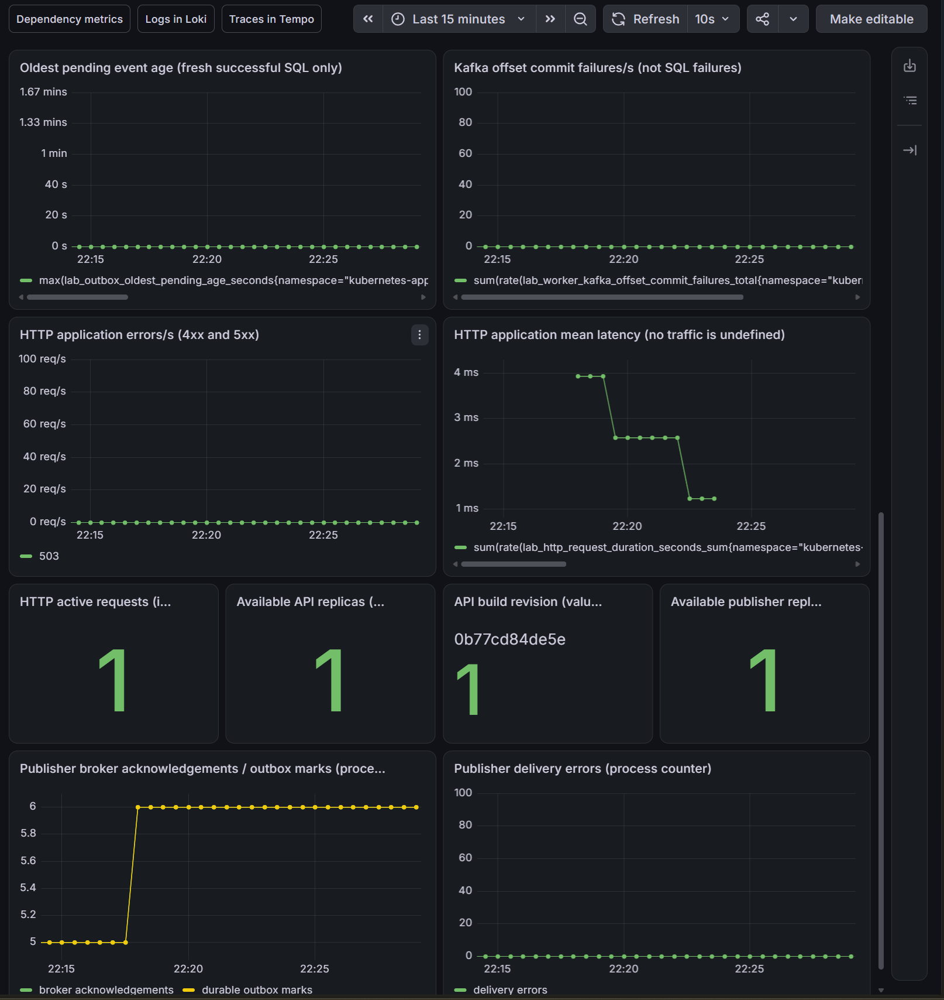
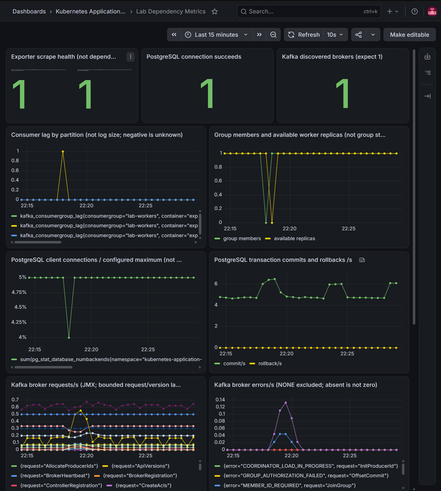
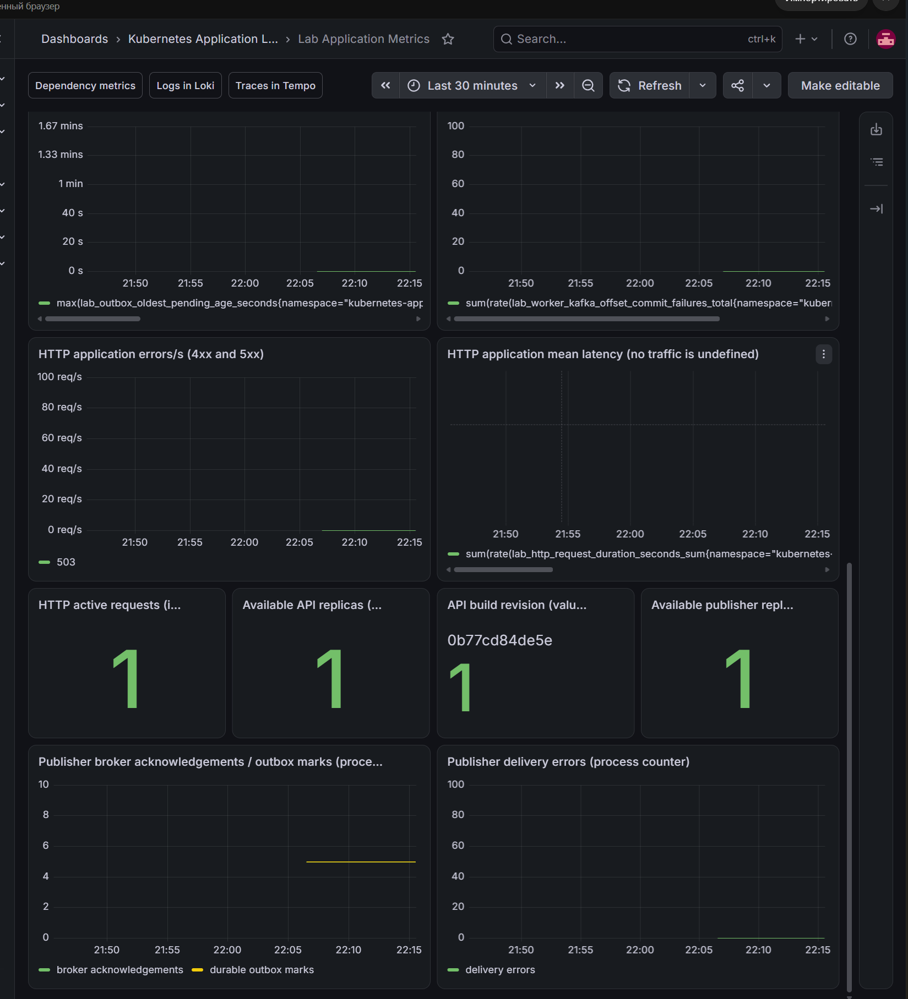
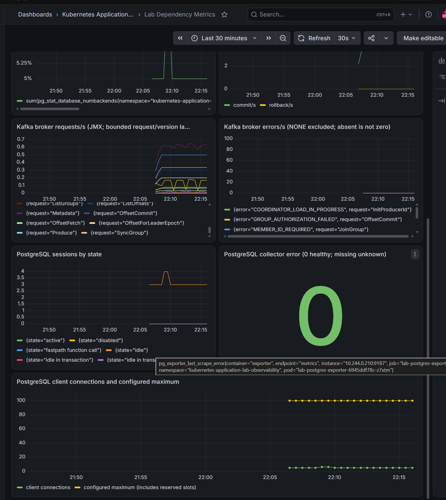

> Historical result from the private development history. Original identifiers are preserved; this is not a rerun of the public snapshot. Reviewed screenshots and selected archived evidence are included; attachment dumps remain private. See [provenance](../provenance.md) and the [evidence index](README.md#первичные-доказательства-milestone-8). Local paths, where present, were redacted.

Первичные данные: [milestone8-final-checks-2026-11-01.json](evidence/milestone8-final-checks-2026-11-01.json). Классификация и SHA-256 — в [индексе](README.md#первичные-доказательства-milestone-8).

# Покрытие панелей Milestone 8

- Статус: `Passed` для загрузки обновлённых панелей, отображения реальных samples и просмотра Loki/Tempo. Общие итоговые проверки Milestone 8 выполняются отдельно; прежние runtime-доказательства панелей находятся в [application metrics](application-metrics.md) и [dependency metrics](dependency-metrics.md).
- Источники: cluster/observability/dashboards/application.json и dependencies.json; provisioning выполняет observability-install.
- Новая проверка: [заключительная процедура](../engineering/observability-final-lab.md).

## Четыре группы из брифа

Отдельные четыре dashboard не требуются: группы размещены в двух версионированных JSON.

| Группа | Панели |
|---|---|
| API Overview | Application: requests/s (5), p95 (6), 4xx/5xx в секунду (13), средняя задержка (14), активные запросы (15), доступные реплики API (16), revision (17), scrape health (1) |
| Kafka / Worker | Dependencies: lag по partition (4), участники и доступные worker (5), обнаруженные brokers (3), JMX requests/errors (8/9). Application: throughput (7), failures (8), retries/duplicates/DLQ (9), время и активность попыток (10), commit failures (12) |
| PostgreSQL / Outbox | Application: pending и свежесть (3/4), oldest age (11), доступность publisher (18), broker ack/outbox marks (19), delivery errors (20). Dependencies: pg_up (2), доля соединений (6), transactions (7), sessions (10), collector error (11), соединения и настроенный максимум (12) |
| Application Flow | Application: enqueue/publisher/worker rates (7), backlog (3/11), длительность (6/10/14), ошибки (8/12/13/20), ссылки на Loki и Tempo |

## Границы интерпретации

Available replicas отражает readiness Kubernetes, не самостоятельную HTTP-проверку. Scrape UP не доказывает успешную бизнес-операцию. kafka_brokers — результат обнаружения, не гарантия доступности каждой операции. 4xx/5xx показываются как частота событий, не доля запросов. Средняя задержка вычисляется из sum/count; p95 — из histogram. При отсутствии трафика задержка может быть неопределённой; отсутствие samples не заменяется нулём. Конфигурационный максимум PostgreSQL включает зарезервированные slots. Process counters сбрасываются при рестарте. Встроенные ссылки открывают соответствующий datasource; Job ID фильтруется в Loki, Trace ID вводится в Tempo.

## Ожидаемая проверка

После render/review и установки сохранить фактическое отображение новых панелей и работу ссылок. При нагрузке проверить ненулевые requests/s и конечные значения задержки; при простое активные запросы могут быть 0. Revision должен совпасть с /version, API/publisher replicas — с Kubernetes. Сохранить текущий dashboard JSON в Git и проверить загрузку из provisioning после обновления Grafana. Существующие доказательства пересоздания Grafana не заменяют проверку новых полей.

## Наблюдавшиеся признаки

Агент разобрал оба JSON, проверил уникальность panel ID и отсутствие пересечения gridPos: 20 прикладных и 12 зависимых панелей. Это статическая проверка структуры, не доказательство исполнения PromQL или отображения.

Владелец предоставил два скриншота после обновления 2026-11-01. На Application видны новые панели и три ссылки: revision `0b77cd84de5e`, значение info=1, доступные API/publisher replicas=1, active requests=1. Последнее включает текущие probes/metrics и не означает одну активную бизнес-операцию. Broker acknowledgements и durable outbox marks совпадают на уровне 5; текущая частота HTTP 503 и счётчик delivery errors отображаются на нуле. Средняя задержка без конечного значения: успешная проверка под трафиком ещё требуется. Наличие кнопок Loki/Tempo не подтверждает переход по ним.

На Dependencies отображены PostgreSQL client connections около 5 с кратким подъёмом до 6, configured maximum=100, collector error=0 и реальные JMX-ряды. Скриншоты подтверждают загрузку новых панелей; вывод команд установки/тестов в этом сообщении отсутствует. Полный статус остаётся Prepared до проверки задержки под трафиком, ссылок и заключительных команд.

### Заключительное дополнение

Следующий вывод владельца подтвердил go test -count=1 -race ./cmd/labctl (1.203s), go vet, оба observability Helm lint, render и установку: lab-monitoring revision 11, lab-observability revision 13, status=deployed. Grafana status/targets/smoke после установки прошли; 23 выбранных targets UP. В сохранённом выводе событий присутствовали более ранние Unauthorized при обновлении EndpointSlice/endpoints Grafana. Точная причина не установлена; дальнейший доступ и отображение подтверждены, предупреждения не скрыты и не объявлены доказанно устранёнными во всём кластере.

На новых скриншотах под фактическим трафиком появились requests/s и конечная средняя задержка примерно 3.9 → 2.6 → 1.2ms; histogram p95 около 4.7ms. Это значения на ограниченной выборке лёгкой нагрузки, не нагрузочный benchmark. Publisher ack/marks выросли 5→6, delivery errors=0. Worker retries=3 и DLQ=1 относятся к новому процессу; смену старого ряда duplicates на новый нулевой нельзя трактовать как уменьшение одного process counter. Во время остановки worker наблюдались lag=1 и доступные реплики/участники 0→1; затем lag=0. PostgreSQL collector error=0, configured maximum=100.

Loki открыл общий запрос трёх сервисов (32 строки, включая терминальный offset commit), Tempo показал новую DLQ-трассировку трёх сервисов из 29 spans. Значение active requests=1 включает сам scrape и probes; отдельный поток полезной работы этим значением не измеряется. Прямой /version ранее совпадал с revision; на новых панелях сохранён `0b77cd84de5e`. Архив команд и связанной DLQ-проверки — final-dlq-correlation (private original artifact omitted; see provenance).

## Итоговая приёмка Milestone 8

2026-11-01 владелец предоставил заключительные проверки (private original artifact omitted; see provenance). Полный go test -count=1 -race ./... прошёл во всех тестируемых пакетах; go vet ./... и git diff --check без ошибок. Observability Helm lint для двух профилей, dependency-metrics/logging/alerting lint и application-tracing-helm-check прошли. Агент не запускал эти проверки повторно; локально проверены сохранённые JSON и diff.

В 19:33 UTC prometheus-targets, application-metrics-verify и dependency-metrics-verify дали 69 наблюдений выбранных targets, все UP. Grafana database=ok, tracing-status/logging-status и smoke успешны. Группа Stable, один worker, committed=end 21/21, 15/15, 19/19, lag=0; pending=0. Helm releases deployed; приложение, PostgreSQL, Kafka и компоненты наблюдаемости Ready. PostgreSQL PVC Bound, прежний volume pvc-08e126ef-91ad-406a-86d1-db94b3f2acbe сохранён. CronJob suspended=true/active=0, KEDA работает; ScaledObject/HPA в итоговом выводе отсутствуют, действует fixed-worker режим. Все пять оставшихся worker diagnostic Pod удалены штатной командой; старые Completed/Error work-probe Pod других опытов не удалялись.

Milestone 8 завершён в границах локального стенда. Доказательства свойств принадлежат отдельным отчётам: [метрики приложения](application-metrics.md), [зависимости](dependency-metrics.md), [tracing](application-tracing.md), [logging](application-logging.md), [outbox alert](alerting.md), [lag/stalled alerts](worker-lag-alerts.md), [DLQ alert и новая корреляция](dlq-alert.md), [API alert](api-unavailable-alert.md), [PostgreSQL alert](postgres-unavailable-alert.md), [crash/redelivery](worker-crash-observability.md), [отказ Collector](collector-outage.md).

Ограничения сохраняются: один узел и один broker, конечные очереди SDK, недолговечный receiver, короткие интервалы ресурсов и диагностический tracing profile. Отсутствие секретных полей проверялось на сохранённых примерах, не является глобальным аудитом всей истории telemetry. Strimzi Operator Ready/Running, но имеет 27 исторических рестартов; их причина и длительная устойчивость этим закрытием не устанавливаются. Ранее сохранённые Unauthorized предупреждения Grafana также не стираются успешным итоговым снимком. Полная доступность всех компонентов в каждый момент между снимками не заявляется.
