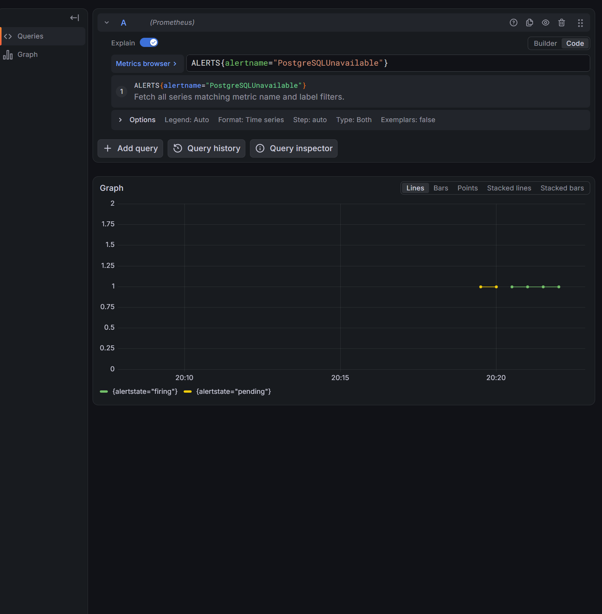

> Historical result from the private development history. Original identifiers are preserved; this is not a rerun of the public snapshot. Reviewed screenshots are included; raw captures remain private. See [provenance](../provenance.md). Local paths, where present, were redacted.

# Остановка PostgreSQL и доставка оповещения

- Статус: `Passed` в границах контролируемой остановки одной реплики, 2026-11-01.
- Ревизия: `6e09794e6db12c1ef10ec8fe744b1cec246d5607`; HEAD и чистое дерево перед опытом подтверждены выводом владельца.
- Среда: основной kind, Kubernetes 1.34.
- Контракт: [alerting](../design/alerting.md).
- Процедура: [PostgreSQLUnavailable](../engineering/alerting-lab.md#postgresqlunavailable-остановка-бд-с-сохранением-pvc).

## Цель и исходные условия

Связать остановку БД с readiness API, сохранностью записи/PVC, Pending/Firing/Received и Resolved после восстановления. Исходно PostgreSQL Ready=1, PVC Bound, контрольная запись читается, pg_up=1 и exporter UP, правило inactive, pending/lag=0. UID API и число рестартов фиксируются до отказа.

## Отказ, ожидаемые признаки и диагностика

Существующая команда db-failure-start меняет scale StatefulSet 1→0, не удаляя PVC. Дождаться удаления PostgreSQL Pod. Через прямой API port-forward ожидаются /livez=200, /readyz=503, /records/key=503 без нового рестарта API. Проверить pg_up отдельно от exporter UP. Сохранить Pending/Firing, active fingerprint и receipt внутреннего receiver. Наблюдатель предназначен именно для zero-replica отказа: сигнал положителен при известном ready=0 и здоровом kube-state-metrics; Missing telemetry не считается восстановлением.

Kubernetes завершает Pod и сохраняет PVC; приложение отвечает за разделение liveness/readiness, ограниченное ожидание SQL и восстановление соединений. Скрипты не удаляют данные и не выполняют restore из backup.

## Восстановление

db-failure-restore возвращает одну реплику. Нужны прежние UID PVC/volume, чтение preserved, /readyz=200, стабильный API Pod, pg_up=1/exporter UP, pending/lag=0 и совпадающий resolved fingerprint/startsAt. Наблюдатель допускает нулевой дефицит только при готовой БД и свежем подтверждении подключения exporter. Проверки SQL, HTTP и PVC выполняются отдельно.

## Наблюдавшиеся признаки

Владелец выполнил go test -count=1 -race ./cmd/labctl (1.192s), go vet ./cmd/labctl и git diff --check без ошибок. Агент тесты и кластерные команды повторно не выполнял. Архив (private original artifact omitted; see provenance) содержит 50 наблюдений, найденный локальный proof, исходный/конечный recovery query, matching receipts, HTTP, контрольную запись и строки PVC, хеши двух вложений.

Локальный proof: `.local-observability/20261101T171818.889990700Z-alerts-watch/alert-cycle-proof.json`. Pending/Firing/Manager=true, fingerprint `c560b57a43d2cf02`, ReceiverStarted=15:07:33.792549256Z и evicted=0 во всём окне.

Все времена UTC:

| Признак | Время |
|---|---|
| Исходное inactive / дефицит=0 | 17:18:19.1417496 |
| Известный дефицит=1 | 17:18:49.3880421 |
| Первый наблюдаемый Pending | 17:19:24.4285867 |
| Первый наблюдаемый Firing | 17:20:24.3947639 |
| Firing принят receiver | 17:20:23.708071415 |
| Дефицит вернулся в 0 с успешным gate подключения | 17:22:19.4073219 |
| Resolved принят receiver | 17:22:23.707814047 |
| Inactive и alert_cycle_completed | 17:22:24.3988474 |

У firing/resolved совпадают fingerprint и startsAt=17:20:09.146Z; endsAt=17:22:09.146Z. Получение webhook может предшествовать первому опросу, увидевшему Firing. Новый цикл завершён в исходном наблюдателе, без повторного отказа и без подмены receipts.

Контрольная запись `pg-alert-20261101171705` со значением `preserved` прочитана до остановки и после восстановления. PVC `data-lab-postgres-0` сохранил UID `08e126ef-91ad-406a-86d1-db94b3f2acbe`, volume `pvc-08e126ef-91ad-406a-86d1-db94b3f2acbe`, состояние Bound. Это проверка данной записи и идентичности PVC, не полная проверка всех данных.

После удаления PostgreSQL Pod в 17:18:45–46 прямые запросы к API показали /livez=200, /readyz=503, /records/key=503. Pod `lab-api-88c698dfc-t8qsw` остался Running/NotReady 0/1, RESTARTS=0. После возврата БД /readyz=200 в 17:22:01; заголовок X-Lab-Pod указывает тот же Pod. Отдельный снимок restartCount после восстановления не предоставлен, поэтому отсутствие рестартов подтверждено только сохранённым снимком во время отказа; непрерывность процесса за всё окно не выводится из имени Pod.

Финальные targets/application-metrics/dependency-metrics/smoke прошли. Суммарно сохранено 92 записи targets: исходная проверка и три финальные, по 23 UP. Снимки SQL sampler здоровы, pending=0, последнее успешное измерение очереди свежее. В 17:22:55 группа Stable/один участник, committed=end 16/16, 14/14, 18/18, lag=0. Нулевой recovery gate после отказа требует ready>=1, pg_up=1 и exporter UP; отдельный график pg_up во время отказа не прислан. Дополнительный db-failure-restore после проверок прошёл штатно.

На скриншоте показан период до Resolved. Завершение подтверждено JSON, proof и восстановлением HTTP/SQL/PVC.

## Граница и риск

Контролируемая остановка одной PostgreSQL реплики не доказывает HA, поведение при повреждении диска, backup recovery или все причины отказа exporter. Дефицит реплик — специальный gate этого опыта; правило PostgreSQLUnavailable шире и также реагирует на потерю мониторинга. Receiver недолговечен. После ошибки или тайм-аута БД требуется явно вернуть. Дополнительный APIUnavailable из-за NotReady допускается, но не подменяет целевой alert.
