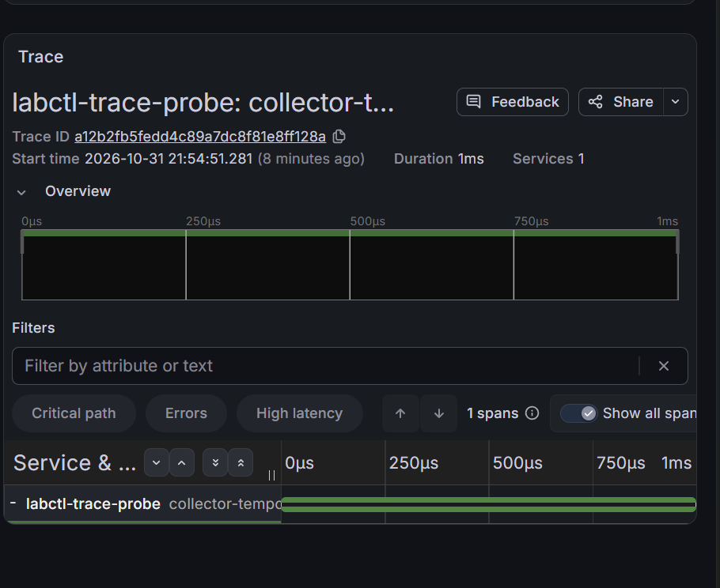

> Historical result from the private development history. Original identifiers are preserved; this is not a rerun of the public snapshot. Reviewed screenshots are included; raw captures remain private. See [provenance](../provenance.md). Local paths, where present, were redacted.

# Collector → Tempo: транспорт трассировок

- Статус: `Passed` для транспорта одного диагностического span, просмотра Grafana, targets и указанного интервала ресурсов; первая итерация части E Milestone 8. Сквозная трассировка приложения ещё отсутствует.
- Ревизии: исходная установка на чистой `4aeecb71bc9d89118a9d16d2887287c324d8379b`; исправление listeners зафиксировано в `3b94c5ab51240bb4bf65be09241e81517676f40a` (18:51:04 UTC). При разборе успешного probe HEAD=3b94c5ab5124 и рабочее дерево чистое; отдельного git status непосредственно перед probe в присланном выводе нет.
- Контракт: [приём и хранение трассировок](../design/tracing-infrastructure.md).
- Воспроизведение: [порядок запуска](../engineering/tracing-infrastructure-lab.md).
- Среда: основной kind/Kubernetes 1.34, namespace наблюдаемости, прежние API/publisher/worker/PostgreSQL/Kafka готовы.

## Цель и исходные условия

Проверить приём стандартного OTLP span через Collector, хранение и чтение из Tempo/Grafana с теми же trace ID/span ID. Это транспортная проверка, не бизнес-задание. Начальное состояние: фиксированный worker=1, Cron suspended, pending=0, lag=0; сохранить SHA/clean, releases, capacity/usage, PVC, images и состояние прежних метрик/API.

## Нагрузка и ожидаемые признаки

Один диагностический span service.name=labctl-trace-probe; без сервисов-демонстраций, данных приложения или новых миграций. Collector 0.163.2/chart 0.178.1, Tempo 3.1.1/chart 3.2.1 monolithic, controls chart 0.1.0. Только traces pipeline с ограниченными memory/batch/queue/retry. PVC standard 1Gi с retention 1h и отключённым автоудалением. Ресурсы Collector 128/256Mi, Tempo 512Mi/1Gi сопоставлены с измерениями в ограниченном режиме ниже.

Ожидаются Ready workload, Bound PVC, выбранные ServiceMonitor и UP targets. OTLP должен принять span полностью; Tempo должен вернуть span с совпадающими идентификаторами и именем. В Grafana Explore требуется открытая реальная трассировка через datasource Tempo. Один HTTP 200, Ready или ID в логах не доказывают доставку.

## Диагностика и восстановление

Сохранить events/logs/rendered config, CPU/memory/RESTARTS, UID/imageIDs, PVC UID/PV и место, counters accepted/exported/failed/refused Collector и received Tempo. Различать scheduling/storage/config, сеть и очередь. Сбой сохраняет resources/evidence, исправление повторяется закреплённым release. Не удалять PVC и не сбрасывать Kafka offsets. Очередь в памяти может терять telemetry при перезапуске, переполнении и истечении retries; exactly-once не заявляется. После опыта закрыть только два port-forward.

## Наблюдения и границы

### Повторная установка и транспорт — выполнены

Просмотр через Grafana выполнен владельцем: datasource Tempo вернул строку поиска с нужным trace ID, service=labctl-trace-probe, именем collector-tempo-transport-probe и длительностью 1ms. Подробный просмотр показывает trace `a12b2fb5fedd4c89a7dc8f81e8ff128a`, начало 2026-10-31 21:54:51.281 по времени браузера UTC+3, Services=1 и один span. Это подтверждает чтение реальной трассы через datasource Grafana, а не только наличие datasource в конфигурации.

Скриншот предоставлен владельцем и сохранён без изменения. Транспорт и просмотр подтверждены; targets, ресурсы/образы и итоговая доступность зафиксированы ниже.

После исправления Tempo render `20261031T184200.110910600Z-tracing-render` успешен. Исходная установка `20261031T184234.435082900Z-tracing-install` создала три releases с revision 1. После исправления listeners повторные render `20261031T185044.136109000Z-tracing-render` и установка `20261031T185057.281432900Z-tracing-install` успешны: lab-tracing-controls, lab-tempo и lab-otel-collector имеют revision 2, deployed. Helm wait не считается самостоятельным доказательством доставки.

В 18:54:51 UTC `task tracing-probe` сохранил `20261031T185451.280490000Z-tracing-probe`: trace ID `a12b2fb5fedd4c89a7dc8f81e8ff128a`, span ID `d7c3a88b0dafe8f0`, service.name=labctl-trace-probe, имя collector-tempo-transport-probe. OTLP ответ принят без partial success; Tempo API вернул span с теми же ID (в JSON ответа они закодированы base64), длительность 1ms. Агент сверил locator и фактический tempo-trace.json. Это подтверждает loopback→Collector→Tempo→API транспорт одного диагностического span. Не подтверждает путь из Pod приложения или работу SDK.

Сохранённый инвентарь установки показывает `storage-lab-tempo-0` Bound, UID `47e92628-6bc9-4486-a07f-5a9be1b16c14`, PV `pvc-47e92628-6bc9-4486-a07f-5a9be1b16c14`. Итоговый запрос подтверждает Bound, прежний PV, 1Gi/RWO/standard. Сохранность traces после пересоздания Tempo и свободное место отдельно не измерялись; заполнение PVC под потоком spans не входит в этот опыт.

### Итоговые targets, ресурсы и доступность — Passed

Владелец предоставил проверки в 19:04 UTC и повторные targets в 19:27:14 UTC: все 21 target UP, last_error пустой. Новые job/service `lab-otel-collector` — 10.244.0.241:8888/metrics, `lab-tempo` — 10.244.0.235:3200/metrics. Grafana health, dependency-metrics-verify, application-metrics-verify и smoke успешны; финальный smoke вернул API revision=401ca963a55c и удалил временный smoke Pod. Доступность приложения сохранена, однако нового бизнес-задания в этом опыте не создавали.

С 19:04:57.771 до 19:20:02.696 UTC 2026-10-31 получен 31 снимок за 15 минут 5 секунд. Во всех снимках перечисленные Pod Ready=1/1, Running, RESTARTS=0:

| Pod | CPU, mCPU | Память по kubectl top, MiB |
|---|---|---|
| lab-otel-collector-659f97ff44-mcvpk | 1 | 19 |
| lab-tempo-0 | 3–4 | 33–46 |
| lab-monitoring-grafana-54c74987bf-bpn6h | 8–16 | 211–629 |

Измерения относятся к одному диагностическому span и просмотру UI, не к будущей нагрузке SDK. Collector/Tempo ниже выбранных requests/limits; это не доказывает достаточность бюджета при массовой трассировке. Максимум Grafana оставляет 395Mi до лимита 1Gi, но длительная устойчивость и пики между снимками не проверены.

| Pod | Pod UID | ImageID |
|---|---|---|
| lab-otel-collector-659f97ff44-mcvpk | 3dae6f44-12fd-4678-962a-4ce054cc3206 | docker.io/otel/opentelemetry-collector@sha256:63e5e8eccf4268be02388ba9f2dc36b80b5e47721291293411c0e83152d75bda |
| lab-tempo-0 | 2f4f7b10-4daf-4d4e-a847-83833d605595 | docker.io/grafana/tempo@sha256:64e2fbd56d9c2b3412a4b430a58ea59e91a670b1e75f920a0c702213ad145044 |

Оба итоговых Pod Ready=True, Restarts=0; фактические теги 0.163.2 и 3.1.1 совпали с выбранными. Unix UID процессов этими командами не измерялся. Сохранены каталоги `20261031T190435.919085200Z-targets`, `20261031T190436.628366100Z-grafana-status`, `20261031T190437.541396600Z-dependencies-verify`, `20261031T190439.017516600Z-application-metrics-verify`, `20261031T192714.703318100Z-targets` и присланный владельцем полный вывод измерений.

Chart Collector предупредил о переименовании exporter otlp в otlp_grpc и автоматически переписал конфигурацию при успешной установке. После прогона в values явно задано otlp_grpc/tempo для exporter и pipeline; это соответствует имени уже работающего rendered exporter. Новый исходный вариант требует повторного render, но не меняет результат сохранённой трассы.

Первый port-forward/probe не подтвердил приём span: `20261031T184856.945165600Z-forward-collector/port-forward.txt` показывает connection refused к 127.0.0.1:4318 внутри Pod при первом обращении клиента; probe `20261031T184917.227827600Z-tracing-probe` завершился ошибкой соединения. В сохранённом render установки `20261031T184234.435082900Z-tracing-install` OTLP endpoints были привязаны к MY_POD_IP. Они не принимали loopback-подключение port-forward. Исправлены оба OTLP listeners на 0.0.0.0 внутри Pod; ClusterIP и NetworkPolicy не расширялись. Последующие применение и probe после исправления успешны, результаты приведены выше. Эта ошибка не доказывает отказ Tempo или сетевого пути через Service.

Первый статический прогон владельца: Go race-тесты labctl успешны (1.918s), vet и diff-check без ошибок. `tracing-render` в `20261031T184018.058028300Z-tracing-render` остановился на lab-tempo-render: chart 3.2.1 обращается к jaeger.protocols в _ports.tpl, а values задавали jaeger=null. Никакая установка не выполнялась. Исправление сохраняет карту protocols для helpers с отключёнными legacy-портами и явно задаёт конфигурацию Tempo только с OTLP/gRPC, чтобы не создавать пустой Jaeger receiver. Повторные render, установка и запуск процессов после исправления успешны, результаты приведены выше.

Агент подготовил upstream values, chart policies, команды Go/Taskfile и диагностический probe с unit-тестами. Агент выполнял только gofmt/diff-check и сверку сохранённых файлов; Go tests/vet, Helm render/server dry-run, установка и runtime агентом не запускались. Проверки и фактический probe выполнял владелец; история первоначальных ошибок сохранена выше. Повторный запуск после исправлений подтвердил транспорт; остальные границы приёмки названы отдельно.

SDK, spans HTTP/SQL/publisher/worker, retry/DLQ/offset commit, W3C outbox/Kafka context и sampling приложения ещё отсутствуют. Один диагностический span не заменяет эти требования. Продолжение работы приложения при отказе telemetry, Loki/Alloy, доставка alerts и длительная устойчивость — вне этой итерации. Статус Passed не распространяется на эти будущие свойства.
