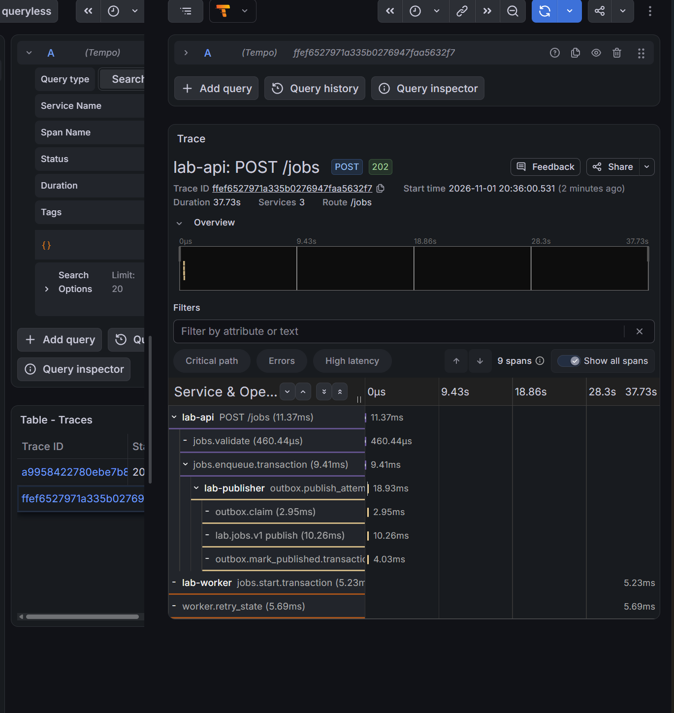

> Historical result from the private development history. Original identifiers are preserved; this is not a rerun of the public snapshot. Reviewed screenshots are included; raw captures remain private. See [provenance](../provenance.md). Local paths, where present, were redacted.

# Crash/redelivery worker с метриками, журналами и трассировкой

- Статус: `Passed` для выполненного сценария: SQL/offset gap, аварийная повторная доставка, восстановленная корреляция и отдельный прирост duplicates на одном instance подтверждены.
- Ревизия сценария: `19aae2b3bedb5858f437dea2b96231275ccae67c`, чистое дерево перед прогоном. Образ worker: `kubernetes-application-lab-worker:7f076b217de6d8f1d0327c0e4940039d3fd70c8986507abc9366db2c3371f96c`, ревизия приложения `0b77cd84de5e`.
- Среда: основной kind, Kubernetes 1.34.
- Контракты: [Kafka](../design/kafka-event-processing.md), [tracing](../design/application-tracing.md).
- Процедура: [наблюдаемая redelivery](../engineering/observability-redelivery-lab.md).

## Цель и исходные условия

Проверить сохранённый SQL-эффект при неподтверждённом source offset, аварийную redelivery того же record и отсутствие второго эффекта. Сопоставить текущие метрики, Loki и фактически сохранённые spans. Исходно одна fixed replica, pending/lag=0, схема/зависимости исправны, tracing profile включён.

## Отказ и ожидаемые признаки

Остановить worker, создать восьмисекундное задание, дождаться публикации. tracing-worker-crash включает существующий job-scoped exit=86 перед source offset commit, сохраняя tracing profile. Сохранить Pod/previous logs/SQL/group до удаления аварийного Pod. Нужны succeeded/effects=1, прежний неподтверждённый source offset и crash hook для того же job/event. Kubernetes перезапускает контейнер; crash hook остаётся активным до явного снятия. Повторная публикация нового record не заменяет аварийную redelivery.

## Восстановление и диагностика

worker-stop → tracing-worker-deploy снимают hook. Новый процесс должен распознать тот же record как duplicate и подтвердить source offset без нового SQL-эффекта; completed_at/result/outbox coords сохраняются. Проверить текущий duplicates counter, различимые attempts в Loki/Tempo, группу Stable/lag=0 и финальные targets/smoke. Дополнительный replay проводится отдельно для наблюдения прироста counter на одном живом процессе, с явной фиксацией нового Kafka offset.

## Наблюдавшиеся признаки

Первый прогон 2026-11-01 сохранён в архиве (private original artifact omitted; see provenance). Владелец выполнил go test -count=1 -race ./cmd/labctl ./cmd/worker ./internal/worker: 1.222s, 1.112s и 1.129s; go vet и git diff --check без ошибок. HEAD/чистое дерево показаны в исходном выводе. Агент команды не повторял.

Job `ab2f1350-82de-4306-ba78-bc8af4918760`, event `9a3bdb1c-0df3-45fc-9f1a-0938139878b7`, trace `ffef6527971a335b0276947faa5632f7`. Исходный record lab.jobs.v1 / partition 0 / offset 16. SQL completed_at=2026-11-01T17:36:46.263381Z, succeeded, effects=1, duration_ms=8000. Предыдущий контейнер lab-worker-6bffccdb66-clrhl сохранил worker_effect_committed (duplicate=false) в 17:36:46.265829575Z, затем worker_crash_before_offset_commit в 17:36:46.265911410Z с exit_code=86. В 17:36:52 committed=16, log_end=17, lag=1: эффект уже сохранён, source record ещё не подтверждён.

Инспектор в 17:36:57 сохранил девять spans и missing parent c4bf0cb7892c85b4, совпадающий с span_id первой worker attempt в журнале. Process span не завершился при os.Exit, worker_attempts=0 в сохранённых данных; это не означает отсутствия попытки. Скриншот исходного POST соответствует частичной трассировке. Отдельный GET /jobs/{id} на другом скриншоте — самостоятельная трассировка, не основной асинхронный путь.

В последовательности команд после инспекции пропущены worker-stop → tracing-worker-deploy; вместо восстановления сразу выполнен дополнительный replay. Он создал новый record offset=17 той же partition в 17:38:49.807355347Z. В 17:39:42 committed остался 16, end=18, lag=2. Worker всё ещё 0/1 CrashLoopBackOff, три рестарта. Метрики duplicates не получены; target lab-worker на 10.244.0.73:8082 DOWN с connection refused. Остальные выбранные targets в сохранённых снимках UP. Обобщённый текст ошибки targets упоминает API, но в этом прогоне неработающий target — worker.

На этом шаге требовалось снять отказ через worker-stop → tracing-worker-deploy и сохранить обработку прежнего source offset=16 отдельно от добавленного replay offset=17. Последующее восстановление приведено ниже; уже созданный replay не заменяет исходную аварийную повторную доставку.

### Продолжение: восстановление выполнено

Владелец снял fault командами worker-stop → tracing-worker-deploy. Архив восстановления (private original artifact omitted; see provenance) и полный фактический ответ Tempo (private original artifact omitted; see provenance) сохранены отдельно от первого незавершённого прогона.

Новый Pod `lab-worker-866ddc4dd7-jpc2n`, instance `10.244.0.78:8082`, Ready=1/1, Running, RESTARTS=0. В 17:44:52.219180950Z исходный record offset=16 распознан как duplicate; в 17:44:52.223254487Z подтверждён committed_offset=17. Отдельный ранее добавленный replay offset=17 распознан как duplicate в 17:44:52.226422630Z и подтверждён committed_offset=18 в 17:44:52.227392442Z. Оба относятся к тому же job/event и partition 0; source offset различает настоящую аварийную redelivery и дополнительную публикацию.

SQL effects остаётся 1, outbox_rows=1, исходный publisher offset=16; completed_at=17:36:46.263381Z и result с duration_ms=8000 не изменились. В 17:45:46 группа Stable/один участник; committed=end по partition 18/18, 14/14, 18/18, все lag=0. Таким образом, основная crash/redelivery часть подтверждена без второго SQL-эффекта.

В 17:45:49 Prometheus показал duplicates=2 для нового instance, processed=0 в прикладной проверке. Это согласуется с двумя распознанными дубликатами, но ноль старого процесса и два нового не являются измеренным приростом одного ряда. Поэтому после восстановления проведена отдельная проверка счётчика.

Loki вернул 29 строк. Tempo в 17:45:51 сохранил 15 spans, две завершённые worker process attempts: `bbd1d3f4f34e28c1` для исходного record и `29f303ca1b15d099` для replay; в обеих есть duplicate_observed и дочерний commit. Родительские spans различаются (`1f065bfc69f6bc5b` и `0b13dd9e73d62dd3`). Missing parent первой аварийной попытки `c4bf0cb7892c85b4` остался отсутствующим: новые spans не дорисовали потерянную попытку и не утверждают два новых SQL completion.

Финальные targets/application-metrics/dependency-metrics/smoke прошли, 69 target observations в трёх проверках — все UP, pending=0, SQL sampler здоров. Это завершает восстановление после прежнего CrashLoop; исходные ошибки сохранены в истории опыта.

### Завершение: прирост счётчика на одном instance

Архив заключительной проверки (private original artifact omitted; see provenance) фиксирует два ответа Prometheus: в 17:52:47.256Z duplicates=2, в 17:53:38.125Z duplicates=3. Оба относятся к Pod `lab-worker-866ddc4dd7-jpc2n`, instance `10.244.0.78:8082`. Между ними диагностический replay опубликовал тот же event/job в partition 0 с новым offset=18 в 17:52:50.562271201Z. Снимок worker после проверки: Ready=1/1, Running, RESTARTS=0.

SQL сохранил effects=1, outbox_rows=1, completed_at=17:36:46.263381Z и duration_ms=8000; исходный outbox offset остался 16. В 17:53:48 группа Stable с одним участником; committed=end по partitions 19/19, 14/14, 18/18, везде lag=0. Таким образом, переход 2→3 подтверждён внутри одного ряда без нового SQL-эффекта. Дополнительный replay проверяет метрику и обработку дубликата; доказательством аварийной повторной доставки остаётся обработка исходного offset=16 после exit=86.

Kubernetes перезапускал аварийный контейнер, но не снимал управляемый отказ. После явного восстановления приложения новый worker завершил обработку сохранённых записей. Диагностические Pod последних replay/group-status первоначально оставлены командами для сохранения журналов; после записи отчёта владелец сообщил об очистке. Отдельный вывод удаления не предоставлен.

## Граница доказательства и риск

os.Exit обрывает deferred span End и batch export; полная первая попытка в Tempo не гарантируется. Инспектор сохраняет только реальные spans и missing parent IDs, не строит недостающие. Первый metrics scrape нового процесса может уже показать duplicates=1; это не наблюдаемый переход 0→1 внутри одного ряда. Рост после отдельного replay также не доказывает аварию. One-effect вывод ограничен конкретным job и проверенными SQL/Kafka координатами; exactly-once Kafka/уведомлений не заявляется. После ошибки fault требуется явно снять.
